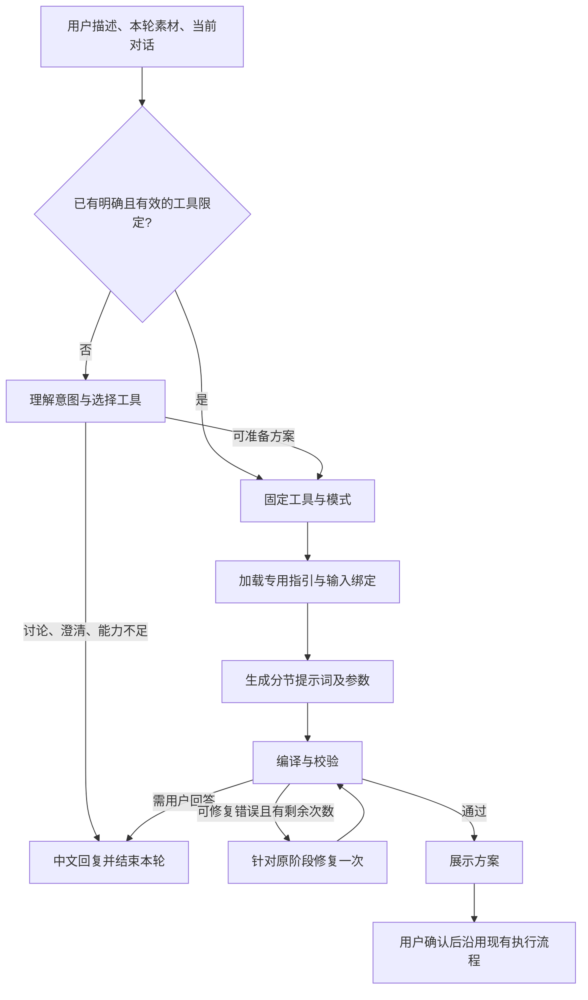

# Agent 优化规格：工具选择与专用提示词生成

版本：1.1  
日期：2026-10-23  
状态：首版范围已实现；离线回归、真实模型方案准备及浏览器界面已核查，成片效果待用户实际生成评估。  
实现分支：`优化agent`；基线提交：`aea6733`（多对话框）。

本文补充 `SPEC.md`，重点规定助手如何根据用户描述选择工具，再按工具及任务模式生成合适的提示词。本文覆盖旧规格中“单次通用规划调用”的部分；确认执行、素材保存、工作流版本管理、全局队列和对话隔离继续沿用现有实现。详细测试用例另行编写，本文件规定交付验收条件。

## 1. 目标、问题与范围

### 1.1 产品目标

用户用中文描述想要的画面、修改或视频动作，助手应能够：

1. 判断是在讨论、补充信息、修改已有方案，还是要求准备新方案。
2. 结合素材的实际内容和用途，选择当前可用的合适工具及任务模式。
3. 加载该工具适用的写作指引，把用户意图展开为具体、完整的提示词。
4. 保留用户明确指定的主体、风格、台词、镜头、时长与禁止项。
5. 展示可理解的中文方案和实际执行提示词，由用户确认后执行。
6. 修改时保留未被要求改变的内容，并说明本次改动。

“丰富”指信息具体、结构完整、时序合理，能表达需要生成的内容；不以字数、形容词数量、镜头数量或新增剧情衡量。

### 1.2 当前实现需要解决的问题

- `Planner.SYSTEM` 同时承担对话规则、工具选择和所有工具的提示词写作，视频专用规则较少。
- 规划上下文中的工具信息主要是 ID、输入槽位和参数名称，缺少用途、适用条件和错误示例。
- 选工具与写最终提示词在同一次模型输出中完成，无法在确定工具后注入对应的详细指引。
- 原视频工作流中的完整提示词会被生成的新字符串替换，其写作结构没有传递给助手。
- 方案能通过参数校验，不代表它完整落实了动作、镜头或声音要求。
- 来源、种子和待确认方案已有继承能力，但缺少按约束进行局部修改的协议。

### 1.3 本次实现范围

覆盖现有六个工具的路由说明、指引绑定、提示词或参数生成，以及方案展示。视频重点交付 MiniMax H3 的 I2VA 首帧模式。

本次不增加：

- MiniMax 全参考生成、尾帧、首尾帧或纯文生视频工作流。
- 视频剪辑、续写、原音轨复制、自动成片分析或自动评分。
- 多工具自动执行链、多个 Agent、向量数据库或外部知识检索。
- 自动从任意用户文件或 ComfyUI 工作流提取可执行工具。
- 跨对话记忆、自动学习用户偏好、后台自行重复生成。

用户提出多步创作时，可以说明后续意图，但本轮仍只准备一个可执行操作。讨论本身不强制产生方案。

## 2. 总体技术方案

保留现有技术栈：Python 3.12、FastAPI、Pydantic 2、SQLAlchemy/SQLite、DeepSeek 官方 Responses API，以及 React/TypeScript 前端。继续使用当前 `deepseek-flash` 配置和单进程后台。

新增的核心机制是应用内显式的“路由 → 专用生成 → 校验”流程，不引入 LangChain/LangGraph 或多 Agent 调度。



这里的“路由”与“专用生成”是不同职责，可以使用同一个 DeepSeek 模型。普通新诉求默认最多进行两次正常调用；明确限定工具的入口允许直接进入专用生成。不能仅凭“视频”“编辑”等关键词跳过意图判断。

## 3. 指引的分层与资源管理

### 3.1 指令组成

| 层            | 内容                                                     | 加载时机             |
| ------------- | -------------------------------------------------------- | -------------------- |
| 全局规则      | 用户意图、确认执行、对话隔离、事实与要求的区别、回复协议 | 每次模型调用         |
| 工具能力卡    | 用途、适用条件、输入角色、参数概要、限制、可用状态       | 路由阶段             |
| 通用写作规则  | 原文保留、补充边界、修改继承、观察可靠性                 | 专用生成阶段         |
| 工具/模式指引 | 该工具的写作方法、分节格式、约束和示例                   | 只加载本轮选中的一种 |
| 本轮上下文    | 原始需求、素材及像素、用途、来源、已有方案、约束、历史   | 按阶段组织           |

不能把所有工具的完整指引一起塞入每次请求。讨论或路由阶段也不加载完整的视频写作手册。

能力卡和写作指引都是经过应用适配的发布资源。素材备注、图片文字、历史消息和模板案例中的具体剧情不能覆盖全局规则或用户本轮要求。

### 3.2 参考资料

以下两份用户提供的文件作为适配依据，按当前文件内容记录 SHA-256：

| 文件                                                              | 用途                                                       | SHA-256                                                            |
| ----------------------------------------------------------------- | ---------------------------------------------------------- | ------------------------------------------------------------------ |
| `F:/ComfyUI/references/prompt-templates/fl2va-官方提示词模板.md`  | 文生、首帧、首尾帧与尾帧写作规范；本次选取 I2VA 和共用规则 | `2cfebc096a6e08370f288d468d90b60f7f9bcb938f94bf090816e910e48e75fc` |
| `F:/ComfyUI/references/prompt-templates/ref2va-官方提示词模板.md` | 全参考素材定义、保留关系与分镜写作规范；作为后续模式依据   | `1e574f356716ad55612247ffb7bbccbcdb484ad96599d63c7dca1af186b1fab7` |

实现时将原文件完整复制到仓库内的来源资料目录，保留原内容及 hash，并建立独立适配版。运行应用不能依赖 F 盘参考目录存在，也不能在每次请求时直接读取该目录的最新文件。适配版记录删选的章节、默认行为和与原文件不同的决定。

### 3.3 资源结构

建议的实际交付结构如下，所有文件均为应用自己的资源，不是 Codex skill：

```text
prompt_guides/
  bindings.json
  shared/1.0.0/
    creative_rules.md
    video_camera_audio.md
  sources/minimax_h3/
    fl2va-original.md
    ref2va-original.md
    provenance.json
  <guide_id>/<version>/
    manifest.json
    guide.md
    examples.json
```

`bindings.json` 按 `(tool_id, tool_version, task_mode)` 精确绑定指引版本。映射独立于现有 `tool_registry`，不改写已经发布的工作流 `1.0.0` manifest、模板或 hash。

指引 manifest 至少包含：`id`、`version`、`task_mode`、`output_format`、共享依赖、来源版本、适配说明、文件 hash。参数上下限由工具 Schema 和当前资源设置提供，避免在 Markdown 中维护另一套互相矛盾的值。

`effective_guide_hash` 覆盖 manifest、按确定顺序展开的共享规则、正文、启用的示例及绑定信息。指引版本内容不可原地替换；修改发布新版本。启动时检查绑定、依赖和 hash，将发布资源保存到数据目录，供已有方案追溯。

指引缺失或损坏时禁用对应的“助手生成方案”能力，并提供可读原因；手动工具仍按工作流可用状态运行。不得悄悄回退到通用提示词并声称已经采用专用指引。

## 4. 工具能力卡与首版指引矩阵

### 4.1 能力卡

路由上下文中的每个工具至少提供：

- 工具 ID、版本、中文名称、简短用途及当前可用状态。
- 支持的任务模式及可绑定的指引。
- 必需输入、每个槽位的语义、输出类型。
- 适合的诉求、不适合的诉求，以及必须澄清的情况。
- 参数名称、关键范围、默认值及重要副作用。
- 可理解的限制，例如“整张图成为首帧”“更改比例会拉伸输入”。

后台从当前注册工具、Pydantic Schema、资源设置及路由描述资源共同生成能力卡；不得仅提供节点类型或字段名称。缺少专用指引的模式不属于可路由的助手能力。

### 4.2 首版矩阵

| 工具 ID                      | task_mode              | guide_id              | 提示词/参数重点                                              |
| ---------------------------- | ---------------------- | --------------------- | ------------------------------------------------------------ |
| `image.generate.zimage`      | `image_generate`       | `zimage.generate`     | 主体、场景、构图、光线、风格；避免无效修饰堆叠               |
| `image.generate.qwen`        | `image_generate`       | `qwen.generate`       | 完整画面、文字内容及布局关系；依据 fast/quality 预设配置参数 |
| `image.edit.qwen.fast`       | `image_edit_single`    | `qwen.edit.single`    | 修改对象、位置与变化，明确保持项；采用 instruction           |
| `image.edit.qwen.reference`  | `image_edit_reference` | `qwen.edit.reference` | 主图与参考图职责、特征迁移和保持范围；两张图均必需           |
| `image.upscale.seedvr2`      | `image_upscale`        | `seedvr2.upscale`     | 选择图片、倍率和资源约束；不编造 prompt 或额外增强参数       |
| `video.generate.minimax_i2v` | `video_i2va`           | `minimax_h3.i2va`     | 首帧状态、动作发展、镜头、声画与结束状态                     |

以上指引初始版本均为 `1.0.0`。图片类指引基于实际工具能力制定，不能声称来自这两份视频资料。

2026-10-23 的场景与动作修订发布为 `1.1.1`，六个工具绑定到该版本；开发验收中使用过的 `1.1.0` 和最初 `1.0.0` 均保留，已有方案继续通过原快照追溯。工作流版本仍为 `1.0.0`，未修改采样或模型配置。

保留后续模式 `video_ref2va / minimax_h3.ref2va` 的设计位置，但首版不在工具选择 Schema 中开放它。尾帧、首尾帧和文生视频同理。仅有本机节点代码或写作资料，不代表工作台已能执行该模式。

## 5. 用户意图、选择优先级与创作边界

### 5.1 意图分类

路由结果必须为以下四类之一：

| kind          | 行为                                                                   |
| ------------- | ---------------------------------------------------------------------- |
| `reply`       | 用户在讨论、询问信息或评价提示词；中文回复，不产生方案                 |
| `clarify`     | 缺少必要输入，或关键要求冲突；提出集中、可回答的澄清，不产生方案       |
| `unavailable` | 所需能力尚未接入或工具不可用；说明限制，可提供可行替代方向，不偷换目标 |
| `route`       | 已有足够信息选择工具及模式，进入专用生成                               |

“帮我写一下提示词，先不要生成”可以准备可审阅草案，始终不执行；“讨论这个提示词哪里有问题”默认仅回复。路由理由保存一两句可展示的业务原因，不请求或保存隐藏思维过程。

### 5.2 选择与约束优先级

1. 用户本轮明确要求、明确的工具选择和素材用途。
2. 当前对话已确认且尚未被新要求覆盖的决定。
3. 项目目标与风格。
4. 工具默认值及指引默认写法。

实际工具能力和资源上限始终构成可执行边界。用户明确选择的工具不能满足目标时说明原因，不静默换工具；如果用户选择的是“自动”，才由助手在当前可用工具中决定。

相互矛盾的用户要求需要澄清。关键歧义包括：主图不明、把三视图当角色参考还是首帧不明、固定镜头与要求大幅运镜冲突、静音与对白要求同时存在。

### 5.3 默认补充政策

默认采用“保守补充”：允许补足实现用户意图所必需且与画面相容的细节，不改变核心目标。

允许：动作预备、重心与手部衔接、物体接触和惯性、自然结束姿态、与动作一致的适量物理声音、保持已有场景的必要细节。

未指定环境时，可以建议与目标相容的具体场景、地面、光线和空间层次，标记为 `assumption` 供确认；不能因“保守补充”而默认空黑底或取消主体动作。角色身份保持不自动要求保持参考图底色、排版或姿态。接触材料应合理，例如普通剑插入土面或砂地，而非完整坚硬石板；不能安排手沿剑刃移动。

未经用户或明确项目要求，不新增：主要角色、重大剧情、场景转换、台词、旁白、字幕、显著风格变化或强烈运镜。未知细节不能写成实际观察到的画面事实。

视频默认单镜头、固定机位，不为了“丰富”添加切镜或推镜。默认可描述与场景相容的自然环境声和动作声；非叙事配乐默认 `N/A`，除非用户或项目明确要求。无对白不等于静音，无配乐也不等于静音。用户要求完全静音时两个声音字段均为 `N/A`，正文不增加声音事件。

当短时长要求容纳明显过多动作时，优先澄清时长或保留的动作，不自动延长时长或删掉用户主要动作。具体可行性由模型依据动作和首帧判断，不能仅用固定“每秒动作数”决定。

### 5.4 原文与语言

中文用于回复、选择原因、方案摘要、补充说明和改动说明。生成模型正文默认英文；用户明确要求其他语言时遵从，保留模板固定字段及必要指令。

用户给出的台词、歌词、画面文字原语言、措辞及标点保持原样，不自动翻译、润色或替换。参考资料中对音频转录标点的规范化要求不用于改写用户原文；首版也不转录参考音频。无用户依据不能从模板案例带入示例台词。

## 6. 路由阶段

### 6.1 输入

输入包含原始当前消息、当前对话的必要历史/摘要、项目背景、待确认方案、明确引用的来源执行、能力卡、素材元信息及用途。本轮明确选择或链接引用的图片像素随请求提供，保留现有图片限制与审计规则。

不得通过元信息臆测图像。其他对话生成素材继续只在明确引用时进入；最近执行、草案和摘要保持当前对话作用域。指引可共享，对话记忆不能共享。

### 6.2 RouterResult

Pydantic 判别联合使用以下结构；字段名为后续实现约定：

- 共用：`kind`、`message_zh`、`visual_observations`。
- `route` 分支：`tool_id`、`task_mode`、`selection_reason_zh`、`input_bindings`、`creative_brief`、`based_on_plan_id`、`based_on_execution_id`、`frame_assessment`。
- `creative_brief`：`goal`、`must_keep`、`requested_changes`、`must_not`、`literal_texts`、`camera_policy`、`audio_policy`、`requested_parameters`、`deferred_parameters`、`shot_intent`、`assumptions_zh`。
- `clarify` 分支：问题及待补充项；不附可执行 operation。
- `unavailable` 分支：缺失能力及可行的下一步建议；不能伪造工具 ID。

`input_bindings` 使用真实 `asset_id` 和槽位。`creative_brief` 是可见的创作约束摘要，不能替代原始用户消息。来自当前消息、项目默认或历史决定的约束需要标记来源；原文片段保留在快照中，供生成及审阅。

`Constraint` 保存 `text/source/evidence/asset_id`。`source` 为 user/project/history/observation/assumption。硬约束的 evidence 必须是当前请求、同一对话真实用户消息或项目目标/风格中的连续原文；助手旧回复与历史摘要不能单独证明用户要求。无依据的归因从硬约束移除并记录审计；观察与创作补充可独立展示为建议。这只能证明原文存在，不能证明引用与约束的语义完全等价。

路由阶段不生成最终视频提示词、不确定随机种子、不创建 Plan 或 Task。参数候选仍要经过正常化；模型不能直接决定实际帧数。

`requested_parameters` 只属于当前工具；`deferred_parameters` 按工具 ID 保存后续步骤的要求，不触发执行。先准备首帧再生成 3 秒视频时，时长属于后续视频。后台可将误放在图片准备步骤中的 `duration_seconds` 移入后续视频参数并验证范围；其他未知参数仍明确拒绝，不任意丢弃。后续目标随创作约束保存，并在方案说明中展示。

后续参数的输出 Schema 按各工具实际执行参数白名单展开，视频只接受 duration_seconds/megapixels/aspect_ratio/seed；镜头、声音、场景和动作留在创作约束中。运行时仍独立校验白名单与值域。

### 6.4 动作意图、场景与首帧适用性

视频及带后续视频要求的首帧准备必须有 `shot_intent`，包含 mode（action/hold/uncertain）、真实需求引用、保持姿态的原文依据，以及起始、主要变化、结束状态。动作镜头不能用相同起止状态或只有呼吸的结束姿态替代；关键歧义返回集中澄清。旧视频方案主动改写时若缺少此结构，重新路由并读取实际输入，不直接继承为合格首帧。

`scene` 包含 create/preserve/plain/unspecified 策略、具体环境与光照、是否需要接触面及其描述、来源与原文证据。纯色背景必须有明确依据；涉及物体接触要有具体接触面。未明确的场景以建议展示。

直接生成视频时，`frame_assessment` 必须对应实际 source_image，基于当轮像素记录背景类型（scene/plain/sheet/unknown）、相对动作阶段（before/during/after/hold/unknown）、姿态适用性、场景匹配及接触面可见性。多视图、结束姿态、未知适用性、场景不符或缺少所需地面时先澄清/准备起始首帧。明确限定视频工具时不静默换工具。程序校验这些声明的一致性，视觉判断本身来自模型。

### 6.3 无路由模型调用的入口

仅当请求携带应用支持的明确工具限定，或用户通过界面选择“调整此方案”并绑定有效方案版本时，后台才允许直接确定工具。限定 ID、版本、项目、对话和模式均需校验。

通过此入口的专用生成模型仍可以返回澄清或讨论回复。若本轮要求与限定工具明显冲突，返回原因；不允许在专用生成阶段自行换成另一工具。

普通聊天中只出现工具名称、历史中曾用过某工具或存在待执行方案，都不单独构成确定性快路径；由路由模型理解本轮意图。

## 7. 指引选择、输入绑定与专用生成

### 7.1 选择规则

工具和模式通过后台验证后，按照当前固定工作流版本查找唯一绑定，加载对应指引及声明的共享依赖。模式不匹配、绑定不存在或指引版本不完整时停止，不随机选择相近模板。

专用生成请求只携带所选工具的参数 Schema、能力说明和适用指引。保留原始需求、本轮图片、约束摘要、相关历史和来源；不要因为拆成两阶段而让真正编写提示词的模型失去图片像素。

所选图片执行输入必须在专用生成阶段实际读图。如果用户本轮明确指代“上一结果”，路由将其解析为唯一素材后，可以为该输入准备读图副本；不能从无关旧消息或素材库自行追加图片。记录各阶段实际附图及引用来源，仍受本轮数量限制；路由已附图与新增执行输入的并集超限时要求用户减少输入，不静默丢掉明确选择。

路由提取用户参数，后台补齐默认值并生成 `resolved_execution_settings`。影响视频写作的首帧、请求/实际时长、比例和目标面积在编写前固定；专用生成不得自行改变它们。生成结果中回传的冻结值必须一致。种子策略及不影响上述画面锚点的合法参数按各工具协议处理，随机种子仍由后台确定。

路由与生成都看到图片时按两次实际图片输入计费和预留。路由观察可作为带来源的辅助记录，不能代替生成阶段必要的画面检查。首版不启用供应商隐式会话或缓存引用来代替本地完整请求。

### 7.2 素材编号

程序根据实际送入所选生成节点的顺序创建 `asset_binding_map`，包含 `slot`、`asset_id`、`blob_id`、用途和生成模型标签。

当前 I2VA 只有一个实际输入：`source_image → <Picture 1>`。DeepSeek 为辅助理解看到的其他图片，不能因此获得 MiniMax 的 `<Picture 2>` 标签；辅助观察与执行输入分别标记。

后续全参考模式按节点实际的图片、视频、音频编码顺序分配各类标签，不能假定不同类别相同编号就是同一文件。`<Subject N>` 是模型定义的可复用内容单元，必须说明来自哪些有效来源；它不额外创建输入素材。

### 7.3 PromptCompositionResult

专用生成允许 `propose / clarify / reply` 三类结果。`propose` 必须包含：

- 固定的 `tool_id`、`task_mode` 和合法输入绑定。
- 中文 `message_zh`、`change_summary_zh`、`assumptions_zh`。
- `parameter_values`、`candidate_count`、`seed_policy` 及合法来源关联。
- 与该指引相符的 `prompt_document`，由对应 Pydantic Schema 校验。
- 本轮全部附图的 `visual_observations`，以及面向用户的简短语义检查结果。

专用生成可省略 `creative_brief`，由后台继承已经确认的路由约束，不要求模型逐字重复清单。可选补充合并时不能删掉原有保持项、禁止项和原文，不能改变镜头/声音策略或明确执行参数。实际提示词继续经过原文、镜头、声音及格式校验，继承清单本身不代表生成效果已经验收。

视频和首帧准备另有 `shot_review`，检查正文对动作、状态衔接和场景的覆盖。视频要求 main_action_present；静态首帧使用 start_frame_prepared，不要求图片已经完成未来的视频动作。这里的 true 表示指令已写入相应要求，不表示图片已经生成或视觉验收通过。

文本生成类的文档提供正向提示词及工具支持时的负向提示词；编辑类提供 instruction、保持项、修改项及支持的负向内容；放大类 `prompt_document=null`，仅产生倍率和参数说明。

模型不能在返回 operation 后继续调用工具，也不能返回第二个自动衔接的操作。若所选工具实际上无法实现目标，专用生成可停止并说明问题，不能跨工具重试。

## 8. MiniMax H3 首帧提示词规范

### 8.1 使用模式

本次 `video.generate.minimax_i2v` 固定为 `video_i2va`。必须有一张可用首帧；明确标为主体、风格或构图参考的图，不能直接绑定为首帧。用途为 auto 但画面或语义存在关键歧义时澄清。

三视图作为角色参考、而目标需要独立单角色新构图时，先说明首帧工具的限制。先征求是否准备独立首帧的选择，同意后才提出图片方案；不能靠提示词声称已把整张三视图转成角色参考。缺道具、背景简单或姿态衔接不理想属于效果判断，与执行接口的输入/资源限制分别处理。普通视频请求不能被直接改成图片交付。

最终视频目标与当前操作分别持久化：记录原始需求、动作约束、视频参数、当前步骤与用户选择。首帧方案明确显示图片准备步骤，完成后回报视频尚未生成并允许选择已保存的首帧继续准备视频方案；用户仍逐步确认执行。只有已保存的视频产物完成最终视频目标。按钮携带目标身份与具体结果，后端校验当前对话、可用动作及结果归属；过期或跨对话选择不调用模型。用户明确接受首帧效果风险后可直接尝试视频，但不能绕过明确参考用途、缺少输入或真实目标歧义。

### 8.2 结构化文档及编译

I2VA 的 `prompt_document` 包含 `shots`、`overall_soundscape` 和 `non_diegetic_music`。每个 shot 至少有 `index`、`cut_at_seconds`（首镜为 null）、`description`。说话者/原文、相机策略和声音策略作为伴随结构化数据保留，以便检查；镜头正文必须实际落实相关内容。

后台按确定顺序编译为一个工作流 prompt 字符串：

```text
For the target video, at 0.00 seconds into the target video, <Picture 1> (from [Shot 1]) is fully referenced.

integrated_multimodal_description: [Shot 1] ...

overall_soundscape: ...

non_diegetic_music: ...
```

第一行及标签由程序生成，不让模型改写。首镜没有切镜时间，后续镜头按模板生成 `[Shot N] At MM:SS.mmm, ...`。正文为生成模型输入，不附加工作台聊天说明、内部 JSON 或校验日志。

固定工具及输入后先调用可复用的尺寸/时长解析函数，计算实际宽高、帧数和时长，将解析结果传入生成阶段。PlanService 保存时再次使用同一逻辑核算，不能出现两套公式。

使用实际时长安排动作和切镜；不把请求的整数秒数伪装成实际输出时长。当前帧数、分辨率、拉伸、采样和候选限制沿用现有工具，本次不因添加指引而改变工作流。

### 8.3 写作内容

首镜先建立可见首帧的画面风格、构图、主体、姿态、关键道具和空间关系，再写动作发展。描述遵循：

`首帧锚点 → 动作起始 → 可观察的连续变化 → 结果/反应及结束保持`

关键动作应明确谁在动、怎样动、与什么接触、接触后发生什么变化。保持项优先使用可辨认的具体特征；全盔角色不要机械加入不可见的面部或发型要求。

保持首帧已有的身份、服装、主要色彩、道具和空间关系，除非用户要求改变。新场景与首帧明显冲突时先解决输入，不以一句“保持一致”掩盖矛盾。

镜头动作采用准确自然语言；需要移动时写清类型，必要时补充幅度和速度。切镜必须有用户要求或明确采用的创作方案依据。固定镜头不能同时包含推镜、摇镜或变焦要求。

动作音效在对应动作附近描述，全局环境声在 `overall_soundscape` 概括，避免重复台词。配乐只写实际乐器、节奏及变化；没有配乐时明确 `N/A`。说话者使用稳定 `(S1)` 等编号，台词用 `<d>[Language] 原文</d>`；无人发声时不创建虚构说话者。

篇幅以信息量决定：简单动作也要交代状态和衔接，不机械扩成多镜头；不硬性要求所有视频达到同一字数。编译后的 prompt 总长继续受当前 12,000 字符上限限制，含自动添加的固定文本；超限不能截断保存。

### 8.4 示例的使用

指引包含至少一个简短首帧动作案例、一个声画案例及一个反例。示例传达结构和写法，不成为每次生成的默认剧情。反例应覆盖“角色参考误当首帧”“只写剧情摘要”“无依据新增运镜或对白”。

对骑士插剑诉求，应根据本轮实际首帧交代可见持剑状态、身体与双手的连续动作、剑尖接触、剑身停稳及最终握持。若首帧没有合适武器或所需空间，标记问题；不能把预期巨剑写成已经可见。

## 9. 全参考模板的后续接口边界

保留 ref2va 六分节的对应设计：`subject_definitions / summary / retention_analysis / detailed_description / overall_soundscape / non_diegetic_music`。

后续接入前必须明确实际支持的素材类型、槽位、身份标签和节点语义。模板中的音频 `fully_copy` 等关系只是生成条件描述，不构成对最终音轨逐采样相同的保证；音频编辑/复制能力必须以真实工具链为准。

当前不把六分节写入 I2VA 输出，不向助手宣称视频编辑、续写或音轨复用已可执行，也不因为一个输入文件带音轨就自动分配音频参考标签。

原全参考模板的正常篇幅建议可以保留在后续适配说明中，但不是首版 I2VA 的通用字数要求。

## 10. 校验、修复与失败处理

### 10.1 确定性校验

必须由程序完成：

- 当前项目/对话归属、素材存在性、文件完整性和类型。
- 工具/模式/指引绑定、版本、Schema 和可用状态。
- 槽位、图片用途、执行输入与生成模型标签一一对应。
- 输出分节、必需字段、格式、字符上限及不存在的标签。
- 镜头编号连续、首镜无切镜时间、后续时间递增且早于最后一帧时间；检查用未四舍五入的秒数，展示时间按模板格式化。
- 参数正常化、面积/帧数上限、候选限制、种子范围和策略。
- 结构化台词、可见文字与声明的原文对应；静音、配乐和镜头策略字段无自相矛盾。
- 原方案 revision、来源执行、同对话草案归属及幂等要求。

文字出现一次不等于已落实其含义。关键词或正则不能证明提示词理解了全部要求。

### 10.2 语义检查

专用生成在同一次结构化输出中给出简短的 `constraint_review`：主要保持项、已落实的修改、必要补充，以及仍存在的冲突。该字段是可展示的业务检查，不要求输出逐步思维。

conflicts 仅表示当前方案仍无法解决、需要用户取舍的要求。原图缺地面或需要扩图，若本次编辑指令已安排解决，归入 changed。非空冲突返回澄清且不产生可执行方案，不反复花费修复调用。

模型应检查动作与首帧衔接、时长合理性、主体/参考职责、是否擅自添加内容，以及中文说明与实际提示词是否一致。后台按结构化策略检查能确定的冲突，其余作为模型判断和用户审阅信息，不标为“程序证明正确”。

### 10.3 修复政策

一个用户回合共用一次 `repair` 机会：可以修复路由结构错误，也可以修复生成格式/参数错误，不能各自无限重试。

解析前可本地规范化两类确定的封装错误，并记录 format_normalizations：所有内层内容完整、仅根对象缺一个结束括号时补齐；将误放在 creative_brief 内的 based_on_plan_id/based_on_execution_id/frame_assessment/shot_review 移至当前 Schema 对应的顶层字段。不同层级值冲突则拒绝；不补写字符串、字段值或内层对象，不接受截断正文。规范化后仍通过全部 Schema 与业务校验，不改变创作内容。

路由修复沿用能力卡与原需求；生成修复沿用已固定工具、模式、指引、图片、原要求和错误列表。修复不能偷换工具、增加能力、删除用户要求或把应澄清的歧义当作参数错误处理。

需要用户回答时返回澄清；工具/输入不可用时返回实际错误。达到调用上限或第二次仍不合法时不创建新 Plan，保留用户消息、已完成阶段及原有草案。旧草案仅在新方案成功持久化后才按现有规则替代。失败信息说明具体阶段与原因，根据实际记录说明是否存在保留草案；每次校验错误保存到上下文和回合诊断，不一律要求用户补充需求。

认证失败、拒绝、网络超时、未知计费状态继续不自动重试。放弃本轮会停止后续阶段，不创建任务；已经发出的模型请求按现有未知费用规则处理。

## 11. 上下文、调用与费用预算

### 11.1 阶段上限

| purpose           | 每回合次数上限    | 默认输出上限         |
| ----------------- | ----------------- | -------------------- |
| `routing`         | 1                 | 6,144 tokens         |
| `composition`     | 1                 | 8,192 tokens         |
| `repair`          | 全流程合计 1      | 被修复阶段的输出上限 |
| `history_summary` | 沿用现有最多 4 批 | 沿用现有设置         |

普通生成最多三次非摘要请求：一次路由、一次专用生成、一次必要修复。明确工具的快路径最多一次专用生成加一次修复。讨论正常只调用路由；不得在本轮另起一次“润色”或“评分”绕过次数限制。

此规则明确替代旧规格“最多两次方案调用”；旧日志中的 `proposal` purpose 保留解释能力，新调用使用上述 purpose，并记录修复针对哪个阶段。

### 11.2 上下文

每个对话继续拥有独立的 128K 输入预算，96K 触发历史整理，保留约 24K 近期完整消息。每一次请求的系统指令、指引、Schema、历史、当前需求及图片预留合计都受该上限约束；两阶段不等于一次获得 256K 历史。

TokenCounter 和 compact_context 改为接受实际阶段的 request builder，不能继续按旧的通用 Proposal Schema 估算所有阶段。路由后必须重新计算专用生成预算，将加载的指引和修复余量计入。

允许整理早期历史、移除未明确引用的可选背景；不静默截断当前需求、适用指引的必需规则、用户原文、明确输入与必要来源。无法容纳时明确失败。摘要仍按当前 conversation_id 持久化，不能把指引内容写入用户记忆。

### 11.3 费用与体验

沿用当前每轮 $0.15、每日 $0.50 默认预算，不自动上调。每次请求前事务性预留，包括重复发送图片产生的费用；所有阶段、修复和摘要共用本轮及全局每日预算。

后续阶段预算不足时停止并说明，不自动换低配工具、删规则或再次尝试。已完成路由但生成失败不产生半成品可执行方案。日志区分预算预留、实际结算和未知用量。

运行中向界面报告当前阶段，不给没有依据的完成百分比或 ETA。相同对话的锁覆盖全部阶段，不同对话仍可并行准备；ComfyUI全局生成队列保持原样。

## 12. 方案、参数与局部修改

同一工具的小改必须基于明确的待确认方案或来源执行，保留未被要求改变的参数、主体和风格。来源执行参数完整提供，不依靠素材描述中截短的提示词还原。

`seed_policy` 沿用 inherit/new/explicit；同工具、明确来源的小改默认继承种子，新探索才换种子。改变首帧即使种子相同也不承诺同样画面；跨工具不把种子视为同一视觉身份。

修改阶段应提供“保持项、修改项、实际差异”。模型重新生成分节文档后重新校验；不能因改一句话而丢失已确认的台词或声音策略。变更工具时创建新的方案身份，不把原计划的参数直接套到另一 Schema。

用户可继续直接编辑原始提示词。正文被用户改写后标记 `user_edited`，保留原指引来源及父版本，但不能继续显示“按指引校验通过”。手动方案不强制套用助手的分节格式，仍接受现有参数、文件、输入和执行校验。

对受指引管理的方案，改变输入或时长后必须重新检查标签、首帧锚点和时间安排。确定性文本可重新编译；需要重新理解画面或改写动作时，由用户显式发起重新编写，不在编辑表单保存时暗中调用模型。新方案未完成前不得用旧提示词配新输入直接声称已完成一致性检查。

## 13. 数据、API 与版本兼容

### 13.1 数据结构

通过 Alembic 增加：

- `AgentTurn.stage`：可空；新流程使用 routing/composing/validating，结束后保留最后阶段便于诊断。现有 state 仍使用 planning 等状态，不破坏忙碌判断。
- `Plan.prompt_metadata`：JSON，旧记录为空；保存生成方式、创作约束、文档分节、指引版本/hash、原文保护项、编译器版本、校验结果和父来源。

在现有 `ContextSnapshot.data` 中保存路由输入/结果、已固定的选择、生成上下文及阶段预算；实际请求审计继续由 LLMCall 记录。快照完成后不可因后续指引更新而被改写。保存的是业务约束和简短原因，不保存隐藏思维。

新方案的 metadata 至少能找到：`guide_id/version/effective_hash`、`task_mode`、`asset_binding_map`、`prompt_document`、`compiled_prompt_sha256`、`generation_origin`、`validation_status`、路由及生成 call ID。实际文本仍落在当前 `parameters.prompt/instruction`，不引入另一份含义不同的可执行文本。

执行时将相关指引身份、提示词 hash 及约束摘要冻结到 `Execution.configuration.prompt_generation`；产物详情可以通过来源执行追溯。完整来源规则在本地版本资源中可获取，图片二进制继续只驻留本轮内存，不复制进数据库。

新方案 hash 覆盖实际执行参数及生成元数据摘要，手动修改生成新 revision/hash。旧计划不回填新元数据，不重算旧 hash，不因缺少新指引标为损坏。旧草案可以按原文本执行；用户主动改写时才进入新机制。

指引升级只影响新的编写请求，不自动重写草案或重放任务。已经确认的执行不重新调用模型。旧工作流、既有提示词和任务记录完整保留，迁移前沿用自动备份。

### 13.2 API

保留 `/api/v1/projects/{id}/messages`、Plan 与 Task 的现有路径，扩展字段：

- MessageRequest：可选 `preferred_tool_id`（null 为自动）和 `revise_plan`（plan_id/revision/rewrite_only）。`rewrite_only=true` 用于只改写提示词，冻结工具、输入、候选数量和执行参数；已有引导方案可直接进入专用生成。两者冲突时返回可读错误；限定工具只影响本轮，界面按对话保存选择，不成为跨对话全局状态。
- 回合查询：返回 `stage` 及简短阶段文案。
- 方案查询：增加可空 `prompt_metadata` 和面向界面的创作摘要字段。
- PlanPatch：可选 `prompt_mode=guided/manual`；提示词原文确有改变时自动标记手动覆盖。显式 guided 请求不满足结构时返回问题，不能伪装成通过。
- 事件：继续使用 `turn.updated`，增加 stage 及所选工具信息；不靠高频新事件模拟进度。

新增字段参与新请求的幂等摘要；兼容旧请求时，缺省新增字段不改变旧 payload hash。一次用户提交只创建一个 AgentTurn，路由/生成/修复不是多个聊天消息或多个可执行回合。

前端“重新编写提示词/调整此方案”复用消息接口和 revise_plan，不增加绕过确认执行的接口。用户点击后产生可见请求、正常计费和可取消阶段；不隐藏调用。

## 14. 界面行为

保留现有三栏工作台和多对话入口。创作助手输入区提供紧凑的工具选择项，默认“自动”；展开显示当前可用工具，限制工具的选择可清除。讨论仍能正常回复，不因选择了工具就强迫生成方案。

尚未发送的工具限定属于当前对话草稿，随草稿切换和恢复；不能影响其他对话。发出请求后将实际选择冻结在该回合中。

准备过程按实际阶段显示：理解需求与选择工具 → 编写创作提示词 → 检查方案。放弃按钮覆盖完整回合。加载指引的文件名、hash、内部 Schema 不放入主操作流程。

方案卡片默认展示：

- 所选工具和中文选择原因。
- 实际输入图片缩略图及用途；首帧明确标记。
- 视频动作过程、镜头、声音、实际时长与尺寸的简短中文说明。
- 必要补充和待用户注意的假设，以及本次相对原方案的变化。

“完整提示词”按工具格式分节显示；视频区分画面/动作、环境与动作声音、配乐，支持复制完整执行文本。高级来源详情显示指引版本和生成来源，默认折叠。

动作包含“确认执行”“修改”“重新编写提示词”；原始文本编辑明确标为手动编辑。正在改写时旧草案仍保留，不能同时执行正在被替换的版本；提交执行依旧进行 revision/hash 校验。

必须区分“结构校验通过”“模型认为符合要求”和“成片符合要求”。本次没有成片分析能力，完成消息只报告执行/保存结果，不能标记视觉验收通过。

## 15. 代码落点与实施顺序

### 15.1 模块职责

| 文件/模块                                | 改动职责                                                                               |
| ---------------------------------------- | -------------------------------------------------------------------------------------- |
| `backend/app/planner.py`                 | 保留回合、隔离、取消、幂等与预算编排；调用阶段组件，移除一份 SYSTEM 包办所有创作的逻辑 |
| 新增 `backend/app/agent_routing.py`      | RouterResult、能力卡及路由请求                                                         |
| 新增 `backend/app/prompt_guides.py`      | 指引注册、绑定、版本、依赖与 hash                                                      |
| 新增 `backend/app/prompt_composition.py` | 各工具文档 Schema、专用生成与定向修复                                                  |
| 新增 `backend/app/prompt_compile.py`     | 确定性分节编译、标签和时间校验                                                         |
| `backend/app/registry.py`                | 提供真实工具能力；提取可复用的参数/尺寸/时长解析，保持原执行绑定                       |
| `backend/app/llm_context.py`             | 按阶段请求计数、共用历史整理与预算                                                     |
| `backend/app/models.py`、Alembic         | 回合阶段、方案元数据及兼容迁移                                                         |
| `backend/app/plans.py`、`worker.py`      | 保存/冻结生成来源；继续现有确认、队列和文件完整性检查                                  |
| `frontend/src/App.tsx` 及组件            | 工具限定、阶段文案、中文创作摘要、分节提示词及改写入口                                 |

### 15.2 交付顺序

1. 指引注册机制、能力卡及六个工具的适配指引；原视频资料入库并记录来源。
2. 路由和专用生成协议、阶段预算与上下文计数；保留现有回合外部协议。
3. 首帧视频编译、素材编号和校验；图片编辑/生成及放大走各自 Schema。
4. 局部修改、来源继承、metadata 与旧记录兼容。
5. 界面、错误文案和下列验收条件；同步 README/DEVELOPMENT 的实际交付状态。

上述五项合起来才构成本规格首版完成。全参考/尾帧等模式属于另一项明确的工具接入工作，不以“已有模板”代替交付。

## 16. 验收条件

| 情况                                       | 必须出现的行为                                                 |
| ------------------------------------------ | -------------------------------------------------------------- |
| 用户描述生成图片、修改图片、放大或首帧视频 | 选择匹配的已接入工具及指引；说明理由，不混用输出格式           |
| 用户只讨论某个提示词                       | 回复分析，不强制生成或执行                                     |
| 指定工具无法完成目标                       | 说明限制或澄清，不擅自换工具                                   |
| 主体参考三视图要求独立单角色新场景         | 不直接作为首帧声称已实现角色参考；可讨论或准备独立首帧操作     |
| 合适首帧与明确动作                         | 最终 prompt 包含正确首帧指令、具体连续动作、结束状态及三个分节 |
| 用户要求固定镜头、无配乐或完全静音         | 分别落实各自语义，不套用示例运镜和配乐                         |
| 中文台词或画面文字                         | 原文、语言和标点保留，不因英文正文被翻译                       |
| 用途为辅助观察的第二张图                   | 不出现执行节点未接收的 Picture 2 引用                          |
| 小改动作或速度                             | 保留未要求变化的约束、参数及同工具来源种子，展示差异           |
| 原文手动编辑或输入/时长改变                | 正确更新来源与校验状态，不沿用过时“已校验”标记                 |
| 参数放大工具                               | 生成倍率和参数方案，不制造不存在的创作提示词                   |
| 指引缺失、错误格式或非法标签               | 明确失败或在一次额度内定向修复，不静默降级                     |
| 对话 A/B 并行准备                          | 路由、观察、约束和摘要仍隔离，结果回到所属对话                 |
| 升级或指引更新后查看旧方案                 | 原始文本/hash/记录保留；可追溯新方案实际采用的指引版本         |
| 取消、费用不足或第二阶段失败               | 不产生 Task；原草案保留，已计费阶段可查，无自动重复调用        |

质量验收以“适用工具、用户意图保持、有效细节、动作连贯、首帧一致、镜头和声音明确”为维度，结合用户已验证的案例审阅。模板结构齐全和字数达标不能单独作为生成效果提升的证明。
