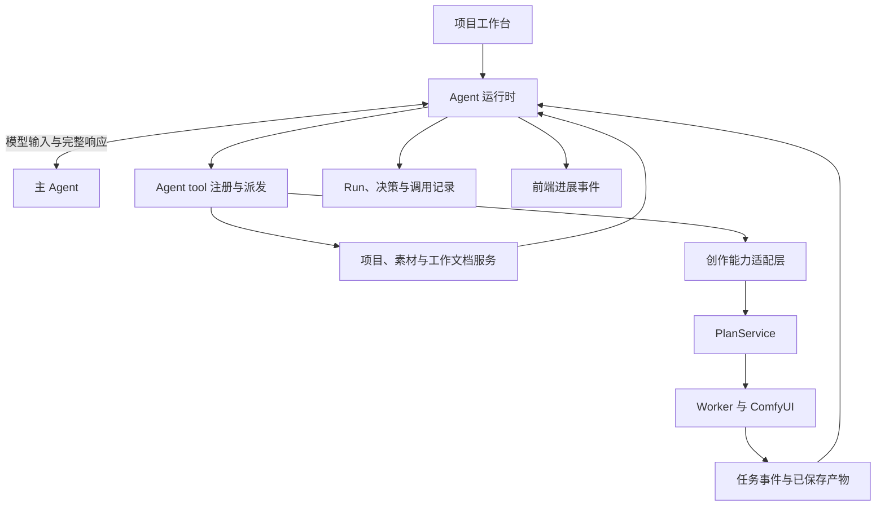

# 通用自主创作 Agent：架构与执行规格

版本：v0.15  
日期：2026-11-10（Asia/Shanghai）  
状态：规格 v0.15，首版主要产品决策已收敛；D01、D02、D03、D04、D07、D08、D13、D15、D16、D18 已确认，D06 结构已确认、初值由工程默认确定；D09、D10、D11、D12、D14 按用户授权采用工程默认；D05 首版范围暂定，D17 延后。2026-11-10 用户已明确授权实施，接入与实际验证见[实现记录](docs/creative-agent-implementation.md)。  
代码核对基线：`175965e`。  
讨论阶段仅维护文档；后续实现以用户明确授权为起点。规格中的历史“未实现”“仅文档”记录保留当时状态，不代表禁止已授权的实施。

本文作为实现和后续讨论的规格依据。第 1.1 节记录用户明确要求，第 18 节区分用户已确认、首版暂定、已延后、工程默认与待讨论。工程默认由助手依据用户对简单决策的授权确定，不表示用户逐项确认，可随实现验证调整。正文中的“应”“必须”表示需要满足的设计约定，不代表所有能力均已经实测；实际接入及验证状态见实现记录。

## 1. 目标、讨论前提与范围

### 1.1 用户已经明确的要求

| 编号 | 要求 |
| --- | --- |
| U01 | 在当前项目基础上增加 Agent 形式的创作助手，由大模型自主调用 tools 推进创作。 |
| U02 | 用户主要表达创作目标，助手承担提示词、参数和创作步骤的准备与执行，目标是用一句话完成各阶段并交付成品。 |
| U03 | Agent tools 与现有创作工具是不同层次；Agent 可以通过自己的 tools 使用现有创作工具。 |
| U04 | 先设计通用 Agent 架构，暂不限定图片、单段视频或多镜头视频等具体创作类型。 |
| U05 | 当前处于讨论阶段；先形成 spec，后续在本文上讨论修改，暂不改业务代码。 |
| U06 | 两种方式共用右侧“创作助手”面板，以“辅助创作 / 自主创作”切换；模式对应独立对话，切换保留各自状态，运行中的 Agent 任务继续并提供返回入口。具体见已确认决策 D01。 |
| U07 | 自主创作默认由 Agent 自行设计并执行，不默认先等待用户确认整体方案；用户明确“先给方案”“只写脚本”等阶段任务时，以该阶段为边界。具体见已确认决策 D15。 |
| U08 | 首版工作台 tools 优先，复用项目、素材、文档、创作能力与任务服务；通用脚本执行留待后续扩展。具体见已确认决策 D08。 |
| U09 | 一次具体创作操作采用统一调用，后台完成校验、冻结与提交；Agent 需要提前查看准备结果时按需预检，不固定拆分为准备与提交两个模型决策回合。具体见已确认决策 D13。 |
| U10 | Agent 可用素材限定为用户明确指定的素材、项目关键素材、本次创作的新成果；不向 Agent 开放项目全库的自由检索、读取和使用。精确创作由用户预先整理关键素材；也可明确指定素材或无素材直接创作，避免历史中间产物和无关内容污染上下文。具体见已确认决策 D03。 |
| U11 | 默认允许 Agent 针对真实产物中明确偏离目标的问题进行有限自主返工；主观审美主要在用户反馈后继续修改，具体执行及返工初值由助手按授权确定并可配置调整。原则见 D04，初值见 13.4。 |
| U12 | 成品由 Agent 检查通过后直接标记完成并交付，不默认等待用户点击验收；用户可在交付后反馈修改。未解决的明确问题应保留成果并说明，不冒充完整交付。具体见已确认决策 D16。 |
| U13 | 视频观察首版暂定采用 PyAV / FFmpeg 基础检查和观察材料准备，加 DeepSeek 概览核对及按需局部复查；复杂动作和声音内容的检查限制明确记录。具体范围见暂定决策 D05。 |
| U14 | 由同一个主 Agent 判断普通讨论与创作执行：咨询和讨论直接回复，有明确产出要求时按目标执行，阶段任务遵守指定边界，不新增固定路由模型。具体见已确认决策 D02。 |
| U15 | 首版不加入用户在运行中主动追加要求、修改或替换目标的功能，留待后续版本；当前任务结束或取消后再发起修改。必要澄清回答和运行控制保留，具体见 D17 延后决定。 |
| U16 | 采用“整个任务总额度 + 单个问题返工上限”两层执行约束；按最新范围只控制执行次数、返工等运行限制，首版不以费用或 token 用量作为额度。结构见 D06，计时按 D07，工程初值见 13.4。 |
| U17 | 首版不加入费用记账和 token 消耗量计算、累计或展示，用户在 API Key 服务方查看消耗。保留必要的上下文长度保护和执行限制；本次不修改既有辅助创作代码。 |
| U18 | 等待生成、等待必要澄清和用户暂停不消耗 Agent 推进时长；已提交的生成继续受自身执行超时约束，界面总历时分别展示，已用执行及返工次数不重置。具体见 D07。 |
| U19 | 常规、简单的决策由助手确定工程默认；涉及产品体验、创作边界和显著开发范围的关键决策再交由用户讨论，不重复要求用户逐项选择内部实现。 |
| U20 | 首版先复用现有创作工具，把通用 Agent 跑通；新增剪辑、独立配音、混音和字幕合成等生产能力留待后续接入。运行时与 Agent tools 仍需实现，具体范围见 D18。 |

“一句话”表示常规任务不要求用户逐步选择工具、编写提示词和填写参数。确实缺少关键素材、要求互相冲突或需要扩大任务范围时，仍允许集中询问。

### 1.2 本文提出的总体方案

技术方案建议采用一个主 Agent、一个应用内持久化运行时和一套 Agent tools，复用现有项目、素材、创作工具与任务执行服务。界面上保留辅助创作、增加自主创作，并在右侧共用面板切换，这一 UI 方案已经确认。

自主模式的默认方式已经确认：用户提出目标后，由 Agent 在目标范围内自行完成必要设计并执行，计划和阶段成果对用户可见，不以用户逐阶段确认作为正常推进条件。

消息处理方式已经确认：同一个主 Agent 自行区分普通讨论与创作执行，咨询直接回复，明确产出按目标推进。用户已确认首版不实现运行中主动修改目标；必要澄清回答保留，结束后的修改另起关联创作，避免引入运行中自由输入和目标重规划机制。

首版工具路线已经确认：优先提供围绕工作台资源和创作服务的 Agent tools，通用脚本执行后续增加，接口保留扩展空间。

首版生产能力范围已经确认（D18）：复用现有注册的图片生成、编辑、放大和视频生成能力，重点完成通用 Agent 的自主规划、工具调用、等待、观察、有限返工与交付。新增后期生产能力后续接入；该范围不省略 Agent 运行时、工作台 tools 和适配层的实现。

具体创作操作采用已确认的“统一调用、预检按需”：正常情况下由一次调用完成后台校验、配置冻结和任务提交；需要提前查看配置换算或约束问题时，Agent 可先预检。整个作品仍由 Agent 多轮选择、观察与调用工具推进。

素材范围已经确认：只使用用户明确指定、项目关键素材和本次创作新成果构成的集合。项目全库承担素材存储与用户挑选的职责，不自动成为 Agent 的上下文或检索范围；无参考创作可以直接从用户目标开始。

返工原则已经确认：针对实际产物中有依据、明确偏离目标的问题，Agent 可在限定次数及 Run 执行限额内自行修正；不默认因模糊的审美判断持续生成。结构已确认为“整个任务总额度 + 单个问题返工上限”，两层约束同时生效；首版不加入费用记账或 token 用量统计。计时按已确认的 D07，具体执行初值见 13.4。

交付方式已经确认：Agent 完成必要检查、提交真实成果并通过后台核验后，直接标记完成并交付，不设置默认的用户待验收步骤。完成表示本次目标已经执行并交付，主观满意度可以通过后续反馈继续打磨。

通用性体现在：执行循环不预设具体创作路径，工具与创作能力可扩展，运行记录能够容纳多种阶段成果。实际交付能力以已经接入、可运行且能保存产物的能力为准。

### 1.3 首版架构范围

- 原生函数调用驱动的自主执行循环。
- 项目与素材访问、能力发现与资料读取、创作调用、长任务等待。
- 文本及结构化工作文档、媒体观察、计划更新、必要沟通和成果交付。
- 持久化、幂等、恢复、暂停、取消及必要澄清的等待和回答。
- Run 级执行数量、返工次数、超时及无进展限制；不加入费用记账或 token 消耗统计。
- 与旧模式、现有队列、素材追溯及公开共享权限兼容。

已确认先复用现有创作工具（D18），不在首版新增剪辑、独立配音、混音和字幕合成等生产能力。架构保持通用，后续可通过相同运行时和能力适配接入，不要求先实现全部创作类型，也不能把未接入能力标为已有。现有视频生成工具自身可产生的音轨照常保留；媒体观察所需解码、抽帧、局部裁剪和音轨检查继续按 D05 提供，不作为后期生产能力开放。

通用脚本与命令行执行按 D08 留待后续扩展，不作为首批 Agent tools。工作台服务内部实现仍可使用所需代码与媒体处理库；该决定限制的是向主 Agent 开放通用执行入口，不禁止后续增加新的已注册处理能力。

多 Agent 分工、外部检索、跨项目自动取材和长期经验学习，暂作为可讨论的扩展方向，不是本稿已经确定的首批能力。

用户运行中主动补充要求、修改或替换目标，以及对应的输入分流和目标重规划，按 D17 明确留待后续，不作为首版接口或验收要求。

## 2. 当前项目基线

### 2.1 已有能力与可复用部分

| 现有部分 | 实际情况 | 新架构的使用方式 |
| --- | --- | --- |
| 项目工作台 | React / TypeScript；项目、对话、画布、素材与任务面板 | 增加自主模式与 Run 展示，继续使用既有工作空间。 |
| 后端 | FastAPI、asyncio、SQLAlchemy、SQLite；单进程服务 | 在应用内增加运行时，沿用当前部署方式。 |
| 模型调用 | DeepSeek 官方 Responses；现有凭据、预算、调用审计、摘要 | 复用凭据、模型接入和必要记录，增加工具协议；既有计费和用量逻辑不自动成为新 Agent 的前置依赖。 |
| 工具注册表 | 10 个创作工具、11 个注册版本；固定模板与参数入口 | 作为创作能力来源，不直接等同于 Agent tool 注册表。 |
| 写作资料 | 能力卡、参数 Schema、按版本绑定并校验 hash 的指引 | 通过能力读取工具按需提供给主 Agent。 |
| 执行 | Plan / Task / Execution；校验、冻结、队列、取消、恢复、补存 | 支撑单次创作操作；整个目标的推进交给 Run。 |
| 素材 | Asset / Blob、关键素材、标签、检索、来源关系 | 支撑参考查找、阶段成果保存与最终交付。 |
| 事件 | 持久事件和 SSE | 驱动任务唤醒及前端进展更新。 |
| 访问边界 | 本机管理入口与匿名共享入口分离 | Run 和 tools 继承发起来源的权限。 |

以上来自当前代码与注册文件检查，不代表本次重新进行过线上模型或 GPU 生成验证。实际模型、预算、资源上限与工具可用性以运行配置和在线预检为准。

### 2.2 现有助手与目标架构的差异

当前主链路为：上下文准备 → 工具路由 → 专用编写 → 校验 → 用户确认 → 队列执行 → 等待反馈。视频可按预先冻结的两步依赖续接，但没有通用的结果驱动决策循环。

现有实现中的下列行为需要为新模式单独处理：

- `Planner.invoke` 主要返回 `response.output_text`，尚未派发原生函数调用。
- 模型调用预算按 routing、composition、repair 等固定阶段计数。
- `Planner.prepare` 与前端输入在当前对话有活动 Task 时限制继续交互。
- `PlanService` 包含规划忙碌、方案确认、旧背景确认等既有交互约定。
- `Worker.aggregate` 会在单项任务结束时更新 AgentTurn，并发送等待用户反馈的消息。
- 现有 token 计数、图片审计与摘要逻辑面向文本和图片消息。新 Agent 适配工具协议、图片和上下文整理，但不以扩展 token 消耗统计或费用核算作为首版要求。

不能仅在旧流程外包一层循环就认为完成改造；需要分离可复用的执行约束与旧模式的交互、编排规则。

### 2.3 与历史文档及本机实验的关系

- [SPEC.md](SPEC.md) 记录既有系统基础设计。
- [AGENT_OPTIMIZATION_SPEC.md](AGENT_OPTIMIZATION_SPEC.md) 记录旧助手的路由与专用编写设计。
- [参数自主调整归档](docs/archive/2026-11-04-agent-parameter-design/README.md) 是未实现提案，可参考其中的权限、继承和追溯讨论，不自动继承其固定阶段、次数与确认规则。
- 本机存在被 Git 本地排除规则忽略的 `production.py`、`production_media.py` 等定制脚本，包含调度、抽帧和拼接逻辑，未接入主应用。它们仅作为经验来源，不能作为新架构已经具备通用成片能力的依据。

本文单独维护；旧规格、封存快照和已发布工具版本不因本稿出现而改变含义。

## 3. 术语与职责

| 术语 | 定义 |
| --- | --- |
| 主 Agent | 接收目标和工具结果，决定下一步行动的大模型角色。 |
| Agent 运行时 | 管理模型请求、工具调度、状态、等待、恢复与限制的应用代码。 |
| Agent tool | 主 Agent 可通过原生函数调用使用的接口，有明确输入、返回值、执行语义和恢复方式。 |
| 创作能力 / capability | 实际完成生成或处理的能力；首批主要由现有创作工具提供。 |
| AgentRun / Run | 一次从用户目标到交付或停止的持续创作过程，可跨多次用户交互。 |
| AgentStep | 一次模型决策及其上下文版本记录，不是预设的业务阶段。 |
| AgentToolCall | 一次原生工具调用及其执行结果记录。 |
| 工作计划 | Agent 对任务的可见分解与进度记录，允许调整，不等同于执行 DAG。 |
| 执行方案 Plan | 现有系统中冻结一次具体创作操作的输入、参数、版本与种子的记录。 |
| 工作文档 | 脚本、分镜、创作说明等有稳定身份和版本的文本或结构化成果。 |
| 交付物 | Run 明确提交给用户的成果引用；可以是媒体或文档，也可以引用范围内已有素材。 |

工作计划、执行方案和最终交付清单分别保存，不能互相代替。

## 4. 总体架构

主 Agent 决定创作路径：需要哪些信息、使用哪些能力、如何编写内容、是否修正以及何时交付。运行时决定某次调用能否合法执行，并负责将执行事实可靠地交回模型。

确定性的参数换算、模板渲染、版本核验、文件保存与执行限额检查继续由代码完成。运行时不根据关键词自行编排“文生图 → 编辑 → 放大 → 视频”等创作路径。

首版建议在现有后端增加小型运行时和服务适配层。两个注册体系分别维护：Agent tool 注册表管理可调用接口，现有创作注册表管理生产能力。

## 5. 用户交互与任务范围

### 5.1 模式与启动

已确认的 UI 方案（D01，2026-11-09）：

- 保持左侧素材、中间画布、右侧“创作助手”的整体布局。
- 右侧面板顶部提供“辅助创作 / 自主创作”分段切换；`assisted`、`autonomous` 为内部模式标识。
- 两种模式共用对话选择、素材引用和输入区的界面骨架，内容与操作随模式变化。
- 每个对话绑定一种模式。切换标签恢复对应模式上次使用的对话，不改写原对话的模式或历史。
- 新对话继承当前选中的模式；草稿、附图和聊天记录按各自对话保存。已有对话保留辅助创作模式。
- 切换模式不停止运行中的 Agent 任务；在右侧保留任务状态和返回入口，底部任务队列继续共用。
- 跨模式继续创作时明确引用另一模式产出的素材，不自动合并两段聊天历史。

已确认的消息处理方式（D02，2026-11-10）：由同一个主 Agent 根据用户消息和当前上下文区分普通讨论与创作执行，不增加独立的固定路由模型。咨询和讨论直接回复，不强制生成作品；明确要求产出时自主推进；“先写分镜”等阶段要求只交付对应阶段。关键歧义会影响执行时集中询问，不以固定关键词代替模型理解。

自主模式中，有明确创作要求时在显示的范围和额度内连续推进，不要求每次调用再点击“确认生成”。普通讨论不创建生成 Task，也不显示为作品已经交付。首版对活动 Run 的用户输入限制按 5.3 执行。

每个对话同一时刻最多有一个未结束的 Run，包含等待、暂停和需要处理的 Run。不同对话可有各自的 Run，共享现有串行生成队列及适用执行限制；新 Agent 首版不引入金额日预算或 token 用量配额，旧模式现有机制不在本次代码范围内改动。

### 5.2 目标与约束

保留原始用户消息、启动时项目目标与风格、用户附带素材及必要澄清回答，不只保存模型转述。Run 使用启动目标快照和追加的必要澄清记录；Agent 可展示目标理解、预期交付物、硬约束和假设，首版不在活动 Run 中开放用户自由修改目标。

已确认的创作自主方式（D15，2026-11-09）：用户提出最终目标后，默认由 Agent 自行设计并执行。自主设计包括实现目标所需的内容结构、脚本、分镜、环境与声音安排，以及技术路径、提示词和开放参数；具体采用哪些内容取决于用户目标和可用能力，不要求每个任务都经过这些阶段。

用户明确要求和范围优先。任务具体时围绕指定修改保留无关内容；用户明确“先给方案”“只写脚本”等阶段目标时，以该阶段为交付边界。未指定内容可在目标内自主补全，区分用户要求与 Agent 的创作决定，不默认等待整体方案确认，也不直接沿用旧助手对创意补全程度的限制。

关键指代不清、缺必要依据或硬要求冲突时，保留集中询问机制。需要更换目标或扩大创作范围时说明限制，不能静默改写当前目标；用户可结束当前任务后另行发起。遇到执行限制按相关停止机制处理。计划和阶段成果持续可见；用户必要澄清回答按 5.3 处理。素材范围、Agent tools 范围、创作调用、自主返工和交付方式分别按 D03、D08、D13、D04、D16；常规默认由助手按授权确定，首版生产能力按已确认的 D18。

Run 保存启动时采用的项目背景版本。项目目标或风格发生变化时，提交前继续执行现有版本核验，按版本冲突处理；首版不自动将变化吸收为当前 Run 的新目标，也不绕过检查接受旧背景。已经提交的任务保留冻结配置，后续有新要求时另起创作。

### 5.3 首版运行期间的输入边界

用户已确认运行中主动修改功能延后（D17，2026-11-10）。首版不把新自由消息自动追加到活动 Run，不支持运行中替换目标、重新分配已有步骤或按新要求重规划，也不自动将这些消息排队为当前或下一个任务。暂停不开放修改目标的入口。

建议运行期间的自由输入保留为草稿，待当前 Run 完成、取消或失败后由用户主动发送。后台同样限制活动 Run 的自由消息写入，不能只依赖输入框禁用；另一个独立目标可通过新对话发起，不混用当前 Run 的记录。

`ask_user` 和 `waiting_user` 继续用于 Agent 主动提出的必要澄清。仅在存在待回答问题时接收其对应回答，关联同一原生工具调用并保存配对结果，然后按原创作目标继续。回答可以提供被询问的信息或明确指定的必要素材，但不是通用改目标入口；仍受 D03 的素材范围限制。若回答实际要求更换目标或扩大范围，说明需要结束当前任务后另行发起，不在原 Run 中自动改写。

用户暂停、取消、恢复控制继续保留；Agent 按原目标更新计划、根据结果选工具和有限自主返工也继续有效。已提交任务保留冻结配置，取消只按所属任务执行。完成后的修改以新的关联 Run 处理，原完成记录、原产物和检查说明保留。

首版不要求实现可变目标的版本推进机制；记录固定目标快照、必要澄清和独立控制版本即可。后续增加运行中修改时，再设计目标修订、旧响应失效、在途任务处理及费用继承，不能将这些未来要求提前纳入首版。

### 5.4 素材访问域

已确认的素材范围（D03，2026-11-09）仅包括以下三类：

| 来源 | 进入 Agent 可用范围的依据 | 使用约定 |
| --- | --- | --- |
| 用户明确指定的素材 | 用户选中、明确引用或指定具体素材，由后端解析到真实资源身份 | 保留指定用途和约束；仅说“从项目库找找”不等于开放全库。 |
| 项目关键素材 | 用户为当前项目整理并放入关键素材库 | 可按当前目标读取和选择，不要求用户每次重新附带。 |
| 本次创作的新成果 | 由当前 Run 实际产生并保存的媒体、工作文档及可用阶段产物 | 可以用于当前目标的后续步骤，记录候选、中间结果及用途，不因产生就认定其符合目标。 |

项目全库可能包含历史中间产物、失败候选和与当前目标无关的生成结果。属于同一项目不表示与当前创作相关，不能以“Agent 自主”为由开放整库。撤回 v0.5 中建议项目内全库自主取材的方案。

精确创作的正常准备方式是由用户先整理项目关键素材。纯 AI 创作可以由用户明确指定项目库中的素材，也可以没有参考素材而直接创作。缺少附图或关键素材不触发全库扫描；确实需要特定人物或素材依据时，集中请用户指定或整理所需素材。

关键素材由用户维护。Agent 不得把普通库素材自行标为关键素材来取得读取权，也不自动把本 Run 产物或最终成果升为项目关键素材；用户可在素材界面主动整理，明确要求的整理能力另行设计。

用户可以进一步限定“只用这几份素材”“不用项目素材”或排除指定资源；这些要求优先收窄默认集合。没有参考的任务不强制使用关键素材，也不要求先生成或挑选参考才允许开始。

首版实现补充：新 Run 在素材范围确认前不向模型提供素材元信息、正文或像素。同一个主 Agent 先根据用户原文调用 `set_resource_scope`，将默认集合收窄为沿用授权、仅选中、无参考或具体白名单，并可设置排除项；后台保存并强制执行。排除优先，名称必须来自用户原文并在原授权集合内唯一定位，不能以此搜索全库或重新开启用户已关闭的关键素材权限。范围确认无需用户额外审批；必要澄清中新指定素材仅增加对应的明确授权，不重新开放其他素材。

用户仍可以在工作台浏览、搜索全库并挑选素材；人可操作的素材库范围与 Agent 可见范围分别处理。Agent 的上下文、素材列表、搜索、读取、读图、预检和创作输入校验均遵守三类来源构成的集合，不能先把全库候选返回给模型，再由模型自行过滤。

范围检查覆盖素材 ID、名称、标签、备注、描述、缩略图、像素与正文。范围外素材不进入 Agent 的搜索结果、分页总量或其他聚合信息；普通资源 ID、预览链接和来源关系不构成额外访问凭据。素材从模型输入组装到具体工具执行均由后端过滤，不能仅依赖系统提示词约束。

历史 Run 成果、同一对话的旧产物和其他对话的成果，不因存在于历史或数据库中就自动成为本次创作可读素材；需要用户明确指定，或由用户纳入项目关键素材。既有来源记录不自动开放相关任务的所有输入、输出或其他素材内容；后续续改可以根据用户明确引用绑定具体来源。

不自动读取其他对话的聊天历史和摘要。跨项目素材先按明确的复用操作进入当前项目，再由用户指定或整理为关键素材，不能因被复用到普通项目库就自动开放。

后端记录本 Run 各项可用资源的加入依据，并在读取和提交前复核实际存在、项目归属及有效状态。活动依赖的管理按 D11；关键素材成员变化后仍按实际授权核验，不能从缓存继续读取已失去权限的素材。不能把素材管理操作视为向当前 Run 隐式修改创作目标，也不得绕过 D03 的素材边界。

## 6. 自主执行机制

### 6.1 决策循环

1. 保存启动目标快照、用户消息、范围与额度；已有 Run 只接收已等待问题的对应澄清回答，不接收自由改目标消息。
2. 从持久记录构建上下文，检查模型窗口、请求体及图片数量等约束；不进行消费 token 统计或费用预检。
3. 调用模型，接收完整响应；本次模型请求关联 Run 和 AgentStep。
4. 保存响应与全部函数调用意图，再开始有副作用的工具执行。
5. 校验工具名称、参数、权限、Run 目标快照、控制状态、幂等键和额度。
6. 执行工具，保存返回值、关联资源和副作用；将工具结果按原生协议回填。
7. 根据控制动作进入等待、询问、结束，或将新结果交给模型进行下一次决策。

工作计划按任务复杂度维护，不要求每次读取资料都更新一次。模型可以根据资料或产物重新选择能力；已冻结并提交的执行配置保持不变，需要改变时创建新的操作。

### 6.2 模型协议

- 向模型提供原生 function tools，由运行时执行，模型输出的自然语言不作为工具执行命令。
- 处理完整响应中的函数调用、消息和供应商要求回传的连续性字段，不能只读取 `output_text`。
- 每个函数调用保留原始 `call_id`、名称和参数，并产生配对的工具结果。
- 未完成调用不能在上下文整理时丢失；不能在缺少配对结果时发起不符合供应商协议的下一次请求。
- 可见进展展示业务说明、计划和工具事实；模型内部推理不作为产品展示内容。
- 模型自然语言声称“完成”不会直接触发创作 Run 的完成状态；交付走第 12 节的显式结束动作。

首版建议继续使用当前 DeepSeek Responses 接入。模型层隔离为共享服务，以便后续接入具备相同必需能力的模型，不将供应商会话 ID 作为本地恢复的唯一依据。

### 6.3 同一响应中的多个调用

运行时必须接受模型可能返回多个调用的事实，不依赖供应商的“关闭并行”参数实现限制。

首版工程默认将普通调用按输出顺序串行处理，并逐项复核 Run 控制状态、素材权限和执行限额。调用必须引用已经存在的资源，不能引用同批调用尚未返回的虚构结果 ID。暂不新增工具并行调度。

`wait_for_tasks`、`ask_user`、`finish_run` 为控制类工具，首版工程默认独占一个调用批次。同一响应混入其他调用时，整个批次返回可修正的 `batch_conflict`，不执行该批次的副作用，每个调用仍保存配对错误结果。该批处理策略按 D09 确定。

### 6.4 长任务等待

创作调用提交后返回任务 ID，不阻塞模型 HTTP 请求直到 GPU 生成完成。Agent 可以先完成不依赖结果的工作，再调用 `wait_for_tasks`。

等待工具将等待条件和未完成工具调用持久化，Run 进入 `waiting_task`。此时不为查询进度反复调用模型。任务事件或后台状态核对发现等待条件满足后，保存配对工具结果，再恢复模型决策。

前端显示的“正在等待”是运行事件，不冒充已经完成的函数返回。重启后通过数据库中的任务状态恢复等待，不只依赖进程内 Future 或 SSE 消息是否被收到。

## 7. Agent tools 初版接口

### 7.1 共通约定

每个 tool 声明稳定名称、接口版本、用途、输入 Schema、返回语义、副作用类别、资源消耗及恢复策略。工具集可扩展，以下为首批候选。

已确认首版以工作台 tools 为优先（D08）：覆盖项目背景、资源检索与读取、媒体观察、能力资料、创作调用、任务跟踪、文档保存、计划管理、沟通和交付。具体工具名称、粒度及独立能力仍需结合对应决策收敛，不因范围确认而将全部候选接口视为已定稿。

后端注入 `run_id`、项目、对话、发起来源、目标快照引用和调用幂等身份，不将这些内部字段作为模型自由填写的权限依据。

资源使用稳定 ID 和版本寻址。首批 `read_resource`、`write_document` 面向工作台管理的资源，不直接表示任意本机路径读写权限。通用脚本执行后续另行设计，预留独立 tool 或能力适配入口；工作台 tools 的项目归属检查与 D03 的素材范围检查同时生效，不能以项目内资源为由跳过后者。

### 7.2 候选工具目录

| Tool | 主要输入 | 主要返回 / 行为 |
| --- | --- | --- |
| `set_resource_scope` | 素材模式、明确包含 / 排除的 ID 或原文名称、用户引文 | 在首次素材披露前固化本 Run 的收窄策略；不扩大原授权，当前 Run 新成果继续可用。 |
| `get_project_context` | 可选需要的背景类别 | 项目目标、风格、当前任务约束及获准素材摘要；不附带全库最近素材或范围外素材信息。 |
| `search_resources` | 查询、素材或文档类别、筛选、分页 | 仅在 D03 允许的集合内检索，返回带身份、版本、来源与状态的候选；列表、分页和聚合先受范围过滤。 |
| `read_resource` | 资源引用、版本、可选正文范围 | 先核验范围，再返回获准文本、结构化内容、媒体元数据与必要来源；范围读取告知省略部分。 |
| `inspect_media` | 获准素材引用、观察目的，可选时间范围、采样要求、裁剪区域和获准参考素材 | 范围核验后提供技术检查、带时间戳的真实图片或视频采样、疑点区间、证据与覆盖限制；首版视频观察范围按暂定决策 D05，见 12.1。 |
| `list_capabilities` | 可选创作目标或类别 | 简短能力目录、可用状态与限制，支持后续扩展能力来源。 |
| `get_capability` | 能力 ID、可选版本 | 输入槽位、参数 Schema、写作资料、输出类型、版本与资料 hash。 |
| `preview_creation`（暂名，按需） | 与创作调用一致的能力、输入、正文和参数 | 返回可确定的实际配置、尺寸 / 时长换算与约束问题；不创建生成任务。 |
| `invoke_creation` | 能力引用、输入绑定、正文文档、开放参数、操作目的、来源引用 | 统一完成校验、冻结与提交，返回实际配置和任务 ID，或明确未提交的错误；不强制先预检。 |
| `get_tasks` | 本 Run 任务 ID 列表 | 任务、执行、保存状态、真实产物与错误；不修改状态。 |
| `wait_for_tasks` | 本 Run 任务 ID 列表 | 等待指定任务形成可报告结果后返回；结果不一定是成功。 |
| `write_document` | 名称、内容类型、正文、来源，可选父文档版本 | 保存新的文本或结构化成果版本，返回资源 ID 与内容 hash。 |
| `update_plan` | 计划项、状态、当前工作与简短调整说明 | 保存可见工作计划的版本；不直接创建生成任务。 |
| `ask_user` | 集中问题、必要性、可选建议答案 | 保存必要澄清并等待用户；仅接收对应问题的回答，配对同一调用后继续原目标，不作为运行中自由改目标的入口。 |
| `finish_run` | 结束类别、成果引用、要求对应、检查证据、限制及说明 | 核验交付或停止说明，接受后更新 Run 状态。 |

任务取消首版通过用户侧 Run 控制和现有任务入口提供。D10 工程默认暂不新增模型侧单任务取消 tool；后台仍处理用户取消和执行超时，且仅作用于本 Run 拥有的任务，不清空外部队列。

### 7.3 工具返回值

逻辑返回包括：`ok`、`data`、`resources`、`effects`、`error`。错误至少包含稳定错误码、发生阶段、说明、是否已经产生副作用和恢复方式。

`effects` 引用实际创建的任务、资源或记录，不由模型自行声明。工具返回成功必须有对应事实；任务已受理、生成成功和产物已完整保存分别表达。

文本数据以结构化内容返回；图片通过供应商支持的图片内容块提供，并附素材 ID、原文件 hash 和采样信息。不得只返回一个本机预览 URL 就声称云端模型已经看过图片。

### 7.4 工具错误与修正

名称错误、参数不合法、输入缺失等确定未执行的错误返回模型，由其在剩余额度内决定修正。工具错误不套用旧模式“全轮仅一次 repair”的固定政策。

重复相同错误、无有效进展或额度不足会触发 Run 停止条件。提交结果不明的错误进入核对流程，不允许模型把“再次提交”当作普通修正。

## 8. 创作能力适配与执行

### 8.1 能力目录

首批来源为现有 `tool_registry` 和 `prompt_guides`。能力说明包含适用目标、限制、输入类型与用途、开放参数、输出类型、资料版本、可用性和资源约束。

按 D18，首版创作调用仅开放已经正式注册、可运行的现有创作能力；本地实验脚本、未注册工作流和 FFmpeg 库本身不自动成为新增生产能力。现有能力能够满足的目标由 Agent 自主选择实现路径，不按创作类型固定编排。

若满足明确交付要求必须使用尚未接入的处理能力，应尽早说明具体缺口与当前可实现范围，不自动执行替代目标或把阶段素材冒充成品。已有阶段成果可以保留并标明未完成项；需要改变目标时按 D17 在当前任务结束或取消后另行发起，未满足原目标不标记为完整交付。

模型按需读取资料，可以在读取后重选能力。能力目录不伪造尚未接入的处理方式；后续添加剪辑、音频等能力时实现相应适配，通用循环无需增加对应业务阶段分支。

### 8.2 提示词与参数

主 Agent 负责准备对应能力要求的内容和开放参数。复用现有提示词文档 Schema、编译和内容约束；通用运行时不再强制先调用独立 Router，再调用只能使用固定工具的 Composer。

执行正文应有唯一权威来源：采用结构化提示词文档时由后台编译正文，不能同时接受另一份不一致的执行 prompt。无提示词输入的能力，例如当前高清放大，不强制生成提示词文档。

模型只能修改能力声明开放的参数；后端校验参数范围、输入用途、尺寸与时长换算。新增参数开放是独立的能力版本设计，不因引入 Agent 自动生效。

同来源续改按适用的实际执行配置继承；新独立任务从工具默认或明确引用的配置开始。用户要求、继承、默认和自主设计分别记录，普通调用不回写工具默认值。

### 8.3 提交与版本冻结

`invoke_creation` 内部依次完成：输入与权限核对（包括 D03 的素材范围）、正文编译、参数归一化、版本与资源检查、冻结 Plan、创建 Task / Execution，并保存调用与任务的关联。可选预检遵守相同输入范围，不能用于探查未开放素材。

上述统一调用方式已由用户确认（D13）。一次调用对应一次具体生成、编辑或处理操作；正常操作不固定增加模型查看准备结果后再提交的回合。参数、用户硬要求和资源约束的必要检查每次提交都执行，预检按需不等于省略提交检查。发现冲突时返回具体问题并明确未提交，不能先生成再解释偏差。

提供可选预检入口，暂名 `preview_creation`，与实际提交复用校验、编译和换算逻辑。它只返回可确定的准备结果与限制，不创建生成任务、不向 ComfyUI 提交生成；保存审计不等于产生创作执行。预检不是以 GPU 试生成来评估效果，也不替代后续结果观察。

预检结果区分已解析值、估算值与待提交时确定的值，例如未明确指定的随机种子。实际提交返回完整冻结配置；若要求沿用预检中明确的值，应以一致的输入和显式配置提交。素材状态、Run 目标快照及控制状态、工具可用性和额度仍在提交时重新核验，预检结果不作为绕过检查或自动扩大权限的凭据。

创作能力版本、模板、参数 Schema、写作资料及其 hash 一起记录。校验、归一化和渲染必须使用同一个实际版本；当前部分归一化接口按工具 ID 读取当前版本，实现时需要核对这一点，不能仅补存版本号。

Plan 在新模式中承担冻结执行证据的作用，不要求用户逐项确认。应增加明确的 Run 执行来源和权限上下文，不能通过伪装为手动来源绕过既有约束。

通用 Run 的步骤关系由运行记录和真实成果引用表达。现有候选索引继续表达候选；已有两步视频任务按原记录恢复，不把候选索引扩展成任意业务步骤编号。

### 8.4 指引兼容

复用工具知识、内容约束和有效示例。旧指令中的“一轮一方案、等待确认、工具已固定不能重选”等编排约定不直接注入主 Agent。

新模式适用的指引通过新的版本或绑定发布，保留 hash 与快照。历史工具目录、已发布资料及执行记录不原地覆盖。

## 9. Run 状态与控制

| 状态 | 含义 | 主要离开条件 |
| --- | --- | --- |
| `queued` | 已接收，等待运行时调度 | 获得调度、用户取消或前置条件失败。 |
| `running` | 正在模型决策或执行短工具 | 下一次决策、进入等待、暂停、停止或交付。 |
| `waiting_task` | 等待创作执行或结果保存形成可报告状态 | 持久等待条件满足，保存工具结果后继续。 |
| `waiting_user` | 等待 Agent 已提出的必要澄清 | 收到对应回答后按原目标继续，或暂停、取消；不接收自由改目标消息。 |
| `paused` | 用户暂停后续自主推进 | 用户恢复或取消。 |
| `needs_attention` | 额度耗尽、证据未知等原因使自动推进停止 | 用户处理并明确恢复，或取消。 |
| `cancelling` | 已停止新动作，正在取消或核对本 Run 任务 | 取消结果可确认，或进入需要处理。 |
| `completed` | 创作由 Agent 检查、后台核验后直接完成并交付 | 终态，无默认用户验收步骤；后续修改创建关联的新 Run，讨论回复不显示为作品交付。 |
| `cancelled` | 取消已经落实，成果保留 | 终态。 |
| `failed` | 无法按当前目标继续且已记录原因 | 终态；重试创建关联的新 Run。 |

状态之外保存 `stop_reason`、等待条件和当前控制版本。首版将固定目标快照与控制版本分开记录；控制版本保证暂停或取消后，旧模型响应不能重新激活 Run，不以可变目标版本作为首版前提。

暂停阻止新的模型请求和副作用；已经提交的生成默认继续并保存产物，界面明确展示这一语义。暂停期间可收集任务结果，但不据此自行恢复决策。

取消只作用于本 Run 拥有的任务，不清空其他对话或外部 ComfyUI 队列。提交或取消结果未知时保留证据并进入需要处理，不能直接声称已取消。

按 D11 工程默认，存在未结束 Run 时不直接归档或移除所属项目、对话；提示先取消或完成该 Run，暂停不等于结束。对仍作为活动输入或未闭合工具依赖的素材，先结束相关 Run 再移除；无关素材沿用现有管理行为。操作前后及工具执行前均复核引用和权限，不从缓存恢复已撤回的读取权。

## 10. 持久化、幂等与恢复

### 10.1 建议记录

| 记录 | 核心内容 |
| --- | --- |
| AgentRun（新增） | 项目、对话、原始目标消息与固定目标快照、状态、控制版本、范围、执行限额及问题返工计数、计划、交付清单、停止原因、父 Run。 |
| AgentStep（新增） | Run、决策序号、关联用户回合或必要澄清、模型请求引用、完整响应引用、状态与时间。 |
| AgentToolCall（新增） | Step、原生 call_id、工具及版本、参数、幂等键、状态、结果、错误、关联任务与资源、返工时的问题引用。 |
| AgentTurn / Message（沿用并适配） | 用户请求、必要澄清回答、可见消息和所附素材，增加必要 Run 关联；首版多次用户交互限于待回答澄清，不是运行中自由修改。 |
| LLMCall / ContextSnapshot（沿用并适配） | 增加 Run / Step 关联及恢复所需请求、响应和上下文记录；兼容旧数据。新模式不新增 token / 费用统计字段或聚合逻辑，旧模式记录保留。 |
| Plan / Task / Execution（沿用并适配） | 继续记录具体创作执行，增加可查询的 Run 与工具调用来源。 |
| Asset / Blob（沿用并扩展） | 保存媒体和工作文档，表达文档版本、作者与来源，不伪造 ComfyUI 执行记录。 |

具体列、索引和外键在实现设计中确定；关系归属应有后端和数据库约束，不能仅依赖模型回传 JSON。

### 10.2 提交的一致性

先保存工具意图，再产生副作用。创建内部任务与写入工具调用的任务关联应在同一事务中完成；若跨事务，必须以稳定幂等身份查回同一个结果。

用户消息、Run 创建、文档写入和创作提交各有幂等语义。相同键与相同请求返回已有结果；相同键配不同请求返回冲突。供应商原生 call_id 与应用幂等键分别记录，不假设重新调用模型会产生相同 call_id。

模型响应恢复时不再次执行已经完成的工具调用。新模型决策若要求重复相同操作，需要关联既有操作，区分真实的重新创作与意外重复；重做应是明确的新操作并消耗额度。

### 10.3 启动恢复

1. 先恢复存储回执、已有 Task / Execution 和未知提交的核对。
2. 从数据库核对工具调用与任务、产物的实际关联，修复可确定的中间状态。
3. 对已完成副作用补齐工具返回，不重新提交。
4. 重建长任务和用户询问的等待条件。
5. 仅对允许继续、无停止控制且没有未知副作用的 Run 恢复调度。

启动恢复的活动 Run 应与旧 Worker 的“planning 回合中断即失败”处理分开。运行时对每个 Run 保证单一调度所有权；进程内锁之外保留持久版本检查。

模型请求响应丢失时记录响应未知，不虚构函数调用。按 D14 工程默认，只有尚未保存完整模型响应、未执行其工具副作用的临时请求错误可以有限重试；已保存响应则恢复原工具调用，不重新决策替代。创作提交或取消结果未知时先核对原操作，不能靠重试生成恢复；不依赖费用核算判断是否恢复。

### 10.4 工作文档的工程默认

按 D12 复用 Asset / Blob 保存 Agent 有意写入的脚本、分镜、创作说明等正式工作文档，首版采用 Markdown 或 JSON。每次修改写新版本并关联父版本、Run、来源及内容 hash；不覆盖用户原件，不伪造 ComfyUI Execution，也不把模型内部推理自动转成项目文档。

复用素材与成果入口提供查看、复制和下载。用户交付后通过对话提出修改，生成关联的新版本；首版不增加专用富文本编辑器或运行中用户修改文档的入口。当前 Run 的文档按 D03 使用，历史文档仍需用户明确引用或属于项目关键素材。

## 11. 上下文、记忆与资料

初始上下文提供：当前目标与原始要求、项目背景、用户明确指定素材、项目关键素材及当前 Run 成果的必要摘要、当前计划、获准工作文档引用、相关执行事实和简短能力目录。不能复用旧规划入口自动附带项目最近素材的行为；未开放素材的名称、备注或生成描述也不作为默认背景。

详细写作资料、获准素材集合的列表和长文档按需读取，不把全部参数、历史和二进制一次塞入请求。首版检索可使用现有全文搜索、标签及筛选，但须先按 D03 限定集合，不以新增向量库为前提。

上下文整理保留目标硬约束、用户否定项、未完成工作、关键素材身份、必要操作来源及未知状态。长记录可以摘要并按引用再读取，但未闭合的函数调用与结果不能被拆散。当前用户原文、关键约束和必要正文不能静默截断。

历史上下文、摘要、来源说明和工具返回不能成为引入范围外素材内容的旁路。既有素材引用不自动恢复其本次读取权限；需要续改时解析当前用户的明确引用，并记录范围依据。项目关键素材与 Run 成果也按目标相关性分批提供，允许读取不表示必须每轮全部附图。

构建上下文时考虑工具描述、参数 Schema、调用记录、文本结果和图片，按模型窗口、请求体及图片数量等限制整理输入。保留必要的长度保护和摘要机制，但不为消费统计新增精确 token 计数、累计用量或费用计算。图片使用真实图片内容块，不能把 base64 当普通正文或重复写入日志。

观察与原文件 hash、采样参数绑定。重新使用观察时检查素材身份和版本，区分用户要求、工具文档、生成提示词、模型观察和推测。素材文字、案例和旧助手回复不获得更高指令权限。

## 12. 成果观察、修正与交付

### 12.1 观察能力

图片观察返回实际像素，可复用现有读图副本生成方式。用户于 2026-11-10 暂定视频观察首版采用“PyAV / FFmpeg 基础检查与观察材料准备 + DeepSeek 概览观察与任务核对”（D05），包括按疑点补充抽帧和局部裁剪后继续复查。该决定限定首版范围；具体采样、阈值及资源参数另行收敛，尚未实现，后续可依据实际视频验证调整。

#### 12.1.1 后台技术检查与取证

通过工作台媒体观察服务处理获准素材，职责包括：

- 检查文件可读取性、视频解码情况、实际尺寸、时长和任务要求的必要音轨；只有实际完成相应检查，才将该项记为已检查。读取元数据或解码首帧不等于完整解码检查，失败或未完成范围须记录。
- 提供覆盖视频时间轴的概览抽帧，以及按需查看的时间点、局部时间范围和画面裁剪。记录实际解码时间戳、帧号、采样与缩放策略、裁剪位置及原文件身份，不只按帧号除以平均帧率推算时间。
- 通过黑场、冻结、静音等信号形成候选疑点区间，记录信号种类、时间范围和检测配置；这些信号须结合创作意图解释，不能直接等同于生成失败。

PyAV / FFmpeg 在后台内部执行。Agent 使用工作台 tool，不填写任意本机路径、FFmpeg 命令或自行启动通用脚本；具体依赖、可执行文件和可用滤镜在实施阶段核验。首版方案不依赖 MCP 对接或额外视频评估模型。

#### 12.1.2 DeepSeek 概览与按需复查

DeepSeek 主 Agent 读取真实采样图片，并结合当前用户目标及获准参考素材，核对主体、场景、必要物体、起止状态和采样中可观察的内容变化，保存简短依据与不确定性。生成提示、文件名及元数据不能替代实际画面证据。

初步发现与目标相关的疑点时，Agent 可以继续调用同一媒体观察能力，取得对应时间范围的更密集抽帧、指定时间点或局部裁剪，再由 DeepSeek 复查。该过程仍属于本方案的两项能力，不预设每次必须增加独立评估模型或生成新的候选视频。

检查项来自真实用户目标与必要交付要求；不能把 Agent 为生成自行添加的全部修饰词，或未要求的全片逐帧物理验证，升级成新的交付门槛。实际解码、采样、图片数量、分辨率、复查轮次和模型调用均受后台资源约束；整体执行初值按 13.4，具体采样和检测阈值由实现及样本验证确定，不要求用户逐项选择。

#### 12.1.3 证据、能力边界与后续行动

观察记录区分技术事实、程序检测信号和模型语义判断。每项至少关联目标要求、素材身份及原文件 hash、时间或画面证据、实际观察覆盖范围和未完成部分；判断区分“发现有证据支持的明确问题”“已检查范围内未发现明显问题”“无法判断”。

有限采样不能据此声称已检查全部动作连续性、接触关系、物理正确性或短暂变形。音轨存在和静音检测不代表听过声音，也不证明台词、声音内容、口型或音画同步正确；没有对应能力时明确尚未检查。关键内容仍无法确认时按 D16 处理，不能将所有不确定性直接视作通过或失败。

有证据支持的明确目标偏差可以进入 D04 的有限自主返工；信号疑点先结合意图解释或补充观察。技术检查、抽帧或模型观察出错须记录为观察失败，不能直接转换成作品不合格并重新生成。

观察图片、裁剪和区间证据均是原素材的派生观察材料，继承 D03 的范围限制；原素材及参考素材均须先核验权限，不能通过取证扩大素材可见集合或自动提升为项目关键素材。先实现可追溯的技术检查与抽帧观察，再用用户明确指定的视频样本验证漏报、误报、时间定位和消耗；未实测前不承诺对复杂动作的可靠验收。

### 12.2 自主修正

已确认的自主返工原则（D04，2026-11-09）：允许 Agent 针对真实产物中明确偏离目标的问题进行有限自主修正，在单问题返工上限及 Run 的生成数量、执行时间等限制内，选择编辑、调整相关参数、换用已接入能力或重新生成；按最新范围不加入费用记账。

问题判断必须关联当前用户目标和实际产物证据。例如，明确要求竖屏但实际比例不符、必要主体或内容丢失、实际观察表明指定动作没有表现。示例用于说明依据，不能实现成固定关键词触发或强制使用同一种修正路线。

模型观察不确定时，应先利用已有观察能力补充证据，或明确说明不确定性，不能直接把猜测当作反复生成的理由。视频和声音判断继续受 D05 的实际观察能力限制，不因允许返工就声称已经检查全部内容。

默认不因“还能更漂亮”“电影感还可以更强”等模糊审美判断持续返工。主观偏好主要在用户查看结果并反馈后形成后续修改目标；用户明确提出的风格、主体等要求若明显未落实，仍可以作为与目标有关的问题判断，并说明依据。

每次修正记录目标、具体差距、证据、操作目的及关联的原产物，保留旧产物。无关设置尽量保持；新随机种子或参数改变应与当前问题有关。返工遵守 D03 的素材范围，不能为修正问题自行扫描项目全库。

生产目标与显示计划步骤分开记录。媒体生成前声明 `creation_targets`，包括必要中间成果的稳定 ID、含义、媒体类型及要求绑定；后台分配稳定操作身份。首次创建生产任务后这些定义冻结，计划步骤、状态、说明和所用工具仍可调整。同一生产目标再次生成必须关联该目标原产物的观察证据及原要求；更换计划项 ID、换工具、改种子或挪用其他产物证据，不产生新的返工身份。真正生成前仍可调整生产目标，不预设业务工具链。

已确认按 D06 的两层结构约束返工：整个 Run 的执行限制与同一明确问题的返工上限必须同时满足。具体计数和可配置初值按 13.4；它们是助手按授权选定的工程默认，不是用户逐项指定或已经实测的质量保证。每次重新生成计入实际执行次数并关联所修正的问题，不能通过换任务、换能力或重写计划重置。达到适用上限仍有明确问题时，保留已有成果，说明未完成项与停止原因，不将未满足要求的产物标为完整交付；交付方式遵守 D16。

创作返工、确定未提交的参数修正、已有结果补存和未知提交核对分别处理。补存优先取回已有产物；参数未提交的修正不冒充一次生成；提交结果未知时先核对，不能当作普通返工直接重复提交。网络与故障恢复按 D14 工程默认。

等待、重读相同资料、改写计划或重复同一失败调用，不自动算有效进展。无进展限制依据执行事实、资料获取和成果变化判断，不以模型自述“有进展”为唯一依据。

不强制每个操作后执行独立评分流程；需要作视觉判断时取得真实像素，媒体技术检查可由工具直接提供。

### 12.3 结束与交付

已确认的交付方式（D16，2026-11-09）：Agent 检查通过后直接标记完成并交付，不默认进入用户待验收阶段，也不要求用户点击确认完成后才结束本次创作。

检查分别处理交付完整性、明确要求及主观满意度：文件与任务事实由后台核验；主体、动作等语义要求结合实际观察检查；个人审美偏好由用户查看后反馈。完成表示本次目标已经执行并交付，不承诺用户对所有审美细节均满意。

`finish_run` 提交成果清单、目标对应和检查说明。后台核验资源身份、保存状态、任务状态和 Run 目标快照及必要澄清后，将完整创作记为 `completed` 且结束类别为 `delivered`，发布完成事件并展示成果。

完整交付至少满足：

- 引用成果可读取且已完整保存，文件能打开，资源身份、类型和版本明确。
- 交付清单对应本 Run 的目标快照及必要澄清，说明用户要求分别由哪些成果满足。
- 必要步骤完成，已提交创作任务没有待处理执行、保存不全或未知提交状态。
- 没有遗漏的必要输入、未处理的询问或对应澄清回答，以及未闭合工具调用；结束调用本身除外。
- 可核验的明确要求已经检查，语义结论有实际观察依据，已发现的明确问题已解决。
- 检查覆盖范围与不确定性被准确标注，不把未检查或无法验证的关键要求声称为已经达标；具体媒体观察能力按 D05 收敛。

完成提交再次核对目标快照、必要澄清及控制版本，避免误用其他任务成果或在暂停、取消到达后仍按旧控制状态完成。首版没有运行中自由改目标的提交路径。

仍有未解决的明确问题、关键证据不足以判断完成，或达到执行上限只能保留部分成果时，说明已有成果、未完成项和原因，进入 `needs_attention` 等相应停止状态，不冒充完整交付。用户可以处理后恢复或取消；执行及返工初值按 13.4，计时按 D07。

交付后用户可以继续提出修改，复用获准的成果开展关联后续创作；保留原完成记录、原产物和检查说明。用户后续不满意不倒改原 Run 的执行事实，也不自动启动未请求的新一轮生成。

普通讨论按已确认的 D02 由同一个主 Agent 直接回复，以普通回复结束，不创建生成 Task、不计入作品交付。若启动阶段已预建 Run，记录方案可采用 `completed / reply`；具体持久化字段在实现时确定。保留实际调用与状态记录，首版不统计 token 消耗和费用；已进入创作的 Run 不能改标普通回复来跳过交付核验。

用户要最终视频时，只有脚本或中间图片不能标为完整交付；用户只要脚本时，脚本本身可以作为最终成果。阶段成果和最终成果分别标记，不把“文件已生成”或模型自称满意当作充分依据。

## 13. 执行限制与资源控制

用户于 2026-11-10 确认采用“整个任务总额度 + 单个问题返工上限”（D06），随后明确首版不加入记账和 token 消耗量计算。因此，本节总额度只表示执行次数、返工及运行限制，不表示金额预算或 token 用量配额。D07 计时已确认，具体初值由助手按用户授权确定为 13.4 的工程默认。

首版不新增 token 消耗统计、供应商 usage 汇总、费用换算、价格快照、金额预留或扣减、费用面板及 token 消耗量展示。用户在 API Key 服务方查看实际消耗。保留恢复所需调用记录和必要上下文长度保护，但不以消费统计作为新 Agent 调用模型的前置条件。

### 13.1 整个任务总额度（执行限额）

复用全局任务队列及适用的资源限制，按 Run 控制实际创作执行数量，并可配置模型请求数、工具调用数、自动推进时长和连续无进展决策数。摘要、格式修正和媒体观察同样遵守适用的调用次数或运行限制，不统计其 token 消耗和费用。

生成执行数量按实际候选和内部生成步骤核算，不能用“一个 Task”掩盖多候选或两步生成。记录已预约、已提交和结果未知的执行名额；确定未提交才可释放预约，已被受理的生成保留实际尝试记录，不因取消或失败抹除。

提交前原子检查执行限额，多个 Run 共同遵守适用的工作台执行限制；达到上限时停止超限新操作，保留已有成果并说明原因，不自行提高配置。澄清、暂停、恢复或新增 Step 不重置已用执行次数。

### 13.2 单个问题返工上限

后台以稳定的问题记录关联目标要求、原产物、观察证据和历次返工。针对同一已记录问题换用工具、换种子、改写计划或改变描述，不重新获得返工次数；问题记录的具体载体和归并方式在实现时细化，不要求首版增加额外分类模型。

针对问题的实际创作执行同时进入 Run 执行计数及对应返工记录。即使整个 Run 仍有剩余执行名额，达到某一问题的返工上限后，也不能继续针对该问题发起超限重做；多个问题各自未超限，也必须共同服从 Run 总执行限制。已达上限的问题如果阻碍完整交付，按 D16 保留已有成果并说明，不标为完整交付。

问题计数由后台根据实际操作维护，不能仅采信模型自报；上下文摘要保留问题引用、已用次数和剩余限制。确定未提交的参数修正、补存已有结果、媒体补充观察及未知提交核对不冒充新生成返工，其对应调用仍受适用的请求次数和无进展限制。

恢复、暂停、换 Task 或重启不重置执行与返工计数，Agent 也不能为绕过限制自行另开 Run。具体上限和计数规则按 13.4，后续以样本验证调整工程配置，不要求用户逐项决定常规数值。

### 13.3 等待与暂停计时（D07 已确认）

区分 Agent 自动推进时长、生成任务执行超时和界面展示的总历时：模型决策和工具实际处理计入自动推进时长；挂起等待生成结果、等待必要澄清及用户暂停期间不计入该时长。已经提交的生成按自身执行超时规则独立计时，暂停 Agent 不暂停 GPU 工作，也不延长其执行截止条件。

推进时长持久化累计，服务离线期间不作为实际推进时间；恢复后延续已有累计值。排队、生成、保存和恢复状态在界面可见，总历时包含等待，与推进时长分别展示。暂停、等待和恢复不重置执行数或问题返工次数，也不涉及费用记账。

首版工程默认不另设排队、等待用户和暂停的自动结束期限；用户可查看状态并取消。模型请求、工具处理及生成各自遵守对应超时；保存异常按回执补存和 D14 恢复规则处理，不以重新生成代替。暂停后已经开始的请求和生成仍受自身超时约束，结果可保存，但不能自行恢复 Agent 推进。

### 13.4 可配置工程初值

以下由助手按用户授权确定，供首版实现使用，不表示用户逐项指定，也未经真实创作验证；可在配置和后续样本验证中调整，不包含金额或 token 用量。首版不要求为这些初值新增复杂的设置界面。

| 项目 | 工程初值 | 计数或执行约定 |
| --- | --- | --- |
| 单 Run 创作执行上限 | 12 次 | 每个实际 Execution / 候选 / 内部生成步骤各记一次，首次生成也计入。 |
| 单问题追加返工上限 | 2 次 | 初始产物不算返工；每个为该问题追加的实际创作执行记一次，并同时计入 Run 总量。 |
| 单 Run 模型请求上限 | 40 次 | 包含摘要、格式修正和实际重试请求；仅统计请求次数，不计算 token 或费用。 |
| 单 Run 原生工具调用上限 | 120 次 | 以持久化的逻辑调用计数；后台任务状态查询不冒充模型新调用。 |
| 连续无进展上限 | 3 轮 | 重复相同错误、无新资料或执行事实时触发；正常等待不计无进展轮次。 |
| Agent 自动推进时长 | 30 分钟 | 按 13.3 累计，排队、等待用户及暂停不计入。 |
| 临时请求错误自动重试 | 最多追加 2 次 | 默认退避 1 秒、3 秒，适用条件按 D14；实际模型请求仍计入 40 次上限。 |
| 生成单任务超时 | 沿用冻结执行配置 | 不因暂停或服务重启重置，不修改现有创作工具默认值。 |

同一实际执行若同时修正多个已记录问题，Run 总数只加一次，各关联问题的返工次数分别加一次。确定未提交不占生成名额；提交未知则保留占用并核对，不能重试创建新生成来清除未知状态。没有完成目标但达到限制时按 D16 报告现状，不把工程初值当作完成要求的替代。

## 14. 错误处理与权限

| 情况 | 处理建议 |
| --- | --- |
| 参数、正文或输入绑定不合法 | 明确未提交，返回可修正错误，受 Run 额度和无进展限制。 |
| 能力临时不可用 | 返回真实状态，由 Agent 判断其他获准能力或说明阻碍。 |
| 模型认证或账户错误 | 停止模型请求，保留 Run 并提示处理。 |
| 模型网络错误或响应丢失 | 未保存完整响应且尚未执行其工具副作用时，临时错误可有限重试；已保存响应恢复原调用，次数耗尽则需要处理，不依赖用量记账。 |
| 创作提交状态未知 | 使用既有 prompt ID、任务和调用身份核对，不重复生成。 |
| 生成明确失败 | 返回实际错误与已有成果；后续操作是新决策，消耗剩余额度。 |
| 生成成功但保存不全 | 优先补存已有产物，不能用重生成代替补存。 |
| 输入移除、项目或对话归档 | 对活动依赖先按 D11 阻止管理操作；竞态或撤回权限仍在执行前核验，拒绝无效引用并保留已完成部分。 |
| 用户暂停或取消到达，旧决策尚未提交 | 复核控制版本，阻止旧控制状态下的副作用，保留已提交记录；首版不按运行中自由修改重规划。 |
| 达到额度或持续无进展 | 进入需要处理并给出真实原因，不自动提高额度。 |

按 D14 工程默认，只读请求及未产生对应工具副作用的模型请求，可对临时网络错误、限流或服务端故障追加最多两次重试。采用单一重试层，默认等待 1 秒、3 秒；供应商有重试等待指示时在适用请求时限内遵守。实际模型请求计入 Run 次数，不做 token 或费用统计。认证、账户或确定的参数错误直接报告，不通过网络重试修复。ComfyUI 提交或取消结果未知始终先核对原操作；生成明确失败后的新生成按有限返工处理。

所有 Agent tools 继承发起来源、项目、对话和资源范围。后台直接调用服务也执行这些检查，不能只依赖 HTTP 中间件，不能借由 Agent 获得本机管理权限。

密钥继续使用现有凭据服务，不进入模型输入、可见进展或备份。工具结果中的文件、资料与媒体内容作为数据处理。首版不自动修改 ComfyUI 环境、工具注册定义或全局默认配置。

## 15. 工作台与 API 建议

### 15.1 前端呈现

已经确认的界面方向：

- 统一右侧“创作助手”面板，顶部使用“辅助创作 / 自主创作”切换，保留现有对话选择和输入区。
- 辅助创作主要展示方案及“确认生成”；自主创作主要展示计划、当前进展、阶段成果和最终交付，并提供暂停、取消入口。
- 当前模式的新对话入口继承所选模式；切换后恢复各自的对话、草稿和附图。
- Agent 运行期间可以浏览辅助创作；右侧提供持续状态和返回入口，任务队列共用。
- 跨模式使用成果通过明确的素材引用完成。

自主创作的完成行为按已确认的 D16：Agent 检查通过、后台核验后直接显示已完成并展示交付物，提供后续反馈入口，不增加默认的用户验收确认步骤。检查说明和未完成原因应与实际状态一致。

以下细节继续作为建议，随相关决策收敛：自主对话展示进度及必要的执行、返工次数；进展可展开查看工具、实际配置及执行证据；暂停、取消、恢复分别解释其作用；阶段成果可定位并返回来源；单项 Task 完成更新进展，由 Run 统一表达整体交付结果。首版不增加 token 消耗、累计费用或账单面板。

按 D17，首版不提供向活动 Run 追加或修改目标的自由输入入口。建议自由输入保留草稿并提示等待当前任务结束，用户仍可查看进展、切换对话或模式，以及使用运行控制；进入 `waiting_user` 时仅开放对应澄清问题的回答入口。暂停不解锁改目标。前后端均执行相同边界，不自动排队草稿或吸收其他对话的新要求。

依据已确认的 D03，用户保留左侧全库浏览和选取能力，Agent 的可用资源集合单独限定。建议自主对话显示“本次可用素材”的来源与数量，便于核对用户指定、项目关键素材和当前 Run 成果；精确创作可从现有关键素材入口准备，纯文字创作不因集合为空被阻止。具体呈现仍为 UI 细化建议。

提示词与参数详情仍可查看；首版用户修改要求在当前 Run 结束或取消后以新请求提交，后续创作产生关联的新版本。Agent 在原目标内的自主调整和有限返工按 D04 执行，已经冻结的任务配置不原地修改。

### 15.2 候选接口

以下表达资源职责，路径和请求 Schema 尚未定稿：

| 接口 | 用途 |
| --- | --- |
| `POST /projects/{project_id}/agent-runs` | 接收目标、附带素材、运行范围和幂等键，异步启动。 |
| `GET /agent-runs/{run_id}` | 读取状态、目标快照、计划、执行限额、等待原因和交付清单；不要求返回 token / 费用统计。 |
| `GET /agent-runs/{run_id}/activity` | 按游标读取可见决策摘要、工具事实和成果。 |
| `POST /agent-runs/{run_id}/answers` | 仅对 `waiting_user` 中的待回答问题提交答案及被询问的必要素材，绑定问题 / 工具调用身份并核验范围；不接受自由改目标消息。 |
| `POST /agent-runs/{run_id}/pause` | 停止后续自主推进。 |
| `POST /agent-runs/{run_id}/resume` | 在用户处理停止原因后明确恢复，核对版本与额度。 |
| `POST /agent-runs/{run_id}/cancel` | 停止新动作并取消或核对所属任务。 |
| 现有 `/events` | 增加 Run、计划、工具活动和交付事件，沿用持久游标。 |

写接口沿用会话、CSRF、Origin 和权限规则。Run 与项目、对话归属在每次访问时核验。前端断线后通过 Run 快照与游标恢复显示，运行不依赖页面保持打开。

## 16. 代码落点与兼容迁移

| 位置 | 建议改动 |
| --- | --- |
| `backend/app/main.py` | 注册运行时，在现有存储和执行恢复后恢复 Run，关停时保存检查点。 |
| `backend/app/planner.py` | 提取共享模型接入、凭据、协议和必要记录；新 Agent 不依赖旧费用记账前置流程，保持旧模式入口兼容。 |
| `backend/app/agent_flow.py` | 保留旧固定流程；可复用内容校验与编译逻辑另行分离。 |
| 新 `backend/app/agent_runtime.py` | 决策循环、调度所有权、检查点、等待和恢复；文件名为建议。 |
| 新 Agent tool 模块 | 工具定义、输入输出、处理器和恢复语义；与创作 Registry 分开。 |
| 新 Agent 上下文 / API 模块 | 构建工具协议上下文、Run 接口和事件。 |
| `backend/app/plans.py` | 增加 Run 执行来源、幂等关联及后台权限检查，复用实际执行服务。 |
| `backend/app/worker.py` | 保留提交与收集机制，分离旧回合完成消息和新 Run 通知。 |
| `backend/app/models.py` 与迁移 | 增加 Run 相关记录与关联、会话模式、必要约束和索引。 |
| `backend/app/llm_context.py`、`vision.py` | 工具上下文整理、模型窗口和图片输入限制、媒体输入及不复制二进制的必要记录；不新增消费 token 统计。 |
| `registry.py`、`prompt_guides.py`、正文编译模块 | 能力资料适配、统一版本核验与新模式指引。 |
| `storage.py` 与素材接口 | 工作文档版本、Run 来源、交付定位和检索。 |
| `frontend/src/App.tsx` 及新组件 | 模式入口、Run 活动、控制、文档与交付展示；避免继续把全部逻辑堆入主文件。 |

共享模型服务的提取需区分通用模型调用与旧模式的费用预留、单价换算及用量逻辑。新 Agent 首版不自动继承金额预算阻断条件；旧模式现有代码和历史记录不在本次擅自删除，实施时保持其兼容。

已有项目、对话、素材、Plan、任务与执行身份保留。迁移后旧对话默认辅助模式，旧任务按原范围恢复，不自动创建后续步骤或新 Run。

备份和恢复覆盖新记录、工作文档与必要快照。媒体保留原有来源关系；文本成果记录自己的来源，不为接入旧表结构伪造 Execution。

## 17. 实施顺序与验收

### 17.1 建议分阶段实施

| 阶段 | 交付内容 | 验证重点 |
| --- | --- | --- |
| A：运行机制 | 原生函数协议、Run / Step / ToolCall、只读与文档工具、控制和等待机制 | 不同工具结果能改变后续行动；检查点、幂等和恢复可信。 |
| B：创作闭环 | 现有生产能力适配、统一创作调用、真实任务事件、结果观察、有限修正与交付 | 在 D18 范围内完成代表性创作，已有产物被真实用于后续操作；不以接入新增后期能力作为本阶段前提。 |
| C：工作台整合 | 模式入口、活动与执行限制、必要澄清回答、暂停取消、成果定位 | 用户能理解过程并控制任务，运行中自由修改入口不开放，旧模式与共享入口兼容。 |

每阶段的模拟与真实验证分别记录。A 阶段使用模拟创作结果不表示完整 Agent 创作已交付；首版可用性需要三个阶段共同完成。

“把通用 Agent 跑通”需要真实工具结果进入后续决策，并影响能力选择、检查、有限返工或停止；最终成果按 D16 交付，等待和恢复可持续，旧辅助创作保持兼容。仅验证模型输出 function call、生成 Task 创建成功或固定业务链能够执行，不等同于首版闭环完成。

### 17.2 核心验收场景

| 编号 | 场景 | 期望 |
| --- | --- | --- |
| A01 | 同一目标分别返回可用结果、需修改结果、能力不足 | Agent 作出相关的不同后续行动，而非执行固定业务链。 |
| A02 | 一次响应包含多个调用、非法参数或冲突控制动作 | 每个调用有记录和配对结果，非法副作用不发生。 |
| A03 | 生成耗时较长、SSE 断线或重启 | 后台等待并恢复，不用模型持续轮询，不重复提交。 |
| A04 | 任务已创建但工具返回尚未保存时中断 | 恢复关联同一任务。 |
| A05 | ComfyUI 已受理但提交响应丢失 | 核对原任务，证据不足时明确未知。 |
| A06 | 运行中暂停或取消 | 旧控制状态下的决策不能继续提交新操作，其他 Run 和外部任务不受影响。 |
| A07 | 某步失败或产物保存不全 | 已完成成果保留，补存与重新生成被正确区分。 |
| A08 | 多候选、两步任务、修复和摘要 | 实际生成次数计入执行限额，摘要及修正等遵守适用的调用次数限制；不要求统计 token 消耗或金额。 |
| A09 | 使用其他对话或跨项目的素材、伪造资源 ID | 按范围检查，不能串用历史或扩大权限。 |
| A10 | 交付阶段成果冒充成品、文件缺失或旧目标成果 | 完整交付核验不通过，明确未完成部分。 |
| A11 | 文档修改、媒体续改或用户要求保持原文 | 产生新版本，原件、原文及适用的继承配置可追溯。 |
| A12 | 公网 Run 调用工具，旧模式正常创作 | 继承共享权限，旧流程与版本化工具不被新模式改变。 |
| A13 | 全库存在无关素材、历史中间产物或诱导模型使用的备注 | 范围外素材不进入上下文、搜索结果、分页聚合、缩略图和正文；直接 ID、预览链接及预检也不能绕过范围。 |
| A14 | 用户指定、项目关键素材和本 Run 新成果分别用于创作 | 三类来源均可按用途使用并追溯；Agent 不能自行标关键素材或展开来源链以取得其他素材。 |
| A15 | 无参考创作，或用户明确限定不使用项目素材 | 可以从文字目标创作，不扫描全库、不强制取用关键素材；历史 Run 产物不自动混入。 |
| A16 | 真实产物明确偏离目标，或仅存在模糊审美改进空间 | 前者可在额度内自主修正并记录证据；后者不默认持续生成；观察不确定不能冒充明确问题。 |
| A17 | 已多次修正仍未满足明确要求，或补存 / 提交未知被模型误作返工 | 达上限停止并报告已有成果与未完成项，消耗不因换任务重置；补存和未知核对不触发重复生成。 |
| A18 | Agent 检查通过并提交真实成果，用户尚未点击任何验收按钮 | 后台核验后直接完成并交付，成果及检查说明可见；后续反馈可启动关联修改，原记录和产物保留。 |
| A19 | 仍有明确问题、关键检查证据不足或引用其他目标的成果时请求完成 | 不以模型声称成功、文件已生成或不属于本 Run 的结论跳过核验；报告未完成项，不能误标完整交付。 |
| A20 | 首帧可读取，但后续解码失败或完整检查未结束 | 返回失败位置或未覆盖范围，不以元数据和首帧预览冒充完整解码通过；检查故障不直接触发重新生成。 |
| A21 | 视频有创作意图所需的黑场、静止画面或静音 | 返回信号及时间区间，结合目标解释；不能只凭检测命中就判定失败并自主返工。 |
| A22 | 概览发现疑点，需要查看指定时间范围或局部画面 | 在相同素材授权和资源约束内补充真实图像，保留时间戳、裁剪和覆盖信息，由 DeepSeek 复查；不额外生成视频取代观察。 |
| A23 | 音轨存在或抽帧正常，但用户关键要求涉及未验证的台词、口型或连续动作 | 明确能力及证据限制；关键项不足时按 D16 保留成果并说明，不能宣称已听过声音或验证全片动作。 |
| A24 | 用户咨询能力、讨论方案，或明确要求产出最终 / 阶段成果 | 同一个主 Agent 作出相应回复或执行；咨询不自动创建生成任务，阶段要求不越界，不新增固定路由模型。 |
| A25 | Run 正在执行、等待任务或暂停时尝试提交自由修改消息 | 前后端均不将其应用到活动 Run、不自动排队或另起执行；提示当前输入边界，保留原目标与任务配置。 |
| A26 | Agent 等待必要澄清，用户提交对应答案或伪造 / 过期问题身份 | 合法答案配对待回答工具调用后继续原目标；无效关联被拒绝，不重复执行，也不借回答接口开放任意目标修改或全库素材。 |
| A27 | Run 仍有剩余额度，但同一问题已经达到配置的返工上限 | 不再提交该问题的超限重做；换工具、种子、描述或 Task 不重置问题计数，问题仍阻碍交付时准确报告。 |
| A28 | 多个问题分别未达到返工上限，但累计执行触及 Run 总限制 | 阻止超限新操作；保留和核对已有产物，说明剩余问题，不因拆分问题或新增 Step 继续执行。 |
| A29 | 新 Agent 多轮调用及图片 / 工具交互，供应商可能返回 usage | 无需 token 消费统计或费用记账即可执行，不新增相关聚合和面板；必要上下文长度保护、实际执行与返工限制仍有效。 |
| A30 | 排队、等待必要澄清、暂停后恢复或服务重启 | 等待和暂停不计推进时长，累计执行及返工次数保留；已提交生成仍受自身超时约束，暂停时结果保存不触发自动继续。 |
| A31 | 临时模型请求失败、完整响应已保存或创作提交结果未知 | 仅对允许的临时请求有限重试；已保存响应恢复原调用，未知生成先核对，不能重复提交。 |
| A32 | 归档活动项目 / 对话，或移除仍被活动 Run 使用的素材 | 返回明确的在用状态和结束任务入口；不自动取消无关任务，不只靠前端隐藏按钮，执行前仍核对权限。 |
| A33 | 使用已有创作能力完成图片或视频目标，并将实际产物用于后续步骤 | 主 Agent 自主选择和调用工作台 tools，实际结果进入上下文并影响后续行动；最终交付真实成果，不要求新增后期能力或默认人工验收。 |
| A34 | 目标明确需要尚未接入的后期生产能力 | 尽早说明缺口，不调用未注册能力或通过命令行绕过范围；阶段素材不冒充成品，也不擅自把目标降级后标记完成。 |

验证分为协议与工程检查、真实模型行为评估、实际生成结果检查。固定模型响应可以验证状态与协议；真实模型小规模评估验证选择是否相关；实际媒体验证最终效果，三者不互相替代。

真实模型和 GPU 验证应单独记录任务、额度及产物，不能仅凭 Schema 通过宣称创作质量已获验证。当前文档编写不启动这些验证。

## 18. 讨论决策与确认记录

### 18.1 决策清单

D01、D02、D03、D04、D07、D08、D13、D15、D16、D18 已由用户确认，D06 的执行限额结构已确认、初值见 13.4；D09、D10、D11、D12、D14 由助手依据用户授权确定工程默认，不表示用户逐项指定。费用记账和 token 消耗统计移出首版，D05 首版范围暂定，D17 延后。当前主要产品决策已收敛，版本变化见 19.3；后续仅将新出现的关键产品或范围变更交由用户讨论，常规工程细节由助手处理。

| 编号 | 问题 | 当前建议或已确认决定 | 主要影响 | 状态 |
| --- | --- | --- | --- | --- |
| D01 | 模式入口与切换 | 右侧统一面板，顶部“辅助创作 / 自主创作”切换；对话绑定模式，各自恢复历史、草稿和附图；新对话继承当前模式；切换不停止 Agent，保留状态和返回入口；共用任务队列，跨模式显式引用素材。 | 会话迁移、交互与上下文兼容。 | 已确认，2026-11-09；未实现。 |
| D02 | 自主对话中的普通讨论与创作执行 | 由同一主 Agent 根据消息与上下文判断；咨询和讨论直接回复，明确产出要求按目标执行，阶段任务遵守边界，不新增固定路由模型。普通回复不冒充作品交付，运行中修改按 D17 延后。 | 消息入口、Run 创建与结束协议。 | 已确认，2026-11-10；未实现。 |
| D03 | 自动取材范围 | 仅开放用户明确指定、项目关键素材及本次创作新成果；上下文、检索、读取、读图、预检与执行均受限，不开放全库候选。精确创作先由用户准备关键素材，也可指定素材或无参考直接创作。 | 上下文质量、素材检索、精确创作准备与对话边界。 | 已确认，2026-11-09；未实现。 |
| D04 | 是否允许根据产物自主返工 | 针对有真实产物依据、明确偏离目标的问题有限自主返工；模糊审美改进主要由用户反馈触发。保留旧产物、记录问题与修正依据；D06 两层结构已确认，执行初值见 13.4，补存与未知核对分别处理。 | 生成耗时、观察能力与执行限制。 | 已确认，2026-11-09；未实现。 |
| D05 | 视频观察的首批能力 | 首版暂定采用 PyAV / FFmpeg 基础检查、时间戳抽帧、局部裁剪与信号疑点区间，加 DeepSeek 概览核对和按需局部复查；音轨技术检查与声音内容判断分开，见 12.1。 | 观察质量、模型输入、返工依据与交付限制。 | 用户暂定首版范围，2026-11-10；具体参数待验证，未实现。 |
| D06 | 执行限额结构与默认数值 | 整个任务总额度 + 单个问题返工上限；不加入费用记账或 token 消耗统计。工程初值：Run 最多 12 次实际创作执行，单问题最多追加 2 次，其他请求与推进限制见 13.4；换工具或恢复不重置。 | 实际可完成任务规模、问题追踪和停止体验。 | 结构已确认；初值按用户授权确定为工程默认，2026-11-10；未实现。 |
| D07 | 暂停、等待用户与运行时间如何计算 | 自动推进时长、生成执行超时、界面总历时分别处理；排队、等待必要澄清及暂停不占推进时长，已提交生成继续受执行超时约束，执行与返工次数不重置，见 13.3。 | 长任务恢复和用户等待。 | 已确认，2026-11-10；未实现。 |
| D08 | 工具开放程度 | 首版工作台 tools 优先，围绕项目、素材、文档、创作能力与任务服务；通用脚本执行留待后续，预留扩展接口。具体工具粒度、素材访问域和其他扩展分别讨论。 | Agent tool 范围和执行环境。 | 已确认，2026-11-09；未实现。 |
| D09 | 工具批次和并发策略 | 普通工具按序串行；等待 / 询问 / 结束独占批次，冲突批次不执行副作用、逐项配对错误；首版不增加并行工具调度。 | 协议修正、调度与复杂度。 | 工程默认，按用户授权确定，2026-11-10；未实现。 |
| D10 | 是否允许模型取消所属单任务 | 首版保留用户侧 Run / Task 取消和后台超时取消，不新增模型侧取消 tool；只作用于所属任务，未知取消先核对，不清空外部队列。 | 控制语义与首版复杂度。 | 工程默认，按用户授权确定，2026-11-10；未实现。 |
| D11 | 活动 Run 与项目 / 对话归档、素材移除的关系 | 未结束 Run 所属项目 / 对话及仍在使用的输入先完成或取消相关 Run 再移除或归档；暂停不等于结束。前后端和工具提交前继续复核引用与权限。 | 生命周期和现有管理交互。 | 工程默认，按用户授权确定，2026-11-10；未实现。 |
| D12 | 工作文档的数据形态 | 复用 Asset / Blob 保存 Markdown / JSON 与不可变版本、父版本和 Run 来源；提供查看、复制和下载，交付后对话修改产生新版本，不新增专用富文本编辑器。 | 脚本 / 分镜、素材界面和备份。 | 工程默认，按用户授权确定，2026-11-10；未实现。 |
| D13 | `invoke_creation` 是否需要拆分准备与提交 | 统一调用、预检按需：一次具体操作由后台完成必要校验、冻结与提交；Agent 可按需先查看准备结果，不固定拆分两次模型决策；预检不生成，实际提交仍重新核验。 | 工具粒度、模型请求数与可控性。 | 已确认，2026-11-09；未实现。 |
| D14 | 模型故障后的自动恢复程度 | 只读和未保存完整响应、未执行对应工具副作用的模型临时错误最多追加 2 次重试；认证、账户错误停止。完整响应恢复原调用，未知生成提交或取消先核对，不重复生成。 | 可靠性和恢复交互。 | 工程默认，按用户授权确定，2026-11-10；未实现。 |
| D15 | 创作内容自主到什么程度，何时必须询问 | 默认由 Agent 在目标范围内自行设计并执行，不默认先确认整体方案；明确阶段任务停在对应阶段，关键歧义、要求冲突或扩大范围时集中询问。 | 创作主导权、询问频率与“一句话完成”的体验。 | 已确认，2026-11-09；未实现。 |
| D16 | 什么条件算完成，主观质量由谁判断 | Agent 检查通过、后台核验后直接标记完成并交付，不默认等待人工验收；主观审美通过后续反馈修改。未解决明确问题或关键证据不足时保留成果并说明，不能冒充完整交付。 | 交付核验、有限返工与停止条件。 | 已确认，2026-11-09；未实现。 |
| D17 | 运行中主动补充、修改或替换目标 | 首版不加入，后续再评估；当前 Run 结束或取消后以新请求修改。保留 Agent 必要澄清的对应回答、运行控制及原目标内自主返工，不实现自由消息追加、目标修订和自动重规划。 | 首版范围、消息入口、数据模型与验收。 | 已确认延后，2026-11-10；首版不实现。 |
| D18 | 首版生产能力范围 | 先复用现有创作工具，把通用 Agent 跑通；首版完成自主调用、等待、观察、有限返工和交付，新增剪辑、独立配音、混音和字幕合成等生产能力留待后续接入。架构保持通用，未满足原目标不能以阶段素材冒充成品。 | 成品覆盖、开发范围和能力扩展。 | 已确认，2026-11-10；未实现。 |

### 18.2 建议讨论顺序

用户已授权助手处理常规工程决策，仅将关键产品与能力范围问题交回讨论。原讨论清单保留作追踪：第 7 项计时和执行结构已确认，具体初值由工程默认给出；第 8—10 项按工程默认收敛；第 11 项已确认先复用现有创作工具。首版主要产品决策已收敛，无需继续逐项确认常规工程细节。

| 顺序 | 主题 | 需要明确的产品问题 | 决策编号 |
| --- | --- | --- | --- |
| 1 | 创作自主程度（已确认） | 默认由 Agent 在目标内自行设计并执行，用户明确阶段边界时遵守。 | D15 |
| 2 | Agent tools 范围与粒度（已确认） | 首版工作台 tools 优先，统一创作调用、预检按需。 | D08、D13 |
| 3 | 素材自动取用（已确认） | 仅开放用户明确指定、项目关键素材、本次创作新成果；不开放全库检索或读取。 | D03 |
| 4 | 讨论与执行（已确认）；运行中修改（延后） | 同一个主 Agent 自行区分回复与执行，遵守阶段边界；首版不接收运行中主动改目标，必要澄清回答保留。 | D02、D17 |
| 5 | 交付与自主返工（原则已确认） | 明确问题可有限自主返工；Agent 检查后直接完成并交付，具体执行初值按 13.4。 | D04、D16 |
| 6 | 观察能力（首版范围暂定） | PyAV / FFmpeg 基础检查和取证 + DeepSeek 抽帧观察与局部复查；按实际证据交付，复杂动作和声音内容的能力限制明确记录。 | D05 |
| 7 | 执行结构与计时（已确认）、可配置初值（工程默认） | 整个任务总额度 + 单个问题返工上限；等待、暂停不占推进时间，生成超时独立，不加入费用或 token 记账。 | D06、D07 |
| 8 | 控制和异常（工程默认） | 用户取消、活动资源保护、临时请求有限重试和未知提交核对。 | D10、D11、D14 |
| 9 | 阶段文档（工程默认） | 复用现有素材与文件存储，Markdown / JSON，不可变版本和来源。 | D12 |
| 10 | 调用批次与并发（工程默认） | 普通工具串行，控制类调用独占批次，完整保留协议配对。 | D09 |
| 11 | 首版能力覆盖（已确认） | 先复用现有创作工具，把通用 Agent 跑通；新增后期生产能力后续接入。 | D18 |

后续由助手据此落实接口、开发拆分和验收细节，并在实施验证中调整工程默认；不重复询问常规参数、并发、重试或数据载体。只有出现影响产品目标、素材权限、能力范围或交付承诺的关键变化时，再交由用户讨论。D17 和新增后期生产能力不属于首版功能；当前仍处于 spec 阶段，不因范围收敛自动启动业务代码修改。

### 18.3 D15 确认记录

用户于 2026-11-09 明确选择：“默认由 Agent 自行设计并执行”。

据此，用户要成品时，Agent 自行完成目标内必要的创意与技术决策并执行；用户明确只要方案、脚本等阶段成果时，交付该阶段后结束。界面展示计划和阶段成果，正常推进不默认等待用户确认整体方案或逐阶段点击确认。必要澄清能力继续保留。

自主返工原则和交付方式分别按 D04、D16，执行结构和初值按 D06 / 13.4，计时按已确认的 D07；此确认也不扩大 D03 的素材范围，工具开放程度按 D08 单独确定。

### 18.4 D08 确认记录

用户于 2026-11-09 明确选择：“工作台 tools 优先”。本次选择对应此前给出的首版工作台 tools 优先、通用脚本执行后续增加的方案。

据此，首版重点完成项目与素材访问、资料读取、媒体观察、现有创作能力调用、任务跟踪、文档及成果管理等工作台接口。通用脚本执行保留后续扩展入口；新增专用创作或处理能力仍可通过能力适配接入。

这一决定不将外部检索等扩展视为首批已获确认的能力。素材范围遵守已确认的 D03，不开放整个项目库；创作调用组织方式按已确认的 D13，其他具体接口名称与扩展需求另行收敛。

### 18.5 D13 确认记录

用户于 2026-11-09 明确选择：“统一调用、预检按需”。

据此，采用统一的 `invoke_creation`：Agent 提供能力、输入、正文与参数；后台完成确定性校验、编译、归一化、版本冻结和任务提交，返回任务身份与实际配置。验证不通过时明确未提交，并将具体问题交回 Agent 修正。

需要提前核对实际尺寸、时长、配置或约束时，Agent 按需调用只预检不提交的入口；普通操作不强制分成准备与提交两次调用。用户硬要求与资源限制的必要检查始终在实际提交前执行，不能以减少调用次数为由静默改变要求。具体接口名称不由本次选择锁定。

### 18.6 D03 确认记录

用户于 2026-11-09 明确限定开放给 Agent 的素材为：“用户明确指定的素材；项目关键素材以及本次创作的新成果”。

原因是项目全库可能含历史中间产物及与当前目标无关的生成结果，不能随意读取，否则会污染上下文。精确创作前应由用户准备项目关键素材；纯 AI 创作可以明确指定项目库中的素材，也可以无素材直接开始。

据此撤回 v0.5 的全项目自主取材建议。限制覆盖 Agent 的素材发现和读取过程，不能先枚举全库再判断是否使用；对应上下文、工具、预检、执行输入和验收要求已同步。用户仍可在工作台自行浏览全库并选取要开放的具体素材。

### 18.7 D04 确认记录

用户于 2026-11-09 明确选择：“针对明确问题有限自主返工”。该选择对应此前给出的有实际结果依据、针对目标偏差修正、主观审美主要由用户反馈后再修改的方案。

据此，Agent 可在剩余额度内自主修正明确问题，记录依据并保留原产物；观察不确定或仅认为“还能更漂亮”不足以默认触发持续生成。补存已有结果、修正未提交参数与核对未知提交分别处理，不能借返工重复提交状态不明的生成。

D04 当时的确认不设置具体数值；目前执行初值按助手授权后的 13.4，计时按已确认的 D07。交付方式按 D16；达到上限或仍有问题时明确报告已有成果和未完成项，不误标完整交付。

### 18.8 D16 确认记录

用户于 2026-11-09 明确选择：“Agent 检查后直接标记完成并交付”。

据此，正常完成的创作由 Agent 检查、后台核验后直接结束并交付，不默认等待用户点击验收。交付完整性、明确要求和主观满意度分别处理；用户可以在交付后反馈审美或修改要求，继续关联创作，已有完成记录及产物保留。

未解决的明确问题、保存不全或无法判断关键要求是否满足时，保留成果并说明原因，不冒充完整交付。观察范围按暂定的 D05，执行初值按 13.4，计时按 D07；普通讨论按 D02 结束，不冒充作品交付。

### 18.9 D05 首版暂定记录

用户于 2026-11-10 询问，当前版本能否先采用“PyAV / FFmpeg 做基础检查和观察材料准备”以及“DeepSeek 做概览观察和任务相关核对”两项能力。

此前将该组合细化到 12.1、候选工具和验收场景后，用户回复：“可以，这部分先暂定了。”据此，D05 首版观察范围记为暂定。局部补帧和裁剪继续由相同工作台观察工具提供，DeepSeek 继续判断；不增加额外模型或 MCP 作为首版前置条件。整体执行限制按 13.4、计时按 D07，具体采样和检测参数由实现验证调整。

“暂定”表示先按这两项能力作为首版设计基础，可在真实视频验证后调整，并非已实现或已证明检查准确性。已确认的 D03、D04、D16 保持有效：观察限于三类获准素材，有证据支持的明确偏差才可有限自主返工；关键证据不足时不能误标完整交付。

### 18.10 D02 确认及 D17 延后记录

用户于 2026-11-10 认可由同一个 Agent 判断讨论与执行，同时明确：“现在先别加入运行中修改的功能”，后续可能加入。

据此，D02 的消息判断方式已确认；D17 则明确从首版移出。已同步首版范围、目标与输入边界、候选接口、数据记录、交付核验、前端说明及验收，不再把运行中自由消息、可变目标版本和自动重规划作为首版要求。

必要澄清的等待和回答仍用于完成原目标，暂停、取消等运行控制继续保留，Agent 在原目标内自主调整和有限返工按既定原则执行。交付或取消后的修改另行发起，原执行记录和产物保留。暂不因此新增自动排队、自动替换任务或其他运行中编辑机制。

### 18.11 D06 额度结构确认记录

用户于 2026-11-10 明确选择：“整个任务总额度＋单个问题返工上限”，并要求继续下一项。

据此，整个 Run 的执行限额与单个明确问题的返工上限同时生效。实际生成同时计入 Run 执行次数及对应问题返工次数，稳定记录问题、证据和历次操作；不能通过换工具、改种子、换 Task、改写计划或恢复来重置计数。达到适用上限仍有关键问题时，按 D16 保留成果并说明。费用和 token 消耗统计随后按 18.12 移出首版。

D06 结构确认时未设置具体数值；用户随后授权助手处理常规决策，当前可配置初值见 13.4。D07 后续也已由用户明确确认，见 18.13；工程初值可随样本验证调整。

### 18.12 首版费用记账与 token 消耗统计延后记录

用户于 2026-11-10 明确提出：“现在先不加入记账以及计算我token的消耗量吧。”实际消耗由用户在 API Key 服务方查看。

据此，新 Agent 首版不加入 token 消耗量统计、usage 汇总、费用计算、价格快照、金额预算预留或扣减，以及对应展示；共享旧模型接入不等于自动沿用旧计费前置条件。保留运行恢复所需调用记录、上下文长度保护、生成和返工次数限制及执行超时。这里的执行计数用于控制自动推进，不是费用或 token 记账。

本次仅更新 spec，不修改既有辅助创作的统计代码或历史数据。D06 的执行限额结构继续有效；D07 当时尚未确认，用户之后的明确确认见 18.13。

### 18.13 D07 确认与常规工程决策授权

用户于 2026-11-10 确认等待与暂停计时方案，并明确要求：“这些简单的决策你帮我弄了。关键的决策再交给我”。

据此，D07 已确认。助手依授权确定 D09、D10、D11、D12、D14 的工程默认及 13.4 初值，避免继续逐项询问。选用串行工具、用户侧取消、活动资源管理保护、版本化工作文档和受约束的临时请求重试；这些是助手选择的默认实现，不冒充用户逐条批准，也未经实际创作校准。

仍不实施代码、运行中目标修改、费用记账或 token 消耗统计。执行初值可以在实现和验证中调整；明显扩大能力范围、影响承诺成品或创作边界的决定仍交用户讨论。

### 18.14 D18 首版能力覆盖确认记录

目前正式接入的是图片生成、编辑、放大与多种视频生成方式。单张海报或符合目标的单段视频本身可以是最终成品；多个片段按指定时序裁剪拼接、统一音轨和字幕，则需要相应后期能力。检查视频用的 PyAV / FFmpeg 不自动意味着已经有可供 Agent 使用的剪辑合成接口。

在解释现有素材生成能力与新增后期生产能力的区别后，用户于 2026-11-10 明确选择：“先复用现有工具，把通用 Agent 跑通”。据此，D18 已确认：首版先在已有注册创作能力上形成通用执行闭环，新增剪辑、独立配音、混音和字幕合成能力后续接入，不将它们提前作为首版实现或验收前提。

这里不限定 Agent 架构只服务图片或某种视频。Agent 运行时和工作台 tools 仍需实现，复用的是底层现有创作能力；后续可以通过相同运行时和能力适配增加后期生产。首版不新增完整时间线编辑界面，不因 FFmpeg 已用于检查就声称支持剪辑、配音或字幕合成，也不得把未合成的片段或脚本冒充用户要求的完整成片。必要的媒体观察按 D05 继续实现，现有工具自身支持的输出能力保留。

## 19. 参考与修订记录

### 19.1 项目内参考

- [项目任务说明](项目任务说明.md)：原始产品背景；旧的“用户逐步推进”范围不作为禁止新 Agent 的依据。
- [原系统规格](SPEC.md)、[旧助手优化规格](AGENT_OPTIMIZATION_SPEC.md)：既有实现与兼容背景。
- [当前工具参数对照表](docs/工作流参数用途对照表.md)：2026-11-04 检查快照，具体入口仍以代码为准。
- [已封存的参数设计](docs/archive/2026-11-04-agent-parameter-design/README.md)：历史提案与未决问题。
- [模型调用与上下文](backend/app/planner.py)、[固定流程](backend/app/agent_flow.py)、[上下文处理](backend/app/llm_context.py)。
- [执行方案服务](backend/app/plans.py)、[执行与恢复](backend/app/worker.py)、[数据模型](backend/app/models.py)。
- [创作注册表](backend/app/registry.py)、[指引注册表](backend/app/prompt_guides.py)、[访问边界](backend/app/security.py)。
- [媒体观察 tools 与生成视频检查调研](D:/Project/AIV_Agent2/docs/research/media-observation-survey-2026-11-09.md)：本地能力、公开项目源码与首版接入建议；不代表实际视频检查效果已验证。

### 19.2 供应商协议参考

2026-11-09 核对的 [DeepSeek Responses 官方说明](https://api-docs.deepseek.com/guides/responses_api/)支持 function tools 和工具结果图片输入，服务端不保存会话；`previous_response_id` 不可作为恢复依据，`parallel_tool_calls` 和 `max_tool_calls` 不作为应用控制手段。本地保存协议、限制调度和核对结果是本稿据此提出的实现方案。

实施前应再次核对必需协议能力，并用小规模兼容检查确认，不能根据 SDK 方法存在就认定供应商完全兼容。

### 19.3 修订记录

| 版本 | 日期 | 变化 | 状态 |
| --- | --- | --- | --- |
| v0.1 | 2026-11-09 | 根据当前仓库和本次讨论建立通用架构、运行机制、候选 tools、兼容落点、验收与待讨论决策。 | 初版讨论稿；仅文档，未实现。 |
| v0.2 | 2026-11-09 | 记录用户确认的右侧双模式 UI（D01），同步模式与前端章节；补充 D15—D17 和完整讨论顺序，本轮优先讨论 D15。 | UI 方案已确认；其他设计待讨论；仅文档，未实现。 |
| v0.3 | 2026-11-09 | 记录用户确认“默认由 Agent 自行设计并执行”（D15），同步要求、目标与约束及讨论记录；素材范围、工具权限、返工和额度仍待讨论。 | D01、D15 已确认；其余待讨论；仅文档，未实现。 |
| v0.4 | 2026-11-09 | 记录用户确认“工作台 tools 优先”（D08），同步首版范围、工具约定与讨论顺序；通用脚本执行留待后续，继续讨论创作调用粒度 D13。 | D01、D08、D15 已确认；其余待讨论；仅文档，未实现。 |
| v0.5 | 2026-11-09 | 记录用户确认“统一调用、预检按需”（D13），同步工具目录、提交与预检语义；转入 D03 素材范围讨论，项目内自主取材仍为未确认建议。 | D01、D08、D13、D15 已确认；其余待讨论；仅文档，未实现。 |
| v0.6 | 2026-11-09 | 记录用户明确限定的三类素材来源（D03），撤回全项目自主取材建议；同步上下文、检索与读取、预检、执行、UI 细化建议和验收，补充精确创作准备及无参考创作。 | D01、D03、D08、D13、D15 已确认；其余待讨论；仅文档，未实现。 |
| v0.7 | 2026-11-09 | 记录用户确认“针对明确问题有限自主返工”（D04），同步修正依据、主观审美边界、消耗和状态区分及验收；次数、额度和交付判定仍待讨论。 | D01、D03、D04、D08、D13、D15 已确认；其余待讨论；仅文档，未实现。 |
| v0.8 | 2026-11-09 | 记录用户确认“Agent 检查后直接标记完成并交付”（D16），同步完成条件、检查依据、后续反馈、UI 行为与验收；实际观察能力、次数及额度继续讨论。 | D01、D03、D04、D08、D13、D15、D16 已确认；其余待讨论；仅文档，未实现。 |
| v0.9 | 2026-11-10 | 根据用户可行性询问，细化 PyAV / FFmpeg 基础检查和取证 + DeepSeek 概览核对及局部复查的首版建议，补充观察边界、信号解释、错误处理和 A20—A23；引用媒体观察调研。 | 已确认决策不变；D05 方案待确认；仅文档，未实现。 |
| v0.10 | 2026-11-10 | 记录用户暂定 PyAV / FFmpeg + DeepSeek 的首版观察范围（D05），同步要求、工具说明、观察章节和讨论清单；整理剩余决策及下一轮优先主题。 | D05 首版范围暂定，原已确认决策不变；其余待讨论；仅文档，未实现。 |
| v0.11 | 2026-11-10 | 记录用户确认消息由同一 Agent 判断讨论或执行（D02），明确运行中修改目标延后（D17）；移出自由消息、可变目标修订与重规划要求，保留必要澄清回答及运行控制，新增 A24—A26。 | D02 已确认，D17 已确认延后，D05 首版范围暂定；其他未决项继续讨论；仅文档，未实现。 |
| v0.12 | 2026-11-10 | 记录用户确认“整个任务总额度 + 单个问题返工上限”（D06），同步资源控制、返工记录和 A27—A28；D07 计时保留为下一项建议，清理一处旧的运行中改目标错误处理描述。 | D06 结构已确认、数值待定；D07 等未决项继续讨论；仅文档，未实现。 |
| v0.13 | 2026-11-10 | 按用户要求将新 Agent 的费用记账、消费 token 统计及金额预算移出首版，同步模型接入、上下文、数据、UI 和 A29；保留执行 / 返工次数及必要长度保护，D07 不因本次范围调整而变为已确认。 | D06 执行限额结构有效，费用与 token 统计延后；其他未决项继续讨论；仅文档，未实现。 |
| v0.14 | 2026-11-10 | 记录用户确认 D07 并授权助手决定常规工程事项；确定 D09—D12、D14 工程默认及可配置执行初值，补充 A30—A32；新增关键范围 D18，用户要求解释后再选择。 | D07 已确认，常规事项按授权默认收敛；D18 待讨论，未扩大能力范围；仅文档，未实现。 |
| v0.15 | 2026-11-10 | 记录用户确认先复用现有创作工具、跑通通用 Agent（D18），同步首版范围、能力目录、实施验收及 A33—A34；新增后期生产能力后续接入，主要产品决策收敛。 | D18 已确认，常规事项按授权默认处理；D05 范围暂定，D17 延后；仅文档，未实现。 |
