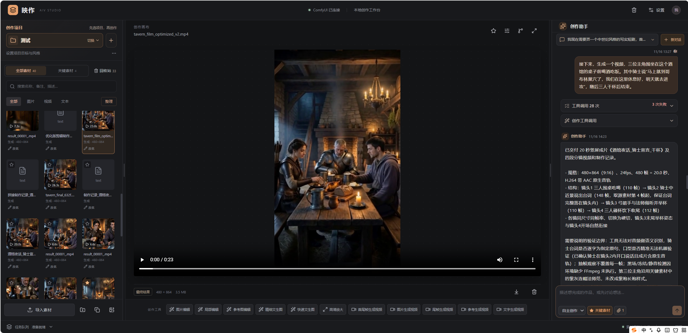

# 映作 · AIV Studio

映作是面向本机 ComfyUI 的 Windows 图像与视频创作工作台。用对话打磨一张图或一个镜头，也能把整条短片交给 Agent 制作。参考素材、生成结果和任务记录按项目保存在本机，方便接着改、找回生成参数，或在新项目里复用。

- **辅助创作**适合逐步打磨。描述想生成或修改的内容，可附上参考素材。查看和修改方案后，再确认执行。
- **自主创作**适合直接交代交付目标。Agent 可规划分镜、用已接入的 ComfyUI 工作流生成镜头，并合成短片。

[快速启动](#启动) · [生成第一张图](#生成第一张图) · [工作流列表](#已接入的工作流)

## 自主创作示例

### 酒馆夜话 · 竖屏短片

烛光下，骑士、弓箭手和法师围坐在酒馆的木桌旁。骑士提起明天的行程，三人举杯作结。下图是工作台打开最终剪辑时的画面，点击可查看成片。

[](docs/examples/tavern_film_optimized_v2.mp4)

[查看《酒馆夜话》成片（MP4，23.75 秒，480 × 864，有声）](docs/examples/tavern_film_optimized_v2.mp4)

## 启动

在 Windows 上准备 Git、Python 3.12 和 Node.js 24，先启动 ComfyUI 0.31.0 或更新版本。映作默认连接 `http://127.0.0.1:8188`。在 PowerShell 中运行以下命令。

```powershell
git clone https://github.com/Zijim/AIV-Studio.git
cd AIV-Studio
powershell -ExecutionPolicy Bypass -File .\scripts\setup.ps1
powershell -ExecutionPolicy Bypass -File .\scripts\start.ps1
```

在浏览器打开 `http://127.0.0.1:8765`。使用对话时，DeepSeek 负责理解需求、读图和规划，ComfyUI 负责本机生成。请在「设置」保存 **DeepSeek 官方 API Key**。只用底部的手动创作工具时可以跳过密钥配置。

安装完成后，再次启动只需运行 `start.ps1`，保留这个终端运行服务。按 Ctrl+C 可以安全关闭，也可以在另一个终端停止应用。

```powershell
powershell -ExecutionPolicy Bypass -File .\scripts\stop.ps1
```

默认数据目录是 `%LOCALAPPDATA%\AIVAgent\data`。可复制 `config.example.toml` 为 `config.toml` 自定义路径、端口和连接地址；不要将密钥写入配置文件。设置页内的预算与资源参数存入数据库并立即生效。切换目录时先关闭服务，保留旧目录。

也可以在仓库目录创建桌面快捷方式。

```powershell
.\scripts\create_desktop_shortcut.ps1
```

快捷方式使用配置的数据目录。需要使用指定目录时，可在创建快捷方式和调用 `stop.ps1` 时传入相同的 `-DataDirectory`。先启动 ComfyUI，再双击桌面「映作工作台」。服务就绪后会自动打开浏览器，关闭网页后服务仍在后台运行。启动日志保存在数据目录的 `logs` 中。

## 生成第一张图

底部的「快速文生图」使用 Z-Image Turbo。下载以下三个模型并放进对应目录。[ComfyUI 官方下载说明](https://docs.comfy.org/zh/tutorials/image/z-image/z-image-turbo)

| 模型文件 | 放在 `ComfyUI` 下的目录 |
| --- | --- |
| `z_image_turbo_bf16.safetensors` | `models/diffusion_models/` |
| `qwen_3_4b.safetensors` | `models/text_encoders/` |
| `ae.safetensors` | `models/vae/` |

这个工作流使用 `UNETLoader`、`CLIPLoader`、`KSampler` 等 ComfyUI 自带节点。完整的节点和模型清单见[工具定义](tool_registry/image.generate.zimage/1.0.0/manifest.json)。

1. 启动 ComfyUI 和映作，在左上角新建一个项目。
2. 在画布底部点「快速文生图」，输入「中世纪酒馆内景，烛光照亮木桌和石墙，写实电影风格」。宽高各填 768，候选数量选 1 张。
3. 保存方案，在助手中点击「确认生成」。完成后，从「任务队列」查看产物，或在项目素材库中打开它。

## 使用

### 辅助创作

1. 先在左上角“创作项目”选择本次使用的项目；点击旁边的“+”可新建项目，下方可设置创作目标和风格。
2. 导入文件、整个文件夹，或通过素材栏“导入ComfyUI既有产物”入口选择本机output目录内文件；Ctrl / Shift 点击可选择多份素材。每批文件显示独立导入结果。
3. 配置好 DeepSeek 官方 API Key 后即可发起对话。默认模型 ID 是 `deepseek-flash`，对应 DeepSeek V4.1 Flash。也可在启动服务前设置 `DEEPSEEK_API_KEY`，它优先于 Windows 凭据管理器中的密钥。
4. 选择图片并直接描述目标，助手默认自动判断素材用途；需要明确限定时可设置主体、风格、环境、构图参考或首尾帧。也可以直接粘贴当前项目图片的本工作台预览/原图链接，后台会自动附图。每轮最多6张，本轮选中或链接引用的图片会生成读图副本并发送至 DeepSeek；其他素材只提供文字信息。回复下方可展开“模型图片观察”，查看各图观察和不确定之处。
5. 输入框默认自动选择生成方式，“高级设置”中可明确限定工具；助手先判断意图和工具，再按对应指引准备方案。检查选择理由、保持项、必要补充、输入缩略图和实际视频时长；展开“完整提示词与参数”查看分节正文、复制执行提示词并核对参数。确认后点击“确认生成”。
6. 结果自动归档；打开素材详情填写备注、标记最佳候选、查看来源关系。通过跨项目素材库复用已有素材。
7. 底部“任务队列”打开任务与结果面板，可进一步展开。每项任务优先展示创作工具、版本和实际模型，再展示“输入参考 → 生成产物”缩略图；点击可预览图片或播放视频，“定位素材”在素材栏高亮并在画布打开，支持返回任务与恢复原列表。定位不改变搜索、筛选、分页、草稿和聊天附图选择。素材详情可反向打开来源任务。下方保留开始、结束时间、累计执行耗时，详情按候选/步骤展示全部素材、参数及执行证据。两步任务的中间素材单独显示，重复预览不计作额外产物，未保存或缺失文件明确标注。补存只取回已有输出；重做仍需确认新方案。

素材可通过 `/projects/<project_id>?asset=<asset_id>` 定位，任务链接使用 `?task=<task_id>`；从任务定位时附带 `from_task` 以保留返回入口。链接按ID核对归属，不按文件名匹配。模型信息来自保存的执行/提交记录，尚未提交时明确标为计划使用模型，缺少记录时明确说明。

同一项目可以开启多个独立对话：点击助手顶部“新对话”，通过对话名称旁的下拉列表切换、搜索、重命名或归档；在“已归档”中可恢复。新对话首次发送后自动命名。项目目标、风格与素材库共享，聊天记录、历史摘要、待确认方案、未发送草稿和所选附图各自独立；需要讨论其他对话的成果时，明确选择该素材或粘贴其本工作台链接。任务结果回到发起它的对话。已有聊天自动迁入“默认对话”，原始记录保留。

“改写提示词”按当前工具指引重写待确认方案，保留输入、候选数量、执行参数和种子；它会正常调用模型并计费，失败时原方案保留。需要改动作、镜头或声音时直接在对话中说明。点击“修改”可手动编辑，保存后显示“手动编辑”，不沿用先前的结构校验标记。不配置密钥时仍可使用底部手动工具。

请求视频时，助手保留最终视频目标、人物身份、动作与时长，并自动选择生成方式：纯文字使用文生视频；三视图或人物/风格/环境参考使用 Ref2VA；明确开场或结束画面时使用对应关键帧模式。参考图的排版、底色和静止姿势不自动约束视频场景，参考图比例也不决定成片比例。普通流程不再出现“直接尝试视频 / 先准备首帧”的技术路线选择。

通常直接生成视频。只有目标确实需要新建特定开场时，助手才为图片准备和视频生成分别编写提示词，组成一个任务；一次确认后，在起始画面完整保存成功后自动续接视频。中间图片不算视频交付。任务支持取消、重启恢复、补存和从未完成步骤重试，视频步骤失败时复用已保存的起始画面；不会自动循环重生成。整项两步方案通过对话修改，避免只改一半。旧版本已确认的单步方案保留原来的执行范围。

校验失败会显示发生阶段和具体原因；没有旧草案时不再提示“原草案已保留”。当前修复支持有真实附图依据的场景观察，只规范化已知的空镜头备注；未知字段、非空多余字段和非法执行参数仍会失败。

视频方案展示场景、接触面、动作起始、主要变化和结束状态；固定机位仍应表现主体动作。场景和道具未指定时，助手可给出贴合目标的建议，放入方案供修改。参考模式不检查素材是否具有目标地面或起始姿态；关键帧模式的衔接风险在方案中说明，不要求用户选择技术路径。

保持项和禁止项需要真实用户或项目原文依据；图片观察、助手补充与用户要求分别记录。项目没有填写的限制不能由助手虚构。上述检查用于约束规划和提示词，实际画质与动作仍需生成后检查；历史方案不会自动重写，手动修改后“原镜头设计”仅供核对。

ComfyUI 中已有外部任务时，本应用等待其队列清空。候选串行运行，保留每个候选的执行、种子与产物。应用关闭不会停止已被 ComfyUI 受理的任务，下次启动通过 prompt ID 查询历史与队列；证据丢失时显示结果未知，不自动重复提交。

累计执行耗时按各候选或步骤的生成时间相加，不包含排队、素材准备及保存结果。优先使用 ComfyUI 历史中的实际起止时间，已有历史也可直接展示；只有本机观测时间时标注“约”，缺失或无法确认的记录会明确说明。运行中的耗时每秒更新，任务详情每5秒刷新，并响应状态事件。

素材“移除”和项目“移除”都可以恢复，归档项目可以查看、搜索和复用。永久文件清理是设置页中的独立操作，先显示受影响素材与可释放大小，确认时再次核查引用。备份采用 SQLite backup API，包含原文件、工具版本和执行记录；恢复校验后写入独立目录，通过配置切换启用。密钥不进入备份。

## 已接入的工作流

| 工具 | 本机工作流 | 使用方式 |
| --- | --- | --- |
| 快速文生图 | 基础文生图.json | Z-Image Turbo，1–4候选 |
| 精细文生图 | 文生图qwen.json | Qwen Image，快速或质量 |
| 图片编辑 | 图片编辑.json | 单图快速编辑 |
| 参考图编辑 | 图片编辑qwen.json | 原图与参考图，Lightning 4步；新方案默认使用1.1.0，历史1.0.0保留40步 |
| 局部编辑 | [局部编辑工作流](tool_registry/image.edit.qwen.local/1.0.0/source.workflow.json) | 原图与矩形选区，Lightning 4步遮罩补绘，按原图尺寸保存 |
| 高清放大 | 图像高清放大.json | SeedVR2，检查实际最长边 |
| 图片生成视频 | video_minimax_h3_i2v.json | FL2VA 权重，整张图片作为开场 |
| 文字生成视频 | MiniMax_H3.json | FL2VA 权重，无图片输入 |
| 参考生成视频 | MiniMax_H3_Ref2VA.json | Ref2VA 权重，1–9张人物/风格/环境/构图参考图 |
| 首尾帧生成视频 | video_minimax_h3_i2v.json 的关键帧节点 | FL2VA 权重，开场与结束双锚点 |
| 尾帧生成视频 | video_minimax_h3_i2v.json 的关键帧节点 | FL2VA 权重，只约束结束画面 |

自主创作还可调用内置的抽帧和视频合成工具，提取可复用的画面，或按分镜顺序拼接已生成的镜头。

应用使用 `tool_registry` 中固定版本的 API 模板，不会修改原始工作流。`scripts/prepare_tools.py` 是开发时的导入工具，运行应用不需要 comfy-cli。

发布新工具版本时保留已注册的旧版本目录；运行时仅加载与应用内定义一致的版本，备份中的额外工具定义不会自动成为可调用工具。

## 开发

后端：FastAPI / Pydantic 2 / SQLAlchemy async / SQLite WAL / Alembic / HTTPX / websockets / Pillow / PyAV / keyring。前端：React 19 / TypeScript / Vite / Tailwind 4 / Radix / TanStack Query / Zustand / React Router / React Hook Form / Zod / React Flow。依赖分别锁定在 `backend/requirements.lock` 和 `frontend/package-lock.json`。

```powershell
$env:AIV_DATA_DIR = "$PWD\.data\dev"
$env:PYTHONPATH = "$PWD\backend"
.\.venv\Scripts\python.exe -m uvicorn app.main:app --host 127.0.0.1 --port 8765
# 在另一个终端
cd frontend
npm.cmd run dev
```

Vite 端口5173代理 `/api` 到后端。生产界面使用 `npm.cmd run build` 构建后由后端同源提供。后端只运行一个 worker，应用目录有进程锁。配置与数据库迁移在启动时完成，迁移前备份已有数据库。

本地 API 文档：`http://127.0.0.1:8765/docs`。写接口需要先 GET `/api/v1/session`，保留会话 cookie，设置同源 `Origin` 和响应中的 `X-AIV-CSRF`。服务仍绑定回环地址，可通过下面的分享模式连接公网隧道。

## 公开共享体验

在 `config.toml` 的 `[sharing]` 设置 `public_origin = "https://studio.zijim.xyz"` 后，可通过本机 Cloudflare Tunnel 发布无需登录的共享工作台。所有访客共用当前数据目录的项目、素材、对话、任务队列及模型总预算。管理入口仍使用 `http://127.0.0.1:8765`；公网禁止访问设置、密钥、备份、永久清理、关停、诊断及本机 ComfyUI 输出浏览接口，含兼容别名。公网与本机会话/CSRF分离，公网 Cookie 仅通过 HTTPS 发送；公网精确校验 Host 和 Origin。

共享上传按90MiB请求总大小分批，前后端均限制，流式请求也受限制；每个公网来源默认每分钟最多30次写请求。现有每日/每轮模型预算和最大排队数继续生效。本站并非个人私密空间，请仅分享准备公开的资料。

素材列表使用最长边320px的WebP缩略图，已有素材也会自动生成；画布、全屏及任务图片预览先显示缩略图，再切换至原图。原图加载失败时保留预览并提供重试。原始文件及保存的PNG预览保持原样。媒体响应允许浏览器保存副本，但每次复用前通过ETag校验；未改变的文件返回304，永久清理后不再认可缓存，并同步移除派生缩略图。项目、会话等其他API响应仍不缓存。此优化不启用Cloudflare边缘媒体缓存。

隧道 `studio` 路由应显式设置 `originRequest.httpHostHeader: studio.zijim.xyz`，将公网请求固定送入分享权限。配置及 DNS 就绪后运行 `powershell -ExecutionPolicy Bypass -File scripts/start_public.ps1` 在后台启动应用和现有 `mediagent` 隧道；重复运行会复用已有进程。电脑需保持联网，ComfyUI仍需运行。取消分享时，删除本地隧道中的 `studio` 路由并重启隧道，或清空 `public_origin` 并重启应用。

上下文使用随应用固定版本发布的 DeepSeek V4.1 Flash 官方分词器计数，并为供应商封装差异预留5%和512 tokens。每个对话独立使用默认128K输入、8K输出预算；达到96K时将较早对话整理成持久摘要，按token预算保留约24K的近期完整消息，不再按12条/2000字符截断。原始消息、摘要边界和每轮上下文快照保存在本机；每个对话独立整理，后续只处理摘要边界之后的新消息。界面可以加载更早消息，不受首屏条数限制。每日费用预算仍由整个工作台共用。

费用按2026-10-11核实的高峰单价估算，实际费用以 DeepSeek 官方账单为准。默认每日预算$0.50、每轮$0.15；普通创作通常进行一次工具路由和一次专用生成，整轮共用一次必要修复额度，普通任务非摘要请求最多3次；必要的两步视频任务多一次独立的视频提示词编写，最多4次，仍共用一次修复额度。已有引导方案的纯提示词改写可直接进入专用生成。较早历史按最多64K输入分批整理，每轮至多4个整理请求，所有阶段共用回合/每日费用预算。模型网络或认证错误不自动重试，未知用量继续占用预留预算。预算或整理失败时保留原始记录并明确报告，不静默丢弃历史。

读图使用原图生成内存中的 JPEG 副本：校正 EXIF 方向、最长边默认1536、不放大、透明区域按白底显示、动画仅取第一帧，原文件及 ComfyUI 输入不变；超过5000万像素或原文件缺失时明确报错。`vision_max_images`（默认6，上限12）和 `vision_max_edge`（默认1536，范围512–2048）可在 `[llm]` 配置中调整，重启生效。

链接入口支持本工作台 `127.0.0.1` / `localhost` 地址或相对路径的 `/api/v1/assets/<id>/preview`、`/content`。后台从本地素材库读取像素，不要求云端模型访问本机网址；链接素材必须属于当前项目且未移除，跨项目需先复用。选择与链接引用会去重，共用图片数量和费用预算；不会扫描旧消息自动附图，也不下载任意外部网址。

图片按[DeepSeek 官方视觉文档](https://api-docs.deepseek.com/guides/vision/)的每图最多1024 tokens预留，与文字共同受128K输入和费用限额约束；不会把base64当作文字分词。图片二进制只用于当轮请求，不重复写入调用日志；上下文和消息保存素材/原文件hash、发送尺寸、用途和模型观察，供后续对话及摘要延续。观察与用户要求、素材原有生成提示词分别保存。

主体参考通过 Ref2VA 的参考条件输入，关键帧通过 FL2VA 的首尾帧条件输入，两个权重不能混用。当前 Ref2VA 执行入口仅支持参考图片，不接入视频、音频参考或视频编辑；视频均为24fps并按17k+5帧对齐。应用尚未自动读取连续帧或验收生成质量，结构校验和工作流预检不代表成片质量保证。

详细的开发验证见 [DEVELOPMENT.md](DEVELOPMENT.md) 和[自主创作实现与验证](docs/creative-agent-implementation.md)。

辅助创作的工具选择与专用提示词生成按 [AGENT_OPTIMIZATION_SPEC.md](AGENT_OPTIMIZATION_SPEC.md) 的 v2 补充规格接入。工具各有固定版本的写作指引，五种视频模式分别绑定用户提供的 FL2VA/Ref2VA 资料适配版。默认固定单镜头、自然声音、无配乐，用户明确要求优先。`prompt_guides/` 按工具版本和模式绑定并校验 hash，方案及执行记录保存实际使用的指引来源。旧工具模板和历史指引快照不原地修改。
