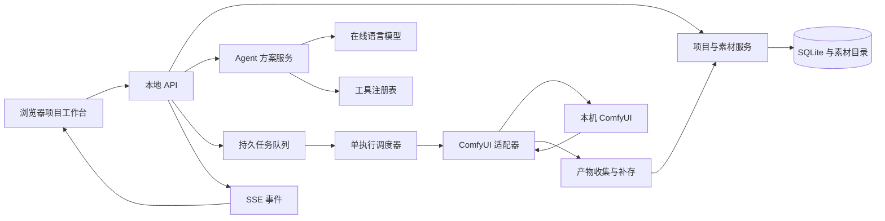

# 个人创作助手与项目素材库：设计与实现规格

版本：1.1  
日期：2026-10-11  
状态：作为首版实现依据；不要求继续环境调研后才开始开发。

本文以[项目任务说明](项目任务说明.md)为产品依据，采用现有本机 ComfyUI 和已准备工作流。技术选型、默认行为和实现边界在本文确定。测试用例与测试执行计划后续另行编写。

文中“必须”表示产品或数据完整性要求；“默认”表示首版初始值，可通过明确的设置修改。初始限制是设计值，不是本机性能保证。既有调研仅作为接口和参数映射依据。

## 1. 产品目标与范围

提供通过 Windows 本机浏览器使用的个人创作工作台，完成：创建项目 → 中文表达诉求 → 查看/调整方案 → 执行工作流 → 查看结果 → 保存并引用素材 → 根据反馈继续创作。

首版完整覆盖：

- 项目目标、风格、归档与恢复；项目内对话和任务历史。
- 中文助手准备创作方案，手动工具提供同等执行入口。
- 文字生成图片、图片编辑、图片放大、图片生成视频。
- 全局串行生成、可见进度、定向取消、用户主动重试。
- 导入与自动保存，管理图片、视频、音频、文本及可获取中间产物。
- 候选分组和用户最佳标记；描述/备注搜索；输入与输出来源追溯。
- 跨项目复用，可恢复移除，单独的永久文件清理。
- 中断核实、结果补存、文件缺失标记、资源和模型费用限制。

首版不实现自动评分/选图、无人反馈连续创作、自动改造或接入任意工作流、视频剪辑与成片制作、看图评价、语音交互、跨会话风格学习、向量语义搜索、多人账号、云同步和公开分享。

助手每轮完成当前交付后停止。旧素材永不被编辑、放大或重新生成覆盖。素材管理、手动执行不依赖语言模型服务可用。

## 2. 技术选型

### 2.1 固定技术栈

| 层 | 选型 | 用途与理由 |
| --- | --- | --- |
| 运行方式 | Windows 本地服务 + 浏览器 SPA | 与既有使用前提一致；发布时由后台同时提供前端静态资源 |
| 前端 | React 19、TypeScript、Vite | 项目工作台与媒体交互；前后端分别开发，生产同源部署 |
| 界面 | Tailwind CSS 4、shadcn/ui、Lucide | 统一组件与图标；界面文案以中文为主 |
| 前端数据 | TanStack Query 5 | API 缓存、分页与状态刷新 |
| 前端临时状态 | Zustand 5 | 当前选择、面板、未提交表单；服务端数据不在此重复维护 |
| 前端路由/表单 | React Router 7、React Hook Form、Zod 4 | 页面导航与类型化参数编辑 |
| 来源关系图 | @xyflow/react 12 | 只读、局部来源图，支持节点跳转；不提供工作流节点编辑 |
| 后台语言 | Python 3.12 | 本机已有独立 Python；图片、视频、文件处理方便，不复用 ComfyUI 内置环境 |
| Web API | FastAPI、Pydantic 2、Uvicorn | HTTP API、输入校验、OpenAPI、异步连接 |
| 数据库 | SQLite + SQLAlchemy 2 + aiosqlite + Alembic | 单用户本地持久记录、事务与结构迁移 |
| 搜索 | SQLite FTS5 trigram + 参数化 LIKE | 基于已保存文本搜索，支持中文短关键词回退 |
| 任务执行 | SQLite 持久队列 + 单进程 asyncio 调度器 | 一次一个生成执行；关闭应用后可恢复记录，无额外队列服务 |
| ComfyUI 连接 | httpx.AsyncClient + websockets | 直接 HTTP/WebSocket 接口；运行时不依赖 MCP/comfy-cli |
| 浏览器事件 | SSE（EventSource）+ REST | 实时任务/素材状态与断线补齐；用户操作通过 REST |
| 语言模型 | DeepSeek 官方 Responses API + OpenAI Python SDK（兼容客户端） | 使用 DeepSeek 官方 API Key 与官方地址；结构化输出，独立于图像生成层 |
| 默认模型 | DeepSeek V4.1 Flash，API ID为deepseek-flash | 主要使用模型；默认 reasoning=low，模型 ID 可配置 |
| 图片处理 | Pillow | 格式探测、尺寸、缩略图及必要的工作流输入副本 |
| 视频/音频信息 | PyAV | 流信息、时长、封面帧；原文件保留 |
| 密钥 | Python keyring，Windows Credential Manager | 设置页录入供应商密钥，前端仅获是否已配置；环境变量可用于开发 |
| 配置/日志 | Pydantic Settings + TOML；Python logging 的 JSON 日志 | 配置校验、脱敏诊断，不记录密钥或原始认证头 |
| 开发工具 | Node.js 24 LTS、npm；Python venv + pip-tools；Ruff | 使用本机已有 Node 24/Python 3.12，分别锁定依赖 |

JS 精确版本写入 package-lock.json；Python 精确版本及 hash 写入 requirements.lock。表中的主版本是实现基线，后续升级显式修改并记录，不在每次启动时安装 latest。

选用本地单体服务，不引入 Redis、Celery、Docker、向量数据库或微服务。agent 采用应用内的显式控制流程，不引入 LangChain/LangGraph 或多 agent 调度。当前任务是有限的“准备一个工具操作”，其状态由本产品管理。

React/Vite 的选择与本机 Node 24 相容，构建要求见 [Vite 官方说明](https://vite.dev/guide/)。后台调度器在 FastAPI [lifespan](https://fastapi.tiangolo.com/advanced/events/) 中启动/关闭，持久队列为数据库记录，不能把长任务仅交给请求级 BackgroundTasks。

### 2.2 语言模型选型与适配边界

默认供应商为 DeepSeek 官方，使用其官方 API Key，`base_url=https://api.deepseek.com`，API模型ID为 `deepseek-flash`，对应当前 DeepSeek V4.1 Flash。不得自行构造 `deepseek-v4.1-flash` 等未列出的ID，也不默认使用代理或其他供应商服务。[官方模型与价格](https://api-docs.deepseek.com/quick_start/pricing/)

通过 `AsyncOpenAI(api_key=deepseek_key, base_url=deepseek_base_url, max_retries=0)` 作为兼容HTTP客户端，调用 `client.responses.create`。`text.format` 使用 `type=json_schema`、schema名称与 Pydantic 生成的JSON Schema；返回内容再经 `PlannerResult.model_validate_json` 和后台语义校验。SDK名称不改变供应商，请求只发往配置的DeepSeek官方地址；不要求OpenAI API Key。[DeepSeek Responses调用与兼容说明](https://api-docs.deepseek.com/guides/responses_api/)、[请求字段](https://api-docs.deepseek.com/api/create-response/)

默认请求参数：`reasoning.effort=low`、`max_output_tokens=4096`、60 秒客户端超时。仅发送DeepSeek明确支持的字段；不发送`store`、`previous_response_id`、`conversation`、`background`等不支持的状态管理参数。DeepSeek Responses是无状态接口，每次发送本地组织的必要历史。只发送本产品准备的文本上下文，不启用供应商在线搜索、代码执行或远程MCP，首版不上传图片/视频给语言模型。

`deepseek-flash` 是官方模型别名，不能按固定快照保证后端版本不变。每次调用保存请求模型ID、响应model、当时文档标注的模型版本与记录时间，以及供应商返回的可得版本信息；官方更新别名指向后记录变化，不自动声称仍是同一快照。

SDK 自动重试关闭（`max_retries=0`）。每个用户回合最多两次计费模型请求：一次准备方案，一次必要的结构/参数修正；修正不得改变用户目标或消除需要用户回答的歧义。鉴权失败、拒绝、超时、未知计费状态不自动重复调用。模型不可用时返回明确状态，手动入口保持可用。

定义 `PlannerProvider.plan(context, tool_schemas, budget) -> PlannerResult`，以及标准化的 usage、provider_request_id、错误与能力信息。首版交付 `deepseek_official_responses` 适配器；其他供应商后续通过此接口增加，不假定所有“OpenAI兼容”服务支持相同参数。设置页默认密钥名称为“DeepSeek官方API Key”，开发环境变量为 `DEEPSEEK_API_KEY`；后台显式传入密钥，不回退读取 `OPENAI_API_KEY`。没有密钥时只禁用助手功能，不阻塞项目/素材/手动创作。

## 3. 部署与目录

### 3.1 服务方式

- 应用监听 `127.0.0.1:8765`，浏览器访问此地址；默认不开放局域网。
- ComfyUI 默认地址 `http://127.0.0.1:8188`，用户自行启动；本产品不自动安装、重启或升级它。
- Uvicorn 固定 `workers=1`。启动时通过数据目录的 Windows 文件锁阻止第二个实例操作同一数据目录；端口占用时清晰退出。
- API、SSE、静态页面和素材预览同源。开发模式 Vite 代理 `/api` 到后台。
- 前端关闭不停止后台已提交任务。关闭后台不默认取消 ComfyUI 任务，先提交本地状态并关闭连接；下次启动核实状态。
- 发布模式需要 Python 应用环境与已构建静态资源；Node/npm 仅用于开发和构建。

提供 `setup.ps1`、`start.ps1`、`stop.ps1` 和配置示例。启动脚本使用项目 `.venv`，日志保存在应用日志目录；不得激活或修改 ComfyUI 的 Python 环境。

### 3.2 代码组织

```text
AIV_Agent2/
  SPEC.md
  backend/
    app/
      api/                 # REST、SSE、媒体访问
      domain/              # 项目、计划、任务、素材、预算规则
      services/            # 用例流程与事务边界
      agent/               # 上下文、planner、提示词、输出协议
      adapters/comfyui/     # HTTP、WS、协议校验、结果引用
      adapters/llm/         # DeepSeek official Responses provider
      storage/             # 数据库、素材文件、迁移、补存
      worker/              # 持久队列、核实、产物收集
      schemas/             # Pydantic API/工具模型
    migrations/
    requirements.in
    requirements.lock
  frontend/
    src/features/          # projects、workspace、assets、tasks、settings
    src/components/
    package.json
    package-lock.json
  tool_registry/
    <tool_id>/<version>/
      manifest.json
      workflow.api.json
      source.workflow.json
      preparation.json
  scripts/
  config.example.toml
```

### 3.3 数据目录

首次启动默认数据目录为 `%LOCALAPPDATA%\AIVAgent\data`，设置界面允许在初始化时选择其他本地磁盘目录。保存为配置中的绝对路径。长期运行后的迁移是显式操作，需要停止执行并复制/核实数据，不能只改路径导致旧资产消失。

```text
data/
  app.sqlite3               # 元数据和持久队列
  app.sqlite3-wal / -shm     # SQLite 自行管理
  blobs/<sha前2位>/<sha>     # 不可变原始文件，扩展名/媒体类型存数据库
  staging/                  # 未完成复制，位于同一磁盘
  previews/                 # 可重新生成的缩略图与封面
  executions/<execution_id>/ # 实际请求、参数、事件及结果 manifest
  registry/                 # 已接入工具的不可变版本副本
  logs/
  backups/
```

原件按全局内容存储，项目通过引用关联，不要求每个项目复制一份物理文件。项目导出时再生成易读的目录和 manifest。路径只由后台生成，用户输入和模型输出不得成为绝对写入路径。

## 4. 模块职责与架构



| 模块 | 必须承担的职责 |
| --- | --- |
| 工作台 | 表达目标、编辑方案、显示选择/结果/状态，用户执行与取消 |
| Agent 服务 | 准备本轮结构化操作、澄清、限制说明、参数变化理由 |
| 工具注册表 | 固定模板、输入/参数白名单、预设、输出角色、版本 |
| 执行服务 | 校验计划、确认快照、任务入队、防止重复点击、预算检查 |
| 调度器 | 全局串行、外部任务观察、提交核实、超时与取消协调 |
| ComfyUI 适配器 | 上传、提交、查询、监听、定向取消、下载结果 |
| 素材服务 | 内容保存、项目引用、候选、搜索、来源、移除与清理 |
| 恢复服务 | 启动核实、保存补齐、缺失标记、异常记录 |

前端不直接连接 ComfyUI，不接触供应商密钥。agent 不直接拥有生成、文件写入、删除、任意 HTTP 或 shell 权限；其“工具调用能力”通过受校验的计划落实。

## 5. 工作台与交互

### 5.1 页面

项目列表支持创建、修改目标/风格、搜索、归档与解除归档。项目工作台采用三块可调整区域：左侧项目素材，中央结果画布，右侧对话/方案；底部任务抽屉显示队列与执行记录。小窗口允许切换区域，仍保留当前任务提示。

全局设置包含 ComfyUI 连接、模型服务/密钥状态、数据目录、资源与费用限制、工具可用性和诊断。设置修改影响未来请求，已提交任务保存当时配置快照。

### 5.2 一轮创作

1. 输入中文诉求；可显式选中素材。
2. 助手返回方案卡片，显示工具/预设、输入缩略图、描述、实际尺寸/时长、种子策略、候选数量、重要参数变化和限制。
3. 用户调整或点击“执行”。参数修改由后台生成新的方案版本；不需要再次调用模型才能执行合法的手动修改。
4. 入队后显示等待、执行节点/采样、保存和结果。对话与素材浏览保持可用。
5. 成果进入对话和项目素材区，显示候选、实际参数与来源；旧结果保留。
6. 回合结束，等待下一条用户反馈，不自动再生成。

手动工具表单使用相同工具 schema、方案校验和执行路径；不经过模型。批量候选中的“最佳”由用户指定，改变标记不删除其他候选、不自动成为所有后续操作的输入。

### 5.3 忙碌、归档与选择

同一项目最多一个正在准备/执行/保存的助手回合。此时新创作诉求返回 busy，显示等待或取消，保留未发送草稿；不得把它记成已受理的创作请求。仍允许浏览、备注、标记和明确的手动工具排队。尚未执行的 awaiting_execution 方案允许用户继续用中文修改，修改关联原回合并产生新方案版本；明确开启其他目标时放弃旧草案再创建回合，不静默执行旧草案。needs_clarification 状态的回答关联原回合。

不同项目和手动任务共用全局队列。归档保留浏览、搜索、素材复用；归档项目不能提交新创作，须先解除归档。当前有活动任务时不允许归档该项目。

方案输入在准备时已固定。切换页面选择不会静默替换方案输入；用户可点击“使用当前选择”生成新版本。项目目标/风格改变后，旧的未执行方案标记 stale，需要更新或由用户明确采用旧背景快照，执行记录保存其选择。

## 6. Agent 协议与上下文

### 6.1 控制流程

单个 agent 服务，应用内显式流程：`接收诉求 → 构建上下文 → 调用 planner → 校验 → 展示方案/澄清 → 用户执行 → 后台交付 → 完成本轮`。

每轮最多准备一个工具操作。候选数量属于该操作的参数，可由后台展开为多个串行执行；不允许 agent 构造“生成后自动编辑、放大、做视频”的长链。用户明确提出多步诉求时，展示当前第一步及剩余意图，交付后等待用户推进。

持久 `agent_turn` 状态：`planning / needs_clarification / awaiting_execution / executing / completed / failed / abandoned`。`completed` 表示已交付当前步骤并等待反馈，不表示助手判断作品满意。澄清回答关联原 turn；完整创作任务入队后 turn 保持 executing，直到交付或明确报告异常。

### 6.2 上下文

后台创建不可变 context snapshot，包括当前项目目标/风格及 revision、当前用户诉求、明确选择、可用工具、相关素材身份/类型/尺寸/备注、最近完成任务的实际输入/参数和近期对话。

近期对话默认最多 20 条；相关素材最多 30 个，不向模型发送完整素材库。直接关联上一次执行和用户明确指定素材，不因裁剪对话丢失这些事实。超出输入预算时按相关性裁剪普通历史，必要事实不能省略；仍超限则提示用户缩短输入。

不依赖云端 conversation 作为唯一历史，不使用未落盘的 previous_response_id 维护项目上下文。对话、计划、执行与素材身份由本地数据库保存。

引用规则：明确指定资产/本轮明确指代优先；“选中的这张”要求当前选择唯一；“刚才那张/上一步”要求当前项目有唯一、已交付且相关的结果。最佳标记仅在用户明确提及或其明确选择时使用；多候选不能任意选第一张。跨项目引用必须先由用户明确复用到当前项目或明确指定可访问资产。缺失、移除或歧义返回澄清。

### 6.3 结构化输出

`PlannerResult.kind` 取 `propose / clarify / explain`。严格 schema、禁止额外字段；可空字段用 null 表达。propose 使用按工具固定字段的类型模型，禁止任意键值参数字典进入严格 LLM schema。模型只返回建议，计划 ID、版本、哈希、项目 ID、预算和真实 seed 由后台补齐。

以下为后台规范化后的方案示例，具体资产 ID 为示意：

```json
{
  "plan_id": "<uuid>",
  "revision": 1,
  "project_id": "<uuid>",
  "context_snapshot_id": "<uuid>",
  "tool_id": "image.edit.qwen.fast",
  "tool_version": "1.0.0",
  "inputs": [{"slot": "source_image", "asset_id": "<uuid>"}],
  "parameters": {
    "instruction": "调亮建筑和行人的暗部，保留夜景和霓虹倒影",
    "negative_prompt": "",
    "output_width": 1024,
    "output_height": 1024,
    "seed": 20261011
  },
  "candidate_count": 1,
  "change_summary": "以已选素材为输入，调整编辑指令；其他可保留设置沿用",
  "based_on_execution_id": "<uuid-or-null>",
  "plan_hash": "<sha256>"
}
```

后台校验工具存在/可用、参数类型/范围、输入槽位/类型/可访问性、项目状态、文件完整性、资源边界及版本。结构正确不代表语义正确；错误引用、未知能力和不符合上下文的方案不能自动执行。

用户确认提交 `plan_id + revision + plan_hash + idempotency_key`。后台冻结该版本的实际请求；计划修改不改变已入队任务。重复确认相同 key 返回原 task，不产生新任务；一个 plan revision 首次执行后消费，重做通过明确的 retry/rerun 操作产生新计划与新任务。

### 6.4 反馈和随机条件

编辑反馈优先引用明确选中的结果，保持可保持的输入、比例和预设；重要变化进入 change_summary，并保存机器可计算的参数 diff。模型的理由不替代实际执行记录。

同工具同用途的反馈迭代，默认沿用上次 seed；用户要求新候选时生成并记录新 seed。跨工具不宣称 seed 具有相同视觉意义。模型不得自行改变已冻结 seed；随机 seed 由后台在方案展示前生成，范围由工具定义。

多候选默认 count=1，允许 1–4；每个候选保存具体 seed 和 candidate_index。可用后台确定的连续种子（在合法范围内）或用户提供的合法列表；规则和全部实际值显示于方案/执行记录。

## 7. 工具注册表与首批工作流

### 7.1 注册格式

每个工具版本包含：`tool_id / version / display_name / capability / local_only / input_schema / parameter_schema / presets / bindings / output_roles / constraints / source_hash / template_hash / required_node_types / required_models / preparation_changes`。

manifest 的 bindings 由实现者编写，映射产品参数到固定模板的 `node_id.inputs.field`。助手只看到输入、参数、用途与限制，不获得任意 node_id、文件路径、模型名称或连线编辑权限。工具版本一经引用不可覆盖；修改生成新版本，旧模板保留用于查阅与复用。

接入脚本可使用 comfy-cli 1.20.0 转换 UI 工作流/展开子工作流一次，也可使用 ComfyUI 的 API 导出；固定 API JSON 随应用保存。必须人工核对 muted/bypass、连接覆盖、真实输入、所有输出节点和类型。转换器不是产品运行依赖，日常不重新解释任意 UI 图。

启动和执行前读取 object_info，校验所需节点与模型枚举、输入类型；以 manifest 的固定可用能力为准。环境变化导致不兼容时将相关工具标记 unavailable 并显示原因，保留素材功能。首版运行基线为当前 ComfyUI 0.31.0；缺少原子定向取消等必需接口的其他版本显示不兼容，不静默退回全局 interrupt。

### 7.2 工具列表与默认值

| 工具 ID | 基础来源 | 输入与开放参数 | 初始预设 |
| --- | --- | --- | --- |
| image.generate.zimage | 基础文生图.json | prompt、negative_prompt、width、height、seed、candidate_count | 默认文生图；1024×1024，9 步，CFG 0.8，euler/simple |
| image.generate.qwen | 文生图qwen.json | prompt、negative_prompt、width、height、preset、seed、candidate_count | fast：1024×1024、Lightning 4 步/CFG 1；quality：1328×1328、50 步/CFG 4 |
| image.edit.qwen.fast | 图片编辑.json | 一张 source_image、instruction、negative_prompt、输出尺寸、seed | Lightning 4 步/CFG 1；按源图比例计算输出，最长边默认不超过 1280 |
| image.edit.qwen.reference | 图片编辑qwen.json | source_image + reference_image，两张必需；instruction、negative_prompt、seed | 现有质量分支 40 步/CFG 4；输入主图最长边 1280；第三参考图不开放 |
| image.upscale.seedvr2 | 图像高清放大.json | source_image、scale 或 target_short_edge、seed | 3B FP8，默认两倍；保留现有 offload/block swap/分块设置 |
| video.generate.minimax_i2v | video_minimax_h3_i2v.json | source_image、prompt、宽高/比例、duration_seconds、seed | 默认目标 0.4 MP、跟随输入比例、请求 5 秒、20 步、24fps |

最先交付四类入口的默认工具；Qwen 文生图和参考图编辑作为同一注册机制中的明确变体。自动文生图默认 Z-Image；用户明确选定工具/质量预设时优先采用其选择。提示词中的目标效果是创作请求，不是模型效果保证。

采样器、scheduler、模型、编码器、VAE、LoRA 与关键资源设置固定在预设内。首版不向助手开放任意采样参数组合。手动界面同样受注册 schema 限制；高级设置只能调整工具显式开放的项。

初始应用边界：生成图片单边 512–1536、面积 ≤1.8 MP，尺寸按工具所需倍数对齐（Qwen 16，其余默认 32）；编辑最长边 ≤1280；放大最长边默认 ≤3072、倍率 1–4；视频宽高按 32 对齐、面积 ≤0.6 MP、最多 243 帧。用户可在资源设置中明确改变上限，仍受节点 schema 限制。

### 7.3 参数映射与准备修正

以下 node_id 为当前来源工作流，经固定版本准备后记录在 manifest；不是任意未来文件的通用 ID。

| 工具 | 关键 API 映射 |
| --- | --- |
| Z-Image | 3.text、4.text；5.width/height/batch_size；1.seed；12.filename_prefix |
| Qwen 文生图 | 4.text、5.text；6.width/height；11.value 预设开关；18.seed；21.filename_prefix |
| Qwen 单图编辑 | 7.image；3.prompt、4.prompt；13.width/height；1.seed；16.filename_prefix |
| Qwen 参考编辑 | 7.image、8.image；3.prompt、4.prompt；18.largest_size；22.seed；24.filename_prefix |
| SeedVR2 | 1.image；5.resolution、5.max_resolution、5.seed；6.filename_prefix |
| MiniMax 子工作流展开后 | 114.image；105:104.prompt/width/height；105:111.value 秒数；105:15.noise_seed；105:9.steps；92.filename_prefix |

准备必须包含：

- Qwen 文生图的两个提示词由嵌套 widget 值规范化为真实字符串。快档映射 11.value=true，质量档 false；实际步数/CFG来自开关连线，不能只改 18 的 widget。
- 单图编辑保留当前快速分支；固定 latent 尺寸转为已声明的 width/height 绑定。主图尺寸由后台计算，不误用未参与执行的 18/19 节点。
- 参考图编辑保留现有质量分支，强制要求第二输入；不得只凭“可选”标题遗漏其文件输入。
- MiniMax 在接入副本中把最终 width/height 准备成开放常量输入，取代只适合 UI 的 ResolutionSelector 连线；核心采样/模型/首帧/音频链保留。该准备变化记录并版本化，日常只填常量值。
- 输出前缀统一由后台写为 `AIVAgent/<execution_id>/result`，不得覆盖原产物。

### 7.4 尺寸、倍率和时长

图片编辑按主图实际宽高计算，默认保留比例；为 latent 对齐产生的小幅尺寸差异显示为实际计划尺寸。需要缩小到最长边 1280 时先在方案说明。不得把 512 试跑尺寸作为所有编辑任务的默认输出。

SeedVR2 的 resolution 为短边像素，不是倍率。后台把倍率转换为目标短边和长边；若触及最大边限制，方案显示实际预期倍率并要求用户采用降低后的值或明确修改资源上限，不静默声称完成指定倍率。

视频按输入比例和目标面积计算宽高：以 `sqrt(target_pixels / input_pixels)` 缩放，再各轴对齐到 32。默认 MP 采用 `1 MP = 1024×1024`。若改变比例，首版仅提供明确的 stretch 选项，方案显示会拉伸；不宣称现有 first_frame 自动裁切。保留比例产生的对齐偏差一并显示。

MiniMax 帧数：`n=max(5, round(requested_seconds×24))`，再向上对齐到 `17k+5`。应用保存 requested_seconds、resolved_frames、resolved_seconds；1 秒为 39 帧/1.625 秒，5 秒为 124 帧/约5.167秒。预算按对齐后帧数检查。实际媒体探测结果与预期不符时显示差异，不修改历史数值掩盖它。

### 7.5 输出角色

每个输出节点在注册表中指定 final、intermediate 或 preview，并声明是否必需；每个成功候选必须至少有一个可读取的必需final。必需输出未出现也属于交付缺失，不能仅因success事件而显示完整完成。导入资产另为 imported，可在项目中标为 reference。temp/output 是 ComfyUI 存储位置，不决定创作角色。

本机末端 PreviewImage 与 SaveImage 的 PNG 可能字节不同而像素相同。收集后，在同一 execution 内、注册为对应末端预览的两项经像素指纹确认一致时，将预览关联为最终资产的表示，不在默认素材网格中显示成额外版本。真正的 intermediate 独立保存、展示、可作为输入。

不能生成工作流未实际输出或不可读取的中间素材。动态采样二进制预览用于进度画面，不默认纳入长期素材库；注册为输出节点的中间结果必须收集。

## 8. ComfyUI 调用协议

### 8.1 本机连接

默认目标为本机回环地址。配置改变目标需显式保存并重新核查工具可用性，首版支持范围仍是本机。当前路径只用于工具准备/用户主动导入历史产物，运行结果通过 ComfyUI 接口读取。

| 动作 | 接口 | 产品使用 |
| --- | --- | --- |
| 健康/资源 | GET /system_stats | 版本、RAM/VRAM观察 |
| 节点能力 | GET /object_info | 输入/schema/模型枚举，按环境缓存 |
| 上传图片 | POST /upload/image | multipart，专属子目录，overwrite=false |
| 提交 | POST /prompt | 固定 API prompt、预先生成的 prompt_id、client_id、任务元数据 |
| 实时执行 | WS /ws?clientId=... | executing、progress、executed、success/error/interrupted |
| 实时队列 | GET /queue | 当前执行与等待，包含其他来源任务 |
| 执行历史 | GET /history/{prompt_id} | 终态、实际执行 prompt、产物引用 |
| 标准任务查询 | GET /api/jobs/{prompt_id} | 当前版本的任务状态辅助查询 |
| 定向取消 | POST /api/jobs/{prompt_id}/cancel | 当前版本的原子定向取消 |
| 获取产物 | GET /view | filename/subfolder/type，下载至应用目录 |
| 释放缓存 | POST /free | 空闲时按策略，不中断任务 |

通用路由与事件说明见 [官方路由](https://docs.comfy.org/development/comfyui-server/comms_routes)、[官方消息](https://docs.comfy.org/development/comfyui-server/comms_messages)。原子取消、预先指定 UUID、history 时序等细节以已检查的本机 0.31.0 源码为准，不把较旧文档当作其完整能力清单。

### 8.2 提交与监听顺序

1. 后台完成入队事务，生成 task 和 execution，锁定模板及参数、具体 seed。
2. 调度器观察外部队列；等服务器空闲后认领下一 execution。数据库状态先改为 preparing。
3. 核查输入 blob 并通过上传接口提供工作流素材。输入名使用内容 hash 和专属子目录；按返回引用绑定，禁止直接写入 ComfyUI input 目录。
4. 打开应用专属 WebSocket，避免复用 ComfyUI 网页的 clientId；保存实际 payload 和 output prefix，记录 submitting，然后 POST /prompt。
5. 收到受理记录 queued；收到 execution_start/executing 后记录 running。提交响应超时/断开记录 submission_unknown，进入核实，不重新 POST。
6. executed 若带可读取文件引用，先保存 pending artifact 再立即启动收集，尤其是 temp；事件处理不可被文件复制阻塞。
7. 终态事件后查询 history 补齐漏掉产物与实际信息。success 事件可能早于 history，短暂重查获取证据，不重新生成。
8. 所有必需可读取产物保存完毕，task 才显示完整交付。复制失败进入待补存状态，记录已有产物。

应用保存 submitted_payload 及其 hash，同时保存可获取的 server history prompt 为 executed_payload。环境/替换节点改变实际 prompt 时记录差异；不能把原先计划直接冒充实际执行记录。

### 8.3 连接和事件

后台维护一个长期应用 client_id 的 WS，由当前 execution 的 prompt_id 路由事件；重连的缺少 prompt_id 的当前节点提示只与已核实的活动执行关联，不凭该提示创造新任务。

进度显示阶段、当前节点和采样 `value/max`。没有可靠总进度时显示不确定进度；不以某个节点 100% 宣称整项已完成。候选分组另显示已完成数量/总数。

WS 重连指数退避 1、2、4、8、15 秒，之后每15秒；断线期间5秒一次队列/history核实。正常连接时每10秒低频核实，终态后停止该执行的轮询。读取失败不会转换为生成失败；多次连接错误进入 reconnecting 并保持记录。

HTTP 查询可以有界重试；上传重试用确定性命名和返回核实；POST /prompt 禁止透明重试。SSE/HTTP 重放只读取状态，不触发再次生成。

## 9. 任务队列、状态与取消

### 9.1 Task 与 Execution

Task 是一次用户确认的创作操作；Execution 是一次实际 ComfyUI 工作流提交。多候选 task 展开为 count 个 execution，每次 batch_size=1，依次执行，分别保存 seed 与输出；它们共享 candidate_group，避免首版用大 batch 争抢显存。

队列按单调 queue_seq 排序，默认 FIFO；同一 task 的候选连续执行。所有执行来源共用一条应用队列。等待项可取消，不支持 agent 自动插队。应用最多10个等待/执行/保存中的创作 task；达到上限明确拒绝新增提交。已结束执行且进入needs_attention的旧记录在核实服务器占用后不永久占据队列名额。

SQLite 是队列事实来源，内存 Event 只唤醒循环。认领/状态变化使用短事务和条件更新；不能跨 HTTP/模型/复制 await 持有写事务。只有单进程调度器可以提交生成，CPU媒体处理和文件IO放入受限线程池（默认2），不得阻塞事件循环。

### 9.2 执行状态与保存状态

Execution.execution_state：

| 状态 | 含义与下一步 |
| --- | --- |
| pending | 本地等待，尚未提交 |
| waiting_external | ComfyUI 有其他任务，等待其结束 |
| preparing | 核查/上传输入，准备请求 |
| submitting | 请求已持久保存，即将/正在提交 |
| submission_unknown | 受理结果未知，禁止重复提交，持续核实 |
| queued | 已确认 ComfyUI 受理，尚未运行 |
| running | 服务器正在执行 |
| cancel_requested | 正在核实并请求取消，不等同已取消 |
| succeeded | 生成执行成功，不代表文件已落盘 |
| failed | 已确认执行错误，保留可读产物 |
| cancelled | 已确认取消/本地未提交项被取消 |
| interrupted | 已知服务/执行中断，不能恢复执行本身 |
| unknown | 服务器证据丢失，无法确认旧执行终态 |

独立 storage_state：`none / collecting / pending / partial / complete / missing`。失败或取消的 execution 也可为 complete（其已知产物已保存）；生成成功的 execution 可为 pending（待补存）。文件缺失是资产/保存事实，不能重新解释成生成失败。

Task 按所有 execution 与产物聚合为 queued/running/saving/completed/failed/cancelled/needs_attention。UI 显示“已生成，等待保存”“取消，已保留2份素材”等具体状态。completed 要求全部目标候选成功且所有已知必需产物完整保存。部分失败/取消不得显示全部完成。

### 9.3 取消、重试与共存

取消本地 pending 项直接标记 cancelled；preparing 阶段在提交前中止。已提交项调用原子定向取消接口并等待队列/history/终态事件核实。若请求到达前执行成功，以真实 success 为准并说明；一个 task 的后续未执行候选取消，已保存结果保留。

用户主动 retry 创建新 task/execution 和新的 prompt_id，保存 retry_of_task_id，旧记录不改。复用既有结果补存不创建 execution，也不触发生成。重新生成与补存为两个独立按钮。

ComfyUI 自身保证服务器执行串行；应用不能独占其队列。调度前发现外部执行/等待时默认等待，并显示“ComfyUI正在处理其他任务”。即使检查与提交间出现竞态，尊重服务器队列；不抢占、不清空外部项。缓存释放只在确认没有服务器任务时请求，并避免自动清理其他进程的资源。

## 10. 数据模型

### 10.1 实体

统一 UUID 主键、UTC 时间存储，界面按用户 Asia/Shanghai 时区显示。所有可更新实体带 revision；执行请求、工具版本、context snapshot 与已确认计划版本不可原地变更。

| 实体 | 关键字段与关系 |
| --- | --- |
| projects | name、goal、style、revision、archived_at、created_at |
| conversations | project_id、title；首版项目默认一条主对话，结构允许以后增加 |
| messages | conversation_id、turn_id、role、content、plan/task链接；真实受理状态 |
| agent_turns | project_id、user_message_id、state、provider/model、调用计数、预算 |
| context_snapshots | project_id/revision、选中项/相关素材、消息范围、实际背景 JSON |
| plans | plan_id、revision、context_snapshot_id、规范化操作JSON、hash、state、origin |
| tool_versions | tool_id/version、manifest、template/source hash、availability、固定文件路径 |
| tasks | project_id、plan/revision、origin、queue_seq、candidate_group_id、state、retry_of_task_id |
| executions | task_id、candidate_index、prompt_id、client_id、tool_version、实际seed/参数、execution/storage_state、时间、错误 |
| execution_inputs | execution_id、slot、asset_id、blob_id、输入hash；冻结引用 |
| artifacts | execution_id、node_id、field、item_index、role、Comfy引用、保存状态、asset_id、representation_of |
| blobs | sha256、byte_size、媒体类型、相对路径、presence、created_at；文件内容不可变 |
| assets | blob_id、origin、role、媒体信息、描述、生成execution/导入记录、presence；稳定创作身份 |
| project_assets | project_id、asset_id、用途、备注、标签、removed_at、revision |
| candidate_groups | task_id、project_id、best_asset_id；候选归属保存在关联表 |
| asset_relations | from_asset_id、to_asset_id、execution_id、slot、relation_type |
| import_batches/items | 文件名/已知原路径、导入进度、已知metadata、错误、asset_id |
| llm_calls | turn_id、provider/model、响应model/已知模型版本与时间、请求ID、token usage、费用估算/未知、price_snapshot |
| budgets/reservations | 日/回合预算、占用金额/调用次数、结算和unknown占用 |
| events | 全局自增id、类型、project/task/entity引用、payload、created_at |
| gc_operations/items | 用户确认的清理范围、引用检查、文件删除结果、实际释放字节 |

关系为：项目 ↔ project_assets ↔ asset → blob；task → execution → inputs/artifacts；输入 asset → execution → 输出 asset。多个资产可以共用完全相同的 blob，而来源仍各自独立。禁止用“同文件名”或“同blob”合并不同生成任务的创作身份。

### 10.2 约束

- `tool_versions(tool_id,version)`、`blobs.sha256`、`executions.prompt_id` 唯一。
- `(task_id,candidate_index)`、`(execution_id,node_id,field,item_index)` 唯一，确保事件重放/补存幂等。
- 当前项目与资产的活动引用唯一；重复导入相同项目内相同导入内容返回已有活动导入资产，生成来源不同的资产不自动合并。
- 同一 candidate_group 最多一个 best_asset_id，必须属于该组且当前项目可见。改变选择通过事务更新；移除当前最佳资产时清除活动标记并保留历史选择事件。
- `idempotency_key` 有唯一记录与payload hash；相同key不同payload返回409，同key同payload返回既有结果。消息规划与执行提交分别使用key，避免双击导致额外模型调用或生成。
- soft-remove 不级联删除 asset、execution 或来源边；真正清理后保留 tombstone 和历史摘要。
- 外键开启、WAL、`synchronous=FULL`、`busy_timeout=5000`。数据库迁移前使用 SQLite backup API 生成一致备份，不能仅复制活跃的 sqlite 主文件。[SQLite WAL](https://www.sqlite.org/wal.html)

数据库写入通过事务完成；大文件复制与数据库事务不是一个原子动作，按下节的保存日志恢复。备份由用户主动发起，包含数据库、registry、execution记录和原始blobs的manifest；恢复到独立目录核实后使用。

## 11. 素材保存、导入与长期管理

### 11.1 保存协议

收到产物引用后先事务登记 artifact 的 pending 状态，包括 execution/node/角色及完整 Comfy 引用，再下载。使用流式复制到 staging，边写边计算 SHA-256；完成后校验文件长度、格式和媒体可读性，记录 width/height/duration/fps/音轨等可得信息。

目标 blob 已存在时核对大小/hash并复用；否则在应用单写入协调下将临时文件原子落位到同一磁盘的内容目录，禁止覆盖不同内容。文件落位后在短事务里创建或关联资产、项目引用、任务输出和来源边，并标记保存完成。

每一步有 artifact 状态与本地 manifest，启动时可补偿：临时文件未完整则重取；完整文件未登记则核实后登记；数据库声称存在而文件缺失则标记 missing。只有 files/DB 都成立才发布 asset.saved。数据库事务的原子性不涵盖外部素材文件，必须保留这些阶段。[SQLite 原子提交说明](https://www.sqlite.org/atomiccommit.html)

产物收集包括成功、失败和取消的执行；先收可读取 temp，再补齐其他输出。每个 execution 独立串行核对最终 manifest。无法读取的项保留失败原因，不把缺失产物计入完整交付。生成成功但空间不足显示“已生成，尚未完成保存”，提供补存；补存不调用生成接口。

元数据内容不能决定产物类型。特别是本机 MP4 可出现在 images 字段中；通过扩展名、文件探测和 PyAV/Pillow确认类型。未知类型原文件保留，显示无法预览，不伪造媒体信息。

### 11.2 预览与详情

图片缩略图、视频封面在 previews 生成，可重建；原始 blob 不变。视频、音频使用浏览器原生播放，后台媒体接口支持 Range/HEAD 和正确 Content-Type。浏览器不支持的导入编码显示说明和下载入口，首版不强制转码所有素材。

文本显示 UTF-8 预览；其他编码可由用户选择解码，原字节仍保留。素材详情展示项目用途/备注、来源类型、工具版本、任务、真实输入、实际参数/种子、后续引用、文件存在状态及原件下载。

### 11.3 导入与复用

浏览器文件选择/拖放使用 multipart 流式导入，单文件默认 ≤2 GiB，批量逐文件处理，失败项不阻断其他项。前端文件名不能作为服务器文件路径；浏览器没有提供原路径时记为未知。

历史 ComfyUI 产物通过用户主动打开的导入面板列出配置的 output 根目录及其子目录，分页筛选并选择复制；不自动纳管全盘、不移动/改写/删除源文件。所有路径经 resolve 检查，拒绝逃出配置根目录的路径、符号链接/junction和遍历请求。

导入保存原文件名、已知来源、导入时间、备注与可读取的内嵌 metadata。内嵌工作流/参数作为“文件携带信息”，不执行它、不虚构已核实的生成历史。相同内容匹配记录为内容关系；不能把外部导入自动宣称为本产品的一次历史执行。

“复用到项目”创建 project_assets 引用，使用相同 asset_id，独立用途/备注；不复制 blob。从一处移除不影响其他项目。导入重复字节复用 blob，来源不同仍可保留不同资产身份。

### 11.4 搜索与来源浏览

搜索索引由素材标题/描述、项目备注/标签、生成提示词、工具名和项目名生成，可按项目、类型、角色、候选批次筛选。索引使用 FTS5 trigram；不足3字符的中文短词（如“雨夜”）使用转义的参数化 LIKE 回退，不能假定 unicode61 自动完成中文分词。[FTS5 官方说明](https://www.sqlite.org/fts5.html)

原始查询不直接当作 FTS 运算表达式执行。归档项目仍可搜索；软移除项默认隐藏，通过回收站或来源详情查看。

来源默认显示直接输入和直接后续结果；“展开关系”分页获取局部图，单次最多100节点，不把整个素材库加载成图。移除/清理过的输入仍显示 tombstone、任务和已知参数，缺失文件明确标记。

### 11.5 移除和清理

普通移除只更新 project_assets.removed_at，可恢复。项目删除也是先软移除项目；归档不参与空间回收。

永久清理是单独操作：先计算候选文件、其他项目/活动任务引用、受影响素材和可释放字节，用户在界面确认后再次核查并删除。仍被任何活动项目使用、正在执行/排队输入、正在保存或备份锁定的 blob 不能清理。

删除完成记录实际释放的原件/预览字节和失败项；共用一个blob只计一次。历史来源边与资产摘要保留，presence改为purged。对后续结果的影响包括原输入无法重做，清理预览要展示这一事实。不得因磁盘不足自动删除作品，不操作 ComfyUI 源目录。

## 12. 重启、异常与补存

启动获得实例锁、打开数据库、执行必要迁移后，先核实所有非终态任务和待保存artifact，再允许新生成提交。

| 情形 | 必须执行的处理 |
| --- | --- |
| 本地 pending/preparing，确认未提交 | 恢复等待；已上传素材可复用，未提交任务取消不调用ComfyUI |
| submitting/submission_unknown | 先查既定prompt_id的queue/history；存在则接管；不可确认时unknown，禁止自动重提交 |
| 已确认queued/running，后台重启 | 重连并核实，继续观察和保存；不重复运行 |
| ComfyUI重启/旧记录不存在 | 标记interrupted/unknown；根据执行专属输出目录manifest或用户指定历史产物补存，不虚构终态 |
| WS丢事件 | 查询queue/history补齐；重复事件受唯一约束保护 |
| success之后history尚不可读 | 有界短重查：0.5、1、2、4、8秒；仍缺失则保持needs_attention继续低频核实，不生成 |
| 已生成、复制失败或部分保存 | 保留来源引用/已有资产，提供补存；原件已丢失标记missing |
| 已有资产原文件被外部删除 | 详情显示缺失，后续工具输入拒绝；可由用户定位相同hash文件修复 |
| 取消/失败已留下产物 | 回收已有引用和history产物，保存后显示部分交付，不抹除记录 |
| 工具不兼容/模型缺失 | 该工具unavailable，说明原因；不得替换模型或无声换另一工具 |
| 语言模型拒绝/格式错误/服务不可用 | 不提交生成，保留用户消息与错误；可手动执行 |

unknown 是长期记录状态；在确认服务器没有该执行且当前队列空闲后，可以释放调度占用，但不能把旧任务改成“从未执行”。用户可结束核实或显式新建重试，界面先说明旧执行状态仍未知。后台不因 unresolved 记录永久阻塞所有素材管理。

已经保存的具体执行请求/版本可用于“复用设置”；旧工具环境不兼容时只展示参数，不承诺重现同样画面。需要重新生成时必须创建新执行并提示当前环境差异。

## 13. 应用 API 与实时事件

所有产品接口位于 `/api/v1`。长操作返回202和任务/turn ID，查询返回快照。错误结构固定：`code / message / details / retryable / request_id`，不把原始traceback直接显示给用户。

| 方法与路径（省略/api/v1） | 用途 |
| --- | --- |
| GET /health、GET /capabilities | 应用、ComfyUI、LLM配置与工具可用性 |
| GET/POST /projects；GET/PATCH /projects/{id} | 列表、创建、详情、背景更新 |
| POST /projects/{id}/archive、/unarchive | 归档/解除归档 |
| GET /projects/{id}/messages；POST /projects/{id}/messages | 对话历史、启动方案回合；幂等key必需 |
| POST /turns/{id}/clarifications；POST /turns/{id}/abandon | 回答澄清/放弃尚未执行方案 |
| GET /plans/{id}；PATCH /plans/{id} | 读取/修改，修改产生新revision，If-Match保护并发 |
| POST /plans/{id}/execute | revision/hash/key确认，返回task |
| POST /projects/{id}/manual-plans | 同工具schema创建手动方案，不调用模型 |
| GET /tasks；GET /tasks/{id} | 队列、进度、执行与保存详情 |
| POST /tasks/{id}/cancel、/retry、/collect | 定向取消、新执行重试、只补存 |
| GET /tools；GET /tools/{id} | 用途、版本、schema、预设与状态 |
| GET /projects/{id}/assets；GET /assets/{id} | 项目素材分页与详情 |
| POST /imports；GET /imports/{id} | multipart导入及逐项结果 |
| GET /comfy-output-files；POST /imports/comfy-output | 用户主动查看/选择配置output根目录内文件 |
| POST /projects/{id}/assets/attach | 明确复用已有资产 |
| PATCH/DELETE /projects/{id}/assets/{asset_id} | 项目备注/用途修改，可恢复移除 |
| POST /projects/{id}/assets/{asset_id}/restore | 恢复引用 |
| PUT /candidate-groups/{id}/best | 用户更新最佳候选，支持null清除 |
| GET /search；GET /assets/{id}/lineage | 文本搜索、局部来源关系 |
| GET/HEAD /assets/{id}/content、/preview | 原件/预览，Range支持，通过asset_id定位 |
| POST /cleanup/preview；POST /cleanup/execute | 明确清理影响和确认后执行 |
| GET/PATCH /settings；PUT/DELETE /settings/llm-key | 配置与仅后台密钥管理 |
| GET /resources；GET /usage | RAM/VRAM/磁盘/队列与模型费用记录 |
| POST /backups；GET /backups/{id} | 显式一致备份 |
| GET /events | SSE，按project/task过滤，支持Last-Event-ID |

分页统一 `items / next_cursor`；正常列表默认50、最大200。revision冲突、忙碌、工具不可用、预算不足均返回可读业务错误，不假装接受任务。

SSE事件包括 `turn.updated / plan.created / task.updated / execution.progress / artifact.pending / asset.saved / asset.missing / project.updated / resource.updated`。事件带全局递增id、实体revision与引用；重要状态在事务中写events，commit后发送。progress最多每秒一次持久推送，原始高频事件可留执行日志。

事件保留默认7天且最多100000条；超出重放范围返回reset事件，前端重新拉取状态。重放不触发副作用。每15秒SSE心跳，前端重连显示连接状态，页面刷新不改变任务。

## 14. 资源、费用与默认配置

### 14.1 默认边界

| 设置 | 初始值 | 达限行为 |
| --- | --- | --- |
| 同时ComfyUI执行 | 1 | 等待队列 |
| 等待/执行/保存中的创作task | 10 | 明确拒绝新增，不调用模型伪装受理 |
| 单次候选数 | 1，允许1–4 | 方案校验拒绝超限 |
| 单个图片/编辑/放大执行超时 | 15分钟 | 定向取消并核实，已有产物保留 |
| 单个视频执行超时 | 30分钟 | 同上；非通用性能承诺 |
| 上传/查询/提交HTTP超时 | 上传60秒、查询10秒、提交30秒 | 查询有界重试，提交结果未知须核实 |
| 数据磁盘保留空间 | 2 GiB | 阻止新生成/导入；保留补存入口，失败如实记录 |
| 语言模型请求超时 | 60秒 | 明确错误，未知费用占用不立即释放 |
| 每回合模型生成请求数 | ≤2 | 停止并说明；输入计数/估算在本地完成，不额外发模型生成请求 |
| 模型输入/输出 | 输入预算预估≤16000 tokens，输出≤4096 tokens/请求 | 裁剪普通历史或拒绝超限；实际input usage另行记录 |
| 模型预算 | 每回合0.05 USD、每日0.50 USD | 预估占用不足时不发新的模型生成请求 |
| 资源刷新 | 活动时5秒，空闲30秒 | 显示瞬时信息，无可靠估算则不显示剩余时间 |

执行超时从服务器确认execution_start/running开始计算，等待外部任务不计为执行时间。超时进入cancel_requested，不先伪造已终止。连接中断时仍记录墙钟边界，恢复连接后核实或定向取消该ID。

磁盘检查针对应用数据目录；若配置本机ComfyUI output目录，还检查其所在卷。原件输出量无法精确预测，展示估算与剩余空间；空间不足不清理作品。内存/显存低显示提示并使用既定资源预设，不因瞬时空闲数值自动改变模型或宣称已预留GPU。

### 14.2 费用核算

DeepSeek适配器不依赖OpenAI专属的 `responses.input_tokens.count` 接口。输入预算在本地保守估算：以UTF-8编码的规范化input/instructions/schema/工具说明的字节总数，再加2048个封装预留token作为初始上界估算；超限先裁剪普通历史，必要事实不能删除。此值用于保守预算，不宣称是供应商精确分词结果。以后可接入经版本核对的DeepSeek官方离线tokenizer，估算方法与版本必须记录，不能直接套用其他模型的分词器。实际计数以响应usage为准。[DeepSeek token使用说明](https://api-docs.deepseek.com/quick_start/token_usage/)

预留金额按保守输入估算、全部缓存未命中 + max_output_tokens输出计算，调用前通过数据库事务同时核查回合/每日余额；完成后按 `usage.input_tokens`、`input_tokens_details.cached_tokens` 和 `usage.output_tokens` 更新估算并释放多余占用。`output_tokens_details.reasoning_tokens` 是输出中的拆分项，不重复加总计费。金额使用Decimal/整数微美元保存，不用二进制浮点累计余额。

价格为带provider/model/currency/as_of/source的配置快照。首次默认参考2026-10-11 DeepSeek官方价格，每百万token峰价：缓存未命中输入0.30 USD、缓存命中输入0.006 USD、输出1.20 USD；对应谷价为0.15、0.003、0.60 USD。默认预留和界面费用估算采用峰价，标注“按峰价保守估算”；官方实际峰谷结算以供应商记录为准，不按本机时间自行猜测节假日折扣，也不为了谷价自动延迟用户任务。用户可更新价格配置，历史调用保留当时快照。[DeepSeek官方价格来源](https://api-docs.deepseek.com/quick_start/pricing/)

费用仍标为估算，不承诺供应商账单绝对上限。超时/usage缺失保留预算占用并显示未知，不因重试无限增加潜在费用；修改模型或价格后必须重新建立预算依据。没有可用价格时可显示usage但禁止自动假报0费用，用户明确配置预算规则后再启用相应服务。

### 14.3 配置示意

```toml
[app]
host = "127.0.0.1"
port = 8765
data_dir = "" # 初始化时解析为用户选定的绝对路径
timezone = "Asia/Shanghai"

[comfyui]
base_url = "http://127.0.0.1:8188"
output_read_root = "F:/ComfyUI/ComfyUI_windows_portable/ComfyUI/output"
max_active = 1
max_outstanding_tasks = 10
image_timeout_seconds = 900
video_timeout_seconds = 1800
auto_free_after_idle_seconds = 300

[llm]
provider = "deepseek_official_responses"
base_url = "https://api.deepseek.com"
model = "deepseek-flash" # 当前对应DeepSeek V4.1 Flash
api_key_env = "DEEPSEEK_API_KEY"
reasoning_effort = "low"
max_input_tokens = 16000
max_output_tokens = 4096
timeout_seconds = 60
max_generation_calls_per_turn = 2
turn_budget_usd = 0.05
daily_budget_usd = 0.50
# 密钥不写入TOML

[storage]
minimum_free_bytes = 2147483648
max_import_file_bytes = 2147483648
```

自动释放缓存仅在本应用最后一次执行后空闲达到5分钟、应用无等待任务且服务器queue为空时请求。无法确认是否存在外部任务则不释放。设置变更通过API保存配置和revision，存储路径变更需要迁移，端口变更需要重启应用服务。

## 15. 本地访问与诊断

应用仅回环监听，校验Host与同源Origin，写操作使用会话CSRF token，cookie为HttpOnly/SameSite=Strict。开发代理同源运行；不开放通配CORS。不引入账号体系，这些约束用于防止其他网页误调用本机写接口。

模型密钥只进入后台Credential Manager/进程环境，不进入前端bundle、日志、执行prompt、导出或备份。素材路径只通过asset ID和后台映射访问；历史output读目录与应用写目录均做绝对路径/边界检查。模型输入、文件metadata、素材备注作为数据，不拥有变更系统规则或扩大权限的能力。

记录 request_id/turn_id/task_id/execution_id/prompt_id、状态转移、错误节点/类型、时间和脱敏诊断。原始模型输入/输出默认保存在对应本地回合记录，UI允许查看/导出；可在设置中关闭额外调试日志，不能关闭必需实际参数和来源记录。

诊断包由用户主动导出，包含版本、工具hash、脱敏错误与相关状态；默认不包含密钥、原始图片/视频或完整对话。日志轮转，不自动删除资产或来源元数据。

## 16. 实现顺序

| 阶段 | 交付范围 | 完成标志 |
| --- | --- | --- |
| A 基础骨架 | 本地启动、静态前端、数据库迁移、项目/素材导入、工具注册 | 重启后项目与导入素材可用，工具能力可查询 |
| B 手动真实闭环 | 四类默认工具、持久队列、ComfyUI适配器、进度/取消/自动收集 | 手动生成与继续处理已有素材，结果有稳定身份与来源 |
| C 中文助手 | DeepSeek官方适配器、context/plan协议、方案编辑/确认、反馈diff | 中文诉求产生可执行方案，交付后等待反馈；模型不可用仍可手动操作 |
| D 完整素材工作台 | 候选/最佳、备注搜索、局部来源图、跨项目复用、归档/移除/清理 | 素材积累可检索复用，清理语义与项目边界明确 |
| E 长期使用收尾 | 核实/补存、缺失标记、预算/资源、备份、启动文档与诊断 | 异常可解释可恢复，已有资产受到保护，Windows日常可启动 |

恢复日志、任务/文件身份和幂等约束从A/B开始实现，不等到E才补数据结构。E完善恢复交互及全流程；所有A–E均属于首版范围。当前不把更多试跑、测试用例编写或框架比较作为开始开发的前置任务。

## 17. 首版必须保持的实现约束

- 所有生成均有项目、确认的方案版本、唯一执行身份和实际参数。
- 自然语言和手动入口使用同一个执行、保存与资源控制系统。
- 日常只执行已接入模板；不自动改模型、加节点、换工具或继续创作。
- 生成、取消、补存、重新生成分别记录，旧记录和旧作品保留。
- 原件、project引用、创作资产与来源边具有独立身份和生命周期。
- 文件未完整保存/缺失、任务状态未知、费用未知如实展示。
- 全局生成串行，外部ComfyUI任务受到尊重，限制不可由模型绕过。
- 不修改ComfyUI安装、配置、原工作流和既有产物；新增输入/结果通过其接口完成。

本文已确定技术栈与行为方案。语言模型密钥和资源配置属于部署输入；无需先完成额外环境调查。详细测试用例、覆盖策略与故障演练后续另行组织，不改变上述数据完整性与控制原则。
