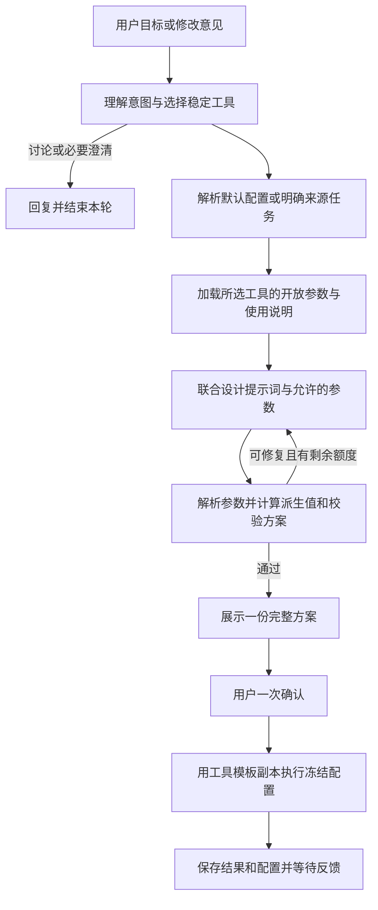

> 已封存（2026-11-04）。本文件是旧流程编排架构下的 v0.3 未实现设计快照，不作为当前开发计划。除本封存标识和搬迁所需的相对链接调整外，保留原规格；下文状态行属于封存前记录。参见[归档说明](README.md)和[评审意见](REVIEW_NOTES.md)。

# Agent 优化与工具常用参数自主调整规格

版本：0.3  
日期：2026-11-04  
状态：修订讨论稿，尚未实现；已明确稳定工具权限、任务配置隔离及自主偏离默认值的统一原则。  
范围：稳定工具配置、逐工具参数开放、自主调整判断、提示词与参数联合规划、任务配置隔离与执行追溯。

本文承接 [现有 Agent 优化规格](../../../AGENT_OPTIMIZATION_SPEC.md) 的 v2 视频任务设计和 [项目总规格](../../../SPEC.md)，以 [工作流参数用途对照表](PARAMETER_REFERENCE.md) 为当前工具与参数事实依据。

本版替代 v0.1 的“完整参数权限、模型输出任意节点补丁、任务中自由调整 LoRA／模型／分支”设计，采用：**每个工具提供一套稳定的工作流配置，agent 在该工具明确开放的常用参数范围内自主设计。** 两步视频、一次整体确认、对话隔离、持久队列与历史追溯继续沿用。

v0.3 在 v0.2 基础上确定：偏离默认值采用一套共享判断原则，工具提供参数语义与适用说明，后台统一合并和校验；不为每个工具、每个参数穷举自然语言触发规则。

本稿记录已明确设计、建议的参数基线与待讨论问题。本次仅更新规格，不修改业务代码、工具模板或参数对照表，不运行模型或 ComfyUI 生成。

## 1. 已明确的设计方向

1. agent 自主理解目标、选择可用工具，并判断下一次方案需要修改提示词、开放参数，还是同时修改；也可以决定保持参数。
2. 参数权限按工具声明，不向 agent 开放全部底层节点字段。常用、作用明确且适合单次创作变化的参数才进入接口。
3. 模型、LoRA、编码器、VAE、节点连接及适配采样配置属于稳定工具定义。需要不同组合时，以独立工具变体表达，不让 agent 在普通任务中组装模型栈。
4. 工具默认值独立于任务配置；单次调整只作用于当前方案和执行，不回写工具默认值，不影响其他独立任务或对话。
5. 独立新任务从目标工具默认配置开始；继续修改已有成果时，以对应任务的配置为起点。继承依据是任务来源关系，不只是对话相同。
6. 用户无需知道参数名；参数与提示词尽量在一次专用规划中联合设计，继续一份方案、一次确认。
7. 不增加默认的自动评分、参数搜索或无人反馈重复生成。
8. **允许 agent 为落实当前目标或反馈，自主调整与之直接相关的开放参数。** 以工具默认值或适用来源为起点，保留无关设置；无法说明调整与需求的关系时沿用基准，不为体现自主性而改参。

“参数可以修改”与“本轮是否值得修改”分开处理：前者由工具接口限定，后者由 agent 结合共享原则、用户需求和工具说明判断。用户无需说出参数名称或具体数值。后台检查权限、约束和可执行性，不通过触发词表替代语义判断，也不把模型给出的理由当成实际效果证明。

## 2. 稳定工具与参数权限

### 2.1 工具定义

一个可调用工具由工具 ID、发布版本、固定工作流、输入与输出约定、开放参数 Schema、默认值、字段绑定及使用指引组成。上述内容组成一致的版本化定义，不在普通任务中改写。

“稳定配置”允许提示词、尺寸等声明参数变化；固定部分保持不变。多个工具可以复用同一来源工作流或后台代码，但对 agent 暴露的每个工具必须具有清楚、稳定的配置含义。

参数分为四类：

| 类别 | 示例 | 控制方式 |
| --- | --- | --- |
| 开放参数 | 提示词、输出尺寸、时长、倍率、种子及工具明确开放的其他常用项 | agent 在该工具 Schema 范围内设计，作用于本次方案 |
| 固定配置 | 模型、LoRA 及强度、编码器、VAE、适配采样器／调度器、未开放的步数／CFG | 工具发布时确定；普通任务不可覆盖 |
| 程序派生值 | 视频实际宽高、帧数、实际时长、SeedVR2 resolution | 后台从最终开放参数及输入确定性计算 |
| 运行时绑定 | 上传后文件引用、输出归档前缀、任务身份、依赖素材 | 后台按已确认契约解析 |

用户锁定的开放参数本轮不可自行改变。派生值不能与其上游参数分别设计。候选数量属于方案级控制，输入槽和用途属于素材绑定，不应与节点的 batch_size 或路径字段混为一谈。

### 2.2 工具变体与发布版本

有 LoRA 与无 LoRA、Lightning 与基础配置等稳定组合，如需同时提供给新任务，应注册为不同工具 ID，并分别提供默认值、能力卡、开放参数与指引。每个工具内部仍可发布自己的版本。

例如“基础图片编辑”和“Lightning 图片编辑”是两个可同时选择的工具变体；各自的 1.0.0、1.1.0 是发布历史。工具展示名称应描述适用场景，不未经验证就承诺无 LoRA 版本画质一定更好。

已存在的 `image.edit.qwen.reference` 1.0.0 与 1.1.0 分别使用基础与 Lightning 配置，但目前是同一工具的历史版本。不能把“保留历史版本”当成“两个工具已同时开放给新任务”。需要重新开放基础变体时，须完成独立注册与验证，不能直接把旧版本重新标成新默认。

当前 Qwen 文生图的 `preset=fast/quality` 是三项联动配置。按本版方向，新 agent 接口应以固定档位的独立工具变体表达；后台可以复用原图并固定选择分支。最终工具 ID 与发布安排待实现设计确定，不在本文虚构已经存在的接口。原 `image.generate.qwen` 的旧方案和旧 preset 路径保留兼容，不得修改历史记录。

工具切换通过正常路由和新方案表达，不能用隐藏的 LoRA 开关、自由模型名或任意节点操作绕过工具定义。用户明确限定工具时继续遵守；没有适用变体时说明能力边界。

### 2.3 参数开放规则

开放集合由发布的工具定义明确列出，以下四项必须一致：Schema、参数说明、默认值和后台绑定。节点接口的合法范围与工作台资源限制用于进一步校验，不能反过来扩大 agent 权限。

选择开放项时考虑：是否常用于表达创作需求、是否作用明确、是否具有适用范围、能否独立或按后台规则联动修改。steps、CFG 即使常见，也不因此自动对所有工具开放。

未声明字段必须拒绝，包括用户明确要求修改但仍属于当前工具固定部分的字段。此时可说明现有工具范围，或为适用的已发布工具变体准备方案；不能自动升级权限、猜测节点路径或忽略该要求后声称已经执行。

新增开放参数应更新工具定义、说明、绑定和验证记录，通过发布版本管理生效。只改 Markdown 或发现本机节点多了一个字段，不构成运行时授权。

## 3. 首批开放参数基线

### 3.1 依据与建议集合

[参数对照表](PARAMETER_REFERENCE.md)描述当前 10 个工具、11 个注册版本的事实。其中“固定”原本表示当前没有单次入口，并非对未来开放范围的决定；文末 491 个节点输入是维护索引，不是 agent 的开放清单。

本版以该表第 2 节的现有入口为首批常用参数基线，保留必要的工具变体适配。以下沿用 v0.2 的建议集合，尚未给未开放的 steps、CFG 等新增权限：

| 当前工具／能力 | 开放文本与参数 | 输入／方案级约束 |
| --- | --- | --- |
| Z-Image 文生图 | prompt、negative_prompt、width、height、seed | 无图输入；candidate_count 1–4 |
| Qwen 文生图的固定档位变体 | prompt、negative_prompt、width、height、seed；档位由工具身份确定 | 无图输入；candidate_count 1–4；现有 preset 仅按第 2.2 节兼容 |
| Qwen 单图编辑 | instruction、negative_prompt、output_width、output_height、seed | source_image；宽高同时填写或同时留空；候选固定 1 |
| Qwen 参考编辑 | instruction、negative_prompt、seed | source_image 与 reference_image；输出尺寸由固定节点策略计算；候选固定 1 |
| SeedVR2 放大 | scale、seed | source_image；不提供 prompt；候选固定 1 |
| H3 文生视频 | prompt、duration_seconds、megapixels、aspect_ratio、seed | 无图输入；比例为 16:9／9:16／1:1；候选固定 1 |
| H3 参考视频 | prompt、duration_seconds、megapixels、aspect_ratio、ref_image_size、seed | 1–9 张连续编号参考图及用途；比例独立选择；候选固定 1 |
| H3 首帧视频 | prompt、duration_seconds、megapixels、aspect_ratio、seed | source_image 作为真实开场；比例可 source；候选固定 1 |
| H3 首尾帧视频 | prompt、duration_seconds、megapixels、aspect_ratio、seed | first_frame 与 last_frame；source 跟随首帧；候选固定 1 |
| H3 尾帧视频 | prompt、duration_seconds、megapixels、aspect_ratio、seed | last_frame；source 跟随尾帧；候选固定 1 |

seed 对模型接口可以配合 inherit／new／explicit 策略表达，后台确定并保存实际数值。不能把 UI 的 randomize 选项或模板样例种子当成真实执行配置。candidate_count 不改变工作流内部 batch_size。

表中开放项不表示在所有配置下都具有相同效果。尤其 negative_prompt 的实际参与方式须按第 6、11 节说明。尺寸、整数倍数、面积、帧数和种子范围仍依据工具 Schema、换算规则及有效资源设置联合检查。

### 3.2 固定部分与后续扩展

本版不向 agent 开放模型路径、LoRA 开关／权重、编码器／VAE、设备、精度、卸载、注意力实现、缓存、分块参数、节点连接、fps、编码器选择等内部配置。

采样设置按稳定工具组合保留：例如现有 Z-Image 的 9 步／CFG 0.8、Qwen Lightning 的 4 步／CFG 1、Qwen 基础文生图分支的 50 步／CFG 4、H3 的 20 步与独立采样／调度节点。它们是本机当前配置的事实，不是跨模型通用推荐。

需要将某项采样参数变为开放项时，单独确定工具、适用配置、范围与作用，再更新工具定义；不因为用户说“更清晰”或“动作更大”就临时开放底层字段。若差异更适合稳定组合，则增加工具变体，而不是扩大普通任务权限。

## 4. 总体流程与调用预算



沿用一次路由、一次专用规划、整轮共享一次必要修复的预算。必要的两步视频任务另有一次视频编写，仍共享修复额度；历史整理与费用限制继续沿用已有机制。

工具选择与开放参数设计使用现有阶段，不增加默认的调参 agent、逐参数模型调用或 GPU 试生成。第 5 节的共享原则进入路由与专用规划指令，具体参数语义只在相应工具说明中补充；不另建逐工具／逐参数的触发策略引擎。

## 5. 默认值、任务配置与来源继承

### 5.1 配置的作用域

| 配置 | 作用 | 保存与修改方式 |
| --- | --- | --- |
| 工具默认配置 | 独立新任务的稳定起点 | 绑定工具 ID 与版本，普通任务不回写 |
| 当前方案／任务配置 | 本次采用的开放参数与固定工具身份 | 对副本进行覆盖，随方案 revision 与确认冻结 |
| 历史执行快照 | 复现、续改、比较与排查 | 保留实际配置及证据等级，不升级为其他任务默认 |
| 命名预设（后续能力） | 用户显式保存的一组可复用开放参数 | 与工具默认值分开；不因此获得修改固定字段的权限 |

参数调整可以永久保存为记录，但不会因此永久作用于后续调用。一次生成成功、用户标记最佳或其他对话出现相似需求，都不能自动推广为工具默认值。

只有用户明确要求持久保存或调整默认时，才进入独立的配置／版本管理操作，说明作用范围并保留旧版本；这不属于本版普通创作流程，也不要求本次实现命名预设功能。

### 5.2 如何选择基准

| 情况 | 起点与继承方式 |
| --- | --- |
| 新对话中的独立任务 | 目标工具的版本化默认配置 |
| 同一对话中的独立新目标 | 同样从目标工具默认开始，不继承刚才任务的参数覆盖 |
| 修改当前待确认方案 | 指定 revision 的工具身份与已解析参数 |
| 明确继续某次生成结果，且为同一工具与版本 | 对应任务的实际开放参数及种子作为起点；固定部分仍须符合该工具定义 |
| 从快速预览转为正式交付等用途变化 | 识别来源及变化，按第 5.5 节重新判断相关覆盖是否仍适用；不盲目保留预览设置，也不自动重置全部参数 |
| 切换工具变体、工具版本或不同能力 | 从目标工具默认配置开始，仅迁移已声明语义相同且适用的开放项，不带入原工具内部配置 |
| 仅将旧素材用作参考或输入 | 不因素材存在历史执行关系，就自动继承其生成工具的配置 |
| 明确复现某次执行 | 使用对应工具版本和已保存执行快照；缺证据或环境不兼容时如实报告 |

agent 可根据“这张图”“刚才那个版本”等表述与当前素材选择确定来源，不要求用户手工提供执行 ID。确实有多个可能来源时集中澄清，不能选择全局最近任务充当基准。

项目目标与当前对话中仍适用的用户要求可参与理解，但“历史中看见过某参数值”不构成继承依据。用户要求的范围与有效期必须和具体任务关联，不能把一次临时预览要求带入其他任务。

### 5.3 证据与合并规则

来源证据按实际执行图、已提交图、已确认计划依次获取，并标记 `executed`、`submitted`、`planned`。新任务使用 `tool_defaults`。缺少实际证据不能把当前模板默认值冒充历史执行配置。

同工具续改时，只从来源中提取当前工具定义允许的参数。历史图若含自定义固定字段或与当前工具定义不符的内部组合，不能将它们通过“继承”绕过权限；精确复现须走匹配的历史执行版本，继续创作须明确采用哪套可用工具配置。

单次解析顺序为：确定目标工具与版本 → 选择默认或适用来源 → 合并本轮允许的修改 → 校验用户锁定项 → 计算派生值 → 保存完整任务参数。所有步骤在任务副本上执行。

用户明确锁定的内容继续保持；“仅改写提示词”锁定工具、输入、全部非文本生成参数、种子和候选数。跨模型、采样配置或分辨率变化时，同一种子不表示画面等价。

### 5.4 默认值来源

默认值以工具定义为单一权威来源；manifest、Schema、能力卡、前端表单和渲染器不能各自维护相互冲突的默认值。声明“跟随原图”或按配置选择尺寸时，应保存统一解析规则，不能由前端和后台分别猜测。

当前对照表中的数值作为现状核对依据，本次不重新调优默认数值。工具变体发布时如需选定或修正默认值，须明确记录；模板样例提示词、样例图片和样例 seed 不作为真实任务默认值。

### 5.5 自主偏离默认值或来源配置的统一原则

所有工具共用以下原则：

> 以工具默认值或适用的来源配置为起点。为落实当前创作目标或用户反馈，可以调整与之直接相关的开放参数；保留无关设置。不能说明调整与需求之间的关系时，沿用基准值。

该原则同时适用于独立新任务和已有成果的续改，不要求用户先使用参数术语。依据可以是用户明确给值、目标中可理解的交付要求，或与参数实际机制相关的修改反馈；例如“用于手机竖屏展示”可以对应工具支持的竖版比例。

agent 判断调整时应落实以下边界：

1. 从真实目标、当前反馈与适用约束出发，不将模板案例、助手自行补充的偏好或可能有误的观察当成用户要求。
2. 根据工具说明判断参数是否与需求存在直接关联，不能仅因用户表达不满就改变多个生成设置。用户没说参数名并不构成禁止调整的理由。
3. 只调整实现目标所需的相关项，保留无关配置；允许有明确联动依据的多项修改，不设机械的“每轮只能改一个参数”限制。
4. 尊重用户锁定和工具限定，不修改固定字段、不扩大资源权限、不为绕过限制切换工具。适用的工具变体仍可通过正常路由与完整方案选择，不设置一套适用于所有场景的切换优先级。
5. 对“更好看一点”等没有指向具体参数机制的宽泛要求，不能据此无差别提高生成面积、改变种子或修改全部开放项。可以保留配置并优化创作表达；只有确有必要信息缺口时才集中澄清，不要求用户逐个决定参数。
6. 记录预期影响及必要取舍，承认判断的不确定性。参数合法、理由合理都不等于已经验证画质或动作改善。

“可以慢一点”是可接受的取舍条件，不是必须提高参数的指令；“保持默认”是明确约束；单纯未提到某参数，则由本原则判断是否存在调整依据。

### 5.6 判断示例与反例

以下示例解释共享原则，不作为关键词触发表，也不要求所有工具采用相同修改动作或数值：

| 用户表达 | 合理判断方向 |
| --- | --- |
| 用于手机竖屏展示 | 可将比例设计为工具支持的竖版；保留与画幅无关的设置 |
| 衣服改成蓝色，其他保持 | 修改相关正文，保持采样配置、尺寸及适用来源种子等无关设置 |
| 这次只需要快速预览 | 结合工具说明考虑适用的快速变体或较低生成面积，说明取舍；不同时改变所有参数 |
| 人物动作不对 | 检查动作描述、素材用途与实际条件机制，不直接认定提高分辨率或增加步数有效 |
| 整体再好看一点 | 不足以单独证明某个生成参数需要变化，可保持参数并优化创作表达 |
| 预览可以了，现在出正式版 | 复核为预览做过的相关覆盖与当前交付要求，不因续改而永久沿用临时设置 |
| 不改生成设置，只润色提示词 | 全部非文本配置保持；该约束优先于一般自主调整原则 |

判断不能化约为“出现清晰就增加 MP”或“出现慢就降低步数”。工具没有相应开放字段时，不制造参数；工具说明不支持预期效果时，不用通用经验替代实际机制。

### 5.7 共享规则与少量工具差异

不新增每个字段独立的触发词、自然语言条件表、数值置信度阈值或逐参数判断调用。开放集合已经定义修改权限，无需再为每个开放字段增加一套独立的自主授权开关；任务锁定和已声明限制仍优先。

工具差异主要通过参数说明表达：名称、作用、默认值、范围、适用前提、资源方向和反例。少量真正的执行约束由后台处理，例如成对尺寸、整数倍对齐、帧数换算、参考槽编号和资源上限；既有共用规则优先复用。

种子沿用共享语义：同工具局部续改默认继承适用来源种子，明确探索新结果时可采用新种子，用户指定值原样保留；跨配置不声称种子等价。候选数遵循当前任务和既有机制，不因调参不确定而自行增加候选或启动参数搜索。

后端可以检查字段与范围、锁定项、理由记录是否齐全及实际差异是否一致，但不声称能通过这些检查证明参数调整值得。某工具出现反复误调时，补充其使用说明或针对性反例，避免预先穷举所有用户表达。

## 6. 参数对照表、工具定义与使用指引

### 6.1 资料分工

| 资料 | 职责 | agent 是否每轮读取 |
| --- | --- | --- |
| 参数对照表与完整节点索引 | 维护和核对当前入口、固定值、派生关系及已知问题 | 不整体发送；按需作为编写工具说明的依据 |
| 发布的工具定义 | 明确开放字段、类型、默认值、范围、输入输出和后台绑定 | 路由接收摘要，专用规划接收所选工具的完整开放 Schema |
| 工具使用指引 | 说明适用场景、开放参数作用、固定配置含义、限制与反例 | 加载所选工具版本适用的简明说明 |
| 本机节点接口 | 检查节点、字段、枚举与运行环境是否兼容 | 主要由后台使用，不自动成为 agent 的编辑权限 |

继续复用现有指引的版本绑定、hash 与快照机制。调参说明可以作为工具指引的独立小节或版本化附页，不再强制为所有底层节点编写一套 agent 手册，也不要求新增通用节点编辑器。

共享判断原则在公共指令中维护一次；各工具只补充其参数作用与例外。注册一个新工具主要需要稳定定义、开放参数说明和绑定，只有出现新的输入或派生机制时才增加专门后台逻辑，不重新编写一套“何时调参”规则。

### 6.2 每个工具需要说明的内容

1. 工具身份、稳定模型配置、适合与不适合的创作诉求，以及相关工具变体的区别。
2. 开放参数的含义、默认值、合法范围、派生关系和已知效果；数值边界从工具定义生成。
3. 哪些设置固定，哪些变化需要选择其他工具；不能把固定参数写成可供 agent 随时调整的建议。
4. 修改前提、速度与资源方向、与其他开放项的联动及常见误解，供第 5 节共享原则判断，不穷举触发条件。
5. 负向提示词等字段在当前模型／采样组合下是否实际参与预期机制；输入可保存不等于效果保证。
6. 来源、版本、采集时间与证据等级，区分节点合法范围、模型建议与本机验证经验。

指引缺失不会扩大权限。后台可以继续提供正确的工具参数定义，无法说明的作用不能编造；关键绑定或适用指引缺失时报告能力不可用或资料缺口，沿用现有手动入口的可用边界。

### 6.3 现状记录与未来设计的区别

参数对照表是 2026-11-04 的检查记录；本 spec 决定未来参数开放策略，发布工具定义决定运行时权限。三者需建立可追溯对应，但不能直接解析表中所有字段作为模型 Schema。

本机 `/object_info` 变化只触发兼容性检查，不自动注册新参数或改变默认值。更新固定配置、开放集合、绑定或有效行为时应发布工具版本；仅文档修订也应保存实际使用的指引版本。历史快照不被新资料改写。

### 6.4 本轮提供给 agent 的工具上下文

路由阶段只提供能力卡：工具身份、适用场景、必要输入、输出类型及主要限制。选定工具后，专用规划接收开放 Schema 和说明、工具默认值、本轮已解析基准值、基准来源、用户锁定项、当前需求与素材。

默认值与来源基准同时标明，不能只给一份没有来源的参数字典。基准、版本与锁定由后台根据任务关系确定；模型可以引用上下文实际提供的来源，但不能任意改写来源身份来重置其他配置。完整 ComfyUI 节点表和字段路径不作为普通参数规划的必需输入。

## 7. 联合规划协议与确定性编译

### 7.1 语义参数接口

模型输出所选工具、素材绑定、提示词文档、开放参数更新 `parameters_update` 及对应的简短业务理由 `parameter_reasons`；不输出任意节点路径、`set_literal`、`apply_profile`、LoRA 名称或完整 API 图。工具选择和版本必须对应后台提供的有效工具上下文。

后台沿用并扩展现有参数绑定机制，从固定模板副本渲染执行图。任意节点补丁协议不再属于本版要求。可选开放字段恢复自动策略时，使用工具定义声明的值，例如 output_width／output_height 同时为 null；不得泛化为删除任意节点输入。

当前方案的 `parameters` 是解析后的完整任务参数；模型更新对象只用于合并。实际修改前后由后台比较得到，不能让模型给出的差异摘要成为另一份执行权威。

稀疏更新语义必须明确：

- 未填写字段表示保留本轮基准；独立新任务的基准为工具默认，续改任务则可能来自历史执行。
- 先合并更新，再对完整结果校验和填充缺省。不能先给模型省略项补默认值，再用它们覆盖来源配置。
- 显式 null 只按字段声明的自动／缺省语义解析，不统一表示“保持不变”；编辑宽高自动处理仍须成对表达。
- 恢复工具默认必须是显式修改意图，并按版本化定义解析，不能通过悄悄换基准或省略字段重置来源值。
- 理由对应提交的更新字段；后台依据实际差异筛出真正发生的修改。用户原文证据与参数作用说明分开记录，允许根据目标语义选择参数，不强求用户原文出现字段名。

下面示意用户要求“做一段用于手机竖屏展示的视频”时的参数设计。当前工具比例默认 16:9，agent 根据交付目标选择开放的 9:16。示例省略同次规划的提示词文档；字段为拟议协议，并非现有 API 已实现。基准来源与工具定义 hash 由后台在上下文和记录中保存。

```json
{
  "tool_id": "video.generate.minimax_t2v",
  "tool_version": "1.0.0",
  "parameter_design": {
    "decision": "prompt_and_parameters",
    "parameters_update": {
      "aspect_ratio": "9:16"
    },
    "parameter_reasons": {
      "aspect_ratio": "视频用于手机竖屏展示，采用该工具支持的竖版比例。"
    },
    "user_evidence": ["做一段用于手机竖屏展示的视频"]
  }
}
```

decision 可为 `prompt_only`、`parameters_only`、`prompt_and_parameters` 或 `keep_configuration`，后台依据实际文本和参数差异核对类别。参数来源分别记录为用户明确指定、适用来源继承、默认解析或按第 5 节作出的自主设计，不把所有非默认值都当成用户明确给值。

`parameter_reasons` 用于用户审阅和审计，要求简短可理解，不记录隐藏思维过程，不作为绕过硬约束的凭据。不额外要求模型对每个未修改参数逐项解释；没有参数变化时可以返回空更新和空理由。

### 7.2 编译顺序

顺序为：选定稳定工具 → 解析来源与开放参数更新 → 计算最终意图值和派生值 → 编译／校验提示词 → 渲染固定模板副本 → 校验完整方案并保存。

视频的时长、面积和比例不能在专用规划前被无条件锁死为默认值；它们在允许调整的前提下参与联合规划，并在方案展示前冻结。用户明确要求的值仍须保持，关键帧最后时刻与实际帧数使用同一套最终计算结果。

只改参数时可以沿用兼容的提示词文档。若时间、输入或其他变化使正文不一致，使用本轮专用编写／共享修复处理；没有额度时报告，不在确认或执行后偷偷改参数或正文。

### 7.3 统一后台处理

沿用现有结构化 JSON 规划输出和服务编排即可，不要求切换为另一套模型工具调用协议，也不新增逐字段的“修改步数”“设置比例”等调用工具。

| 后台步骤（名称为职责示意） | 共用职责 |
| --- | --- |
| `prepare_tool_context` | 根据目标工具和合法来源准备参数定义、默认值、基准、锁定项和说明 |
| `build_plan` | 合并本次更新，计算派生值和实际差异，编译并校验文本，核对并保存模型理由，生成完整方案 |
| `execute_plan` | 用户确认后按冻结方案渲染模板副本、提交并保存结果与执行配置 |

这些由后台连续编排，不要求 agent 额外调用三轮或逐参数读取。默认值与范围来自同一工具定义，能力卡、前端和校验复用；任务参数对象与工具默认对象相互隔离。

## 8. 校验、确认与执行

### 8.1 必须进行的检查

1. 工具 ID、发布版本、工具定义 hash、来源归属与方案 revision 正确。
2. 参数只包含目标工具开放项，类型、枚举、范围、数值精度与有限性合法；未知或固定字段直接报错。
3. 固定模型组合、采样配置、节点结构与该工具定义一致；后台允许的素材可选节点裁剪或绑定由明确规则处理。
4. 参数绑定指向真实控制源；涉及多个字段的后台规则一致，不修改被连线覆盖的无效位置。
5. 符合用户锁定项、素材用途、输入槽数量、候选数及工具限制。
6. 最终实际尺寸、帧数、倍率与面积符合当前资源设置，不能只检查单字段 Schema。
7. 实际提示词、参考编号、时间与最终执行配置一致。
8. 默认模板及其他任务对象没有被本次合并或渲染修改。
9. 实际开放参数改动具有对应理由，更新字段、实际差异与类别记录一致；该检查不使用逐参数触发词或数值置信度阈值替代语义判断。

本地检查不提交生成请求。ComfyUI 的 `/prompt` 验证通过后会入队，不能用它做不执行的参数试验；提交拒绝或执行失败不自动触发改参再生成。

### 8.2 冻结范围与实际图

确认覆盖工具版本及固定配置、完整任务参数、提示词、素材引用、候选种子、指引和解析器版本、派生规则及输出约定，纳入方案 hash。

计划图由上述冻结定义确定性生成；可保存完整图及 hash 作为核对证据，但它是渲染结果，不是另一个可自由编辑的参数来源。实际提交图在上传素材、候选种子及输出归档身份绑定后保存独立 hash 和请求记录。

Worker 可以继续使用现有模板渲染路径，前提是使用正确的冻结工具版本、参数和解析规则。执行阶段不重新调用模型、不从最新默认重建已确认配置，也不使用其他任务的参数缓存。

允许变化的位置限于已声明的运行时绑定及派生契约。其他固定字段或未确认参数变化时停止提交。模板或指引后来发布新版本，不自动修改已确认方案；所需节点、模型不可用时如实报告，不临时替换。

### 8.3 两步、候选与恢复

图片准备与视频生成仍各自使用稳定工具和开放参数，组成一次确认的任务；视频工具不因等待图片而获得额外参数权限。前一步完整保存后绑定唯一真实图片。

若比例跟随尚未生成的图片，方案保存解析规则、预期尺寸与资源边界。依赖结果不符合契约时停止续接，不自由改时长、分辨率或工具。

多个候选使用已确认的数量、相同生成设置和既有种子策略，不自动形成不同参数试验。取消、恢复、重试与补存沿用现有状态及幂等机制；未知结果先核实，不重复提交。

## 9. 数据与兼容

优先扩展现有 `parameters`、`prompt_metadata` 和 `Execution.configuration`，不因本版设计强制增加通用执行图编辑协议。具体存储字段可在实现设计中确定。

新增或完善的参数设计记录至少包含：

- 工具 ID、版本、工具定义与模板 hash，以及默认值快照或可恢复的版本引用。
- 任务关系：独立新任务、修改方案、继续执行或切换工具；相应来源 ID、revision 与证据等级。
- 合并前基准、工具默认、完整任务参数、修改前后、用户锁定项、逐项简短理由、参数来源和解析器版本。
- 写作／参数说明的版本与 hash、实际派生值、候选种子、计划及实际提交图证据。

`parameters` 继续作为单次任务的完整开放参数权威来源；差异与界面摘要由其派生，不维护两份互不一致的实际值。固定配置以绑定的工具版本为准，不复制为可覆盖参数。

历史、任务详情、素材来源和备份可追溯这些记录。旧方案、工具模板、原始文件与 hash 保留，不自动迁移成新变体，不重算旧 hash，不重放任务。用户主动修改旧方案时，按目标工具定义创建新 revision 并展示实际工具变化。

Qwen 旧 preset 方案与参考编辑历史版本继续按原范围执行；新 agent 的固定变体接口不能反向修改旧执行语义。

## 10. 界面与交互

主界面围绕作品表达，默认阶段可展示“理解需求与选择工具 → 设计提示词与参数 → 检查方案”，不要求用户逐项设置参数或理解节点。

方案默认展示工具及选择原因、输入用途、主要创作内容、本次生成设置是否变化。变化时用简短中文说明目标和取舍；工具变体切换作为工具变化展示，不包装成某个隐蔽参数。

展开“完整提示词与参数”后展示开放参数的基准值、最终值、来源及改动理由；固定模型配置只读展示。可以区分“工具默认值”“沿用来源任务”“本轮修改”，避免用户误以为本次结果将成为其他任务的默认配置。

agent 接口与普通手动表单遵守同一开放集合；不通过高级 JSON 表单暴露被禁止的固定字段。内部诊断仍可只读查看完整提交图。

继续一次整体确认，不增加逐参数审批。方案修改产生新 revision／hash。“仅改写提示词”保持所有非文本生成设置，任务身份和归档路径仍按运行时契约生成。

速度影响仅展示有依据的方向或估计，不把步数倍数当成总耗时倍数。任务完成报告执行和保存结果；没有实际成片分析时不声称通过视觉验收。

## 11. 对照表中的已知问题与错误处理

### 11.1 需要纳入规格的现状

以下来自参数对照表第 4、6、7 节，本次只明确要求，不修复代码或声称已完成真实生成验证：

| 现状 | 本版要求 |
| --- | --- |
| Qwen 快速／编辑分支 CFG=1，negative_prompt 虽可保存但不参与普通负向 CFG 采样 | 指引说明实际机制；关键保持／排除内容写入有效正向正文，不为使负向生效而擅改固定 CFG |
| Z-Image CFG=0.8 | 不将负条件解释成通用的 CFG>1 排除效果 |
| 参考编辑的尺寸预估与节点实际最长边处理可能不同 | 冻结和展示前统一使用真实节点尺寸策略；不能用不放大的预估冒充实际输出 |
| 视频 0.6MP 的几个常用比例对齐后超过当前代码默认面积上限 | 合并 Schema 与实际资源检查；不因单字段合法就承诺可执行，也不静默提高上限 |
| Qwen 质量档尺寸涉及后端补值和前端切档行为 | 固定变体发布时明确单一默认／解析规则，保留用户自定义尺寸，不让多层默认互相覆盖 |
| 原 UI widget、旁路分支和示例值不一定进入实际执行图 | 配置事实以固定 API 图及最终绑定为准，指引不能据 UI 外观猜测 |

### 11.2 错误与修复

可修复的结构、开放参数、绑定或一致性错误使用整轮共享的一次修复额度；提供具体错误和有效原文，不借修复扩大参数权限或改变目标。网络、认证和未知计费状态沿用现有不自动重试规则。

错误须区分参数权限、参数值、资源、素材、提示词和环境阶段。例如“该工具固定使用 Lightning，不能传 lora_name”“实际对齐面积超过上限”。用户明确提出固定字段修改时也不能悄悄忽略，而应解释工具范围或提供适用的已发布变体方案。

资料不足不生成虚构机制；模型不可用不切换到默认模型；生成失败不自主改参重跑。配置保存、结果补存和永久默认值管理是不同操作，不能相互代替。

## 12. 覆盖与完成边界

首批覆盖第 3 节的十项现有能力及其必要稳定变体适配，保留第 2.2 节的历史兼容。并不要求新增所有可能的有／无 LoRA 工具：每个新变体都需要明确需求、固定配置、独立身份、指引和验证。

完成时应能清楚回答每个工具“开放哪些参数、固定哪些配置、默认值从哪里来、续改从哪里继承”。参数对照表的完整节点输入不属于全部开放或全部人工编写手册的验收数量。

本次不包含任意节点编辑、任意模型／LoRA 组合、陌生工作流自动导入、自动学习全局默认值、自动评价重生成或参数搜索。

自主偏离默认值遵循第 5 节的已明确共享原则，具体判断结合当前工具说明完成；不以未建立逐参数触发表为由将其继续标成未定义。实现仍须验证对目标的关联判断、无关设置保持、硬约束及来源隔离，不以结构校验通过宣称实际画质改善。

## 13. 实现落点与建议顺序

| 模块 | 改动职责 |
| --- | --- |
| 工具 manifest、Schema、默认值与 bindings | 按稳定变体统一开放参数定义；不增加任意节点写入入口 |
| `registry.py` | 复用模板副本渲染，统一默认解析、字段绑定及真实派生值，验证固定部分 |
| `prompt_guides.py`、工具说明 | 从对照表整理精简参数说明和变体差异；共享判断原则维护一次，按版本保存快照 |
| `agent_routing.py`、`agent_flow.py`、`prompt_composition.py` | 稳定工具路由、来源关系、共享原则驱动的联合规划、稀疏更新与理由及权限约束 |
| `planner.py`、`llm_context.py` | 加载所选工具定义、默认、真实基准、锁定项和指引，保持预算与对话隔离 |
| `prompt_compile.py`、`plans.py` | 参数确定后编译正文、保存与冻结完整方案，保证默认值不被回写 |
| `worker.py`、`task_identity.py` | 按冻结版本执行，保存真实配置、模型、提交图与恢复证据 |
| 前端、模型记录与必要迁移 | 展示参数来源和变化，保护历史与备份兼容 |

建议顺序：核对并发布工具定义／变体 → 统一默认解析与任务继承 → 编译、校验及固定配置隔离 → 接入共享判断原则、精简指引和联合规划 → 界面、历史与回归。不另建庞大的参数策略表，也不为每个工具重复实现相同的自然语言判断流程。

无需为本版新增通用图补丁编译器、完整工作流编辑 UI 或强制重构 Worker；优先复用已有成熟机制，并修正工具定义不一致和实际派生值问题。

## 14. 初步验收标准

验收同时覆盖用户明确给值、根据目标语义自主设计、合理保持配置及硬约束。示例检查关联和边界，不将每种表达绑定为唯一参数组合，也不要求生成效果已获自动验收。

| 场景 | 预期行为 |
| --- | --- |
| 工具固定定义与开放集合 | Schema、说明、默认和绑定一致；普通任务只能修改声明项 |
| 用户要求手机竖屏展示但没有说参数名 | 可以选择工具支持的竖版比例并给出简短理由，无需追问字段名；其他无关设置保持 |
| 用户要求只修改衣服颜色 | 修改相关正文，保持无关生成配置及适用来源种子，不为体现自主性而改参 |
| 用户仅说整体更好看或反馈动作不对 | 不据此无差别提高面积、改变种子或制造不存在的控制字段；结合说明判断，依据不足时保持配置 |
| 用户提出快速预览等目标 | 判断适用工具或相关开放项并说明取舍，不自动改变全部参数、增加候选或试生成 |
| 用户或模型传入 lora_name、模型路径等固定字段 | 明确拒绝，不因节点合法或用户给了数值就扩大权限 |
| 需要另一种稳定模型组合 | 选择适用的已发布工具变体并展示；无工具时说明，不临时组装 |
| Qwen fast／quality 适配 | 新接口按固定变体表达，旧 preset 历史执行范围保留 |
| 工具变体与历史版本 | 独立身份可同时路由；旧版本留存不冒充新能力 |
| A 任务修改开放参数后启动 B 独立任务 | B 从目标工具默认开始；同一对话或另一对话均不被 A 污染 |
| A、B 交错规划或执行 | 模板、默认对象、参数缓存和方案副本相互独立 |
| 同工具续改 A 的结果 | 关联 A 的适用配置与种子，只应用本轮允许的修改 |
| 从预览转正式交付 | 复核与交付有关的临时覆盖，按共享原则设计；不机械保留全部预览值或重置全部配置 |
| 仅以旧素材为参考 | 不自动继承生成该素材的工具配置 |
| 切换工具／变体 | 目标默认作为起点，只迁移适用开放项，固定字段不跨工具携带 |
| 调整记录、最佳标记或保存预设 | 不自动变成工具默认，不影响其他任务 |
| 用户明确尺寸、时长或锁定设置 | 正确合并、保持锁定、计算实际值，不回写默认 |
| 参数更新省略某字段 | 保留本轮基准值，不先补工具默认再覆盖来源参数 |
| 显式 null 或恢复默认 | 仅按字段声明的自动语义或显式恢复意图处理，不将省略、null、默认值混为一谈 |
| 参数变化与理由 | 后台计算真实差异并核对逐项理由，记录用户给值／自主设计等来源，摘要不成为执行权威 |
| 新增工具或常用参数 | 复用共享原则和后台合并校验，补充定义、说明和必要绑定；不要求另建一套触发规则或逐参数调用 |
| 仅改写提示词 | 工具、输入、非文本参数、种子与候选数保持 |
| 负提示词或不存在的 CFG／motion | 说明实际机制，不虚构效果，不修改固定采样配置补偿 |
| 参考编辑尺寸或视频面积边界 | 展示与检查使用真实派生规则，发现超限不静默改设置 |
| 来源图缺失或固定配置不符 | 记录证据等级，不借历史继承绕过工具定义 |
| 确认后更新工具或说明 | 使用冻结身份与参数；不重新采用最新默认 |
| 两步、多个候选、失败、取消、重启与补存 | 保持原执行范围与幂等语义，不自由调参或重复提交 |
| 旧方案、手动方案和备份恢复 | 原版本／hash 可追溯；普通手动入口与 agent 权限集合一致 |

实现验证优先使用离线渲染、固定响应和隔离数据库检查工具定义、默认隔离、合并与恢复；这些检查不证明画质改善。真实生成用于核对实际提交、资源及产物可读取，不为本版引入默认的多轮 GPU 试验。

## 15. 已收敛事项与后续讨论

原 D1“何时允许 agent 主动偏离默认值”与 D4“用途变化时如何取舍”已按第 5 节收敛：默认或来源配置作为起点，以当前目标和反馈为依据，由 agent 根据工具说明调整直接相关开放项、保留无关设置，依据不足时沿用基准；不新增逐工具／逐参数触发表。

以下保留原问题编号，便于后续引用：

| 编号 | 问题 | 当前状态 |
| --- | --- | --- |
| D2 | 哪些工具还应开放 steps、CFG 等参数？ | 首批以第 3 节为基线，逐工具讨论；常见不等于适合开放 |
| D3 | 基础／Lightning 编辑是否都要作为新工具提供，Qwen 变体如何命名与发布？ | 稳定变体原则已明确，具体清单和 ID 待定；不直接复活旧版本代替发布 |
| D5 | 速度／质量偏好持续多久，用户如何明确范围？ | 不由一次任务自动变成全局偏好；具体交互待定 |
| D6 | 是否提供命名预设和显式默认值管理？ | 独立于普通任务；本版不要求实现，后续确定作用范围与版本方式 |
| D7 | 本机经验如何进入参数说明与耗时估计？ | 保存真实配置与明确反馈，不将一次成功自动推广；整理与估计方式待定 |

已不再待定：工具提供稳定配置、agent 仅修改声明参数、固定 LoRA／模型通过工具变体区分、普通任务不回写默认、新独立任务与续改任务分开选择基准，以及共享原则驱动的自主调整、稀疏更新和统一后台处理。

后续讨论集中于具体开放项、工具变体和复用能力；参数权限不会因自主判断而扩展，开放参数也不表示每轮必须调整。个别误用优先通过工具说明和针对性反例改进，不倒推为必须穷举所有场景。

## 16. 依据与参考

- [工作流参数用途对照表](PARAMETER_REFERENCE.md)：当前 10 个工具／11 个版本、入口、固定配置、派生规则和已知问题；为本版主要事实依据。
- [现有 Agent 优化规格](../../../AGENT_OPTIMIZATION_SPEC.md)：已实现的路由、写作指引、视频模式与依赖任务。
- [项目总规格](../../../SPEC.md)、[开发验证记录](../../../DEVELOPMENT.md)：确认、队列、素材、隔离与兼容机制；旧章节须结合后续补充理解。
- [工具注册目录](../../../tool_registry)、[参数 Schema](../../../backend/app/schemas.py)、[模板与参数解析](../../../backend/app/registry.py)：运行时工具定义、默认与绑定的核对依据。
- [ComfyUI 官方 Server Routes](https://docs.comfy.org/development/comfyui-server/comms_routes)：节点定义、执行提交、队列与历史接口；节点可修改性不等于本应用参数授权。
